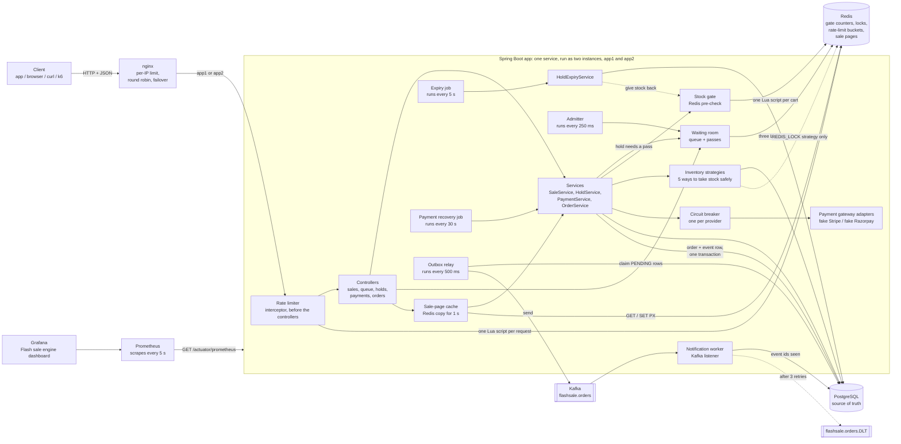
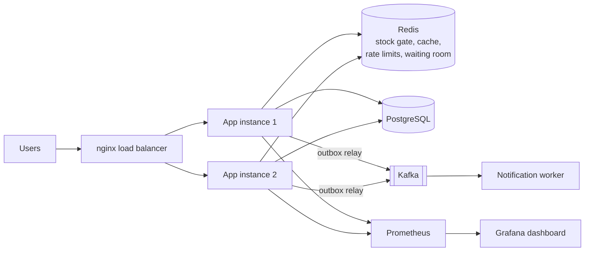
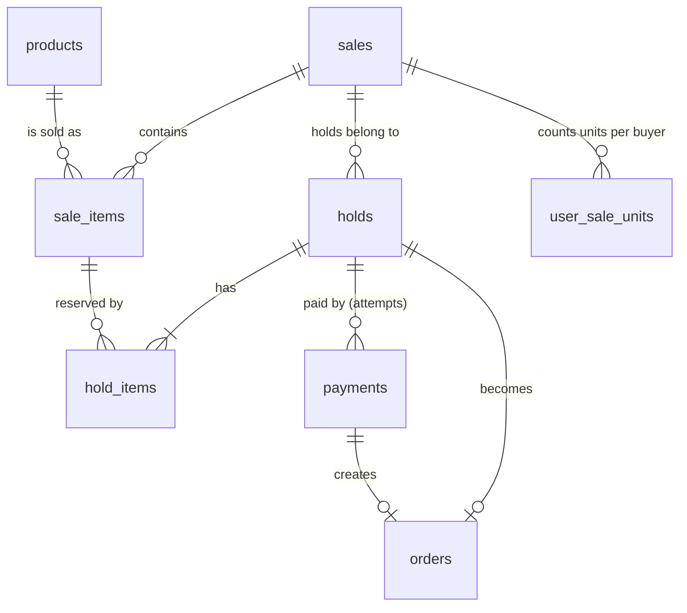
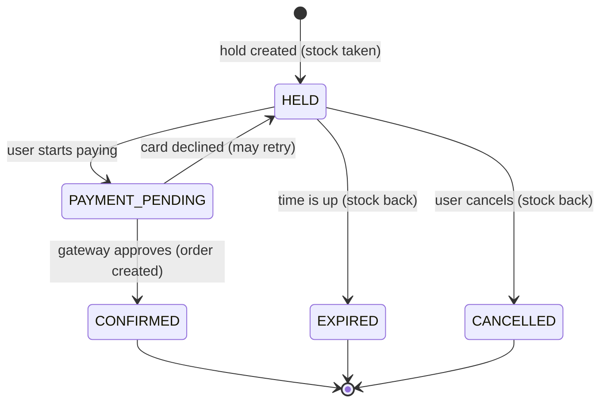
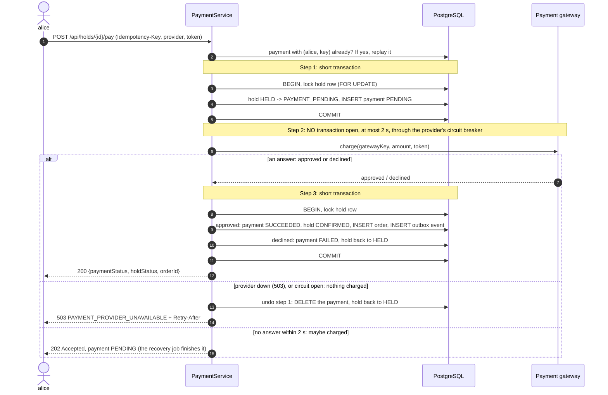
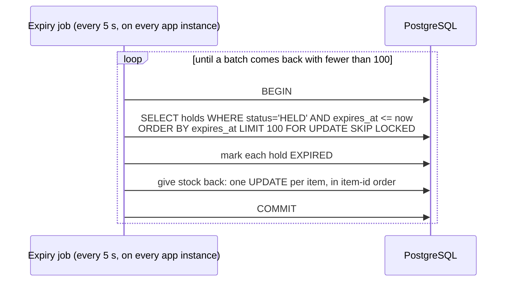
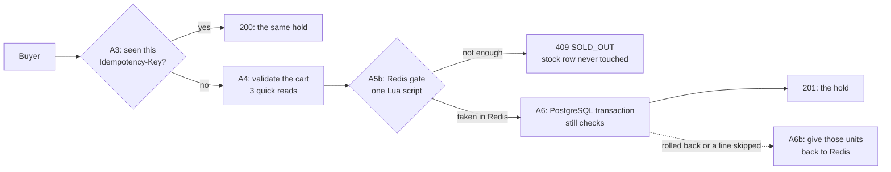

# Flash-Sale Booking Engine: High-Level Design (HLD)

> **What this doc is:** the "big picture" of the system: what it does, the parts, how data flows, and *why* each
> decision was made. Read this before an interview. For classes, patterns and code, read [LLD.md](LLD.md).
>
> **Status:** Phase 1 and Phase 2 are built and tested. Phase 2 added the multi-item cart, the Redis stock gate,
> payment safety (timeouts, circuit breakers, a recovery job), the per-user purchase limit, the rate limiter (with
> an error code on every error) and the sale-page cache. Phase 3 is complete: the transactional outbox, Kafka and a
> notification worker (section 9.12), two instances behind nginx with a per-IP limit there (section 9.13), a
> reconciliation job that watches the Redis stock gate for drift (section 9.14), and a waiting room that lets buyers
> in at a fixed rate (section 9.15). Phase 4 is complete: Prometheus and Grafana watch the running system, including
> an oversell gauge that recounts the stock from the hold rows (section 15, "Monitoring"); k6 load tests measure it
> under a crowd (section 15, "Load tests"); and failure tests kill Redis, an app instance and Kafka in the middle of a
> sale (section 14, "Measured under load"). After the plan, a React web app (2026-10-11) makes it usable from a
> browser: a shop, the full checkout, and a demo console that sends a crowd of fake buyers (section 9.16). 275 tests
> passing.
> Sections marked **(Phase 3+)** are designed but not built yet. See [PLAN.md](PLAN.md) for the roadmap.

## Contents

1. [The problem in one minute](#1-the-problem-in-one-minute)
2. [Requirements](#2-requirements)
3. [Back-of-the-envelope numbers](#3-back-of-the-envelope-numbers)
4. [Architecture](#4-architecture)
5. [Why one service, not microservices](#5-why-one-service-not-microservices)
6. [Database design](#6-database-design)
7. [API design](#7-api-design)
8. [Core flows](#8-core-flows)
9. [The heart of the system: never oversell](#9-the-heart-of-the-system-never-oversell)
10. [Idempotency: safe retries](#10-idempotency-safe-retries)
11. [Holds and expiry](#11-holds-and-expiry)
12. [Payments](#12-payments)
13. [Consistency model](#13-consistency-model)
14. [What happens when things fail](#14-what-happens-when-things-fail)
15. [Scaling: what breaks first, and the plan](#15-scaling-what-breaks-first-and-the-plan)
16. [Key decisions and trade-offs](#16-key-decisions-and-trade-offs)
17. [Interview questions and answers](#17-interview-questions-and-answers)
18. [Glossary](#18-glossary)

---

## 1. The problem in one minute

At 10:00 AM, **100 iPhones** go on sale at a big discount. **50,000 people** click "Buy" in the same few seconds.

The system must:

- sell **exactly 100**, never 101 (no **overselling**);
- give each buyer a short, fair window to pay (a **hold** of 10 minutes);
- put unpaid items back on sale when the hold runs out (**expiry**);
- never charge a card twice, even if the app retries (**idempotency**);
- stay correct when things crash halfway.

The hard part is not the features. It is that **thousands of requests change the same number at the same moment**.
Everything in this design exists to handle that.

**What a user experiences:**

```text
Browse  ->  Hold (stock set aside for 10 min)  ->  Pay  ->  Confirmed + order created
                     |                               |
                     | 10 min pass, no payment       | card declined
                     v                               v
                  Expired (stock goes back)       Still held: try another card
```

---

## 2. Requirements

### Functional (what it does)

| # | Requirement | Phase |
|---|---|---|
| F1 | Admin creates a sale (time window) with products, sale prices and limited stock | 1 ✅ |
| F2 | Anyone can see a sale and how many units are left | 1 ✅ |
| F3 | A user can **hold** units; the hold keeps the stock for 10 minutes | 1 ✅ |
| F4 | A user can **pay** for a hold; success creates an **order** | 1 ✅ |
| F5 | A declined card keeps the hold, so the user can retry before it expires | 1 ✅ |
| F6 | A user can **cancel** a hold; the stock goes back on sale | 1 ✅ |
| F7 | Unpaid holds **expire** automatically and their stock goes back on sale | 1 ✅ |
| F8 | Retrying any "create" request is safe (idempotency) | 1 ✅ |
| F9 | **Multi-item cart**: 1 to 10 items from one sale; the buyer picks all-or-nothing or partial | 2 ✅ |
| F9b | **Per-user purchase limit**: a sale may cap how many units one buyer holds or buys in it | 2 ✅ |
| F9c | **Rate limit**: one buyer can send at most a burst of 10 requests that change something, then 5 a second (429 past that) | 2 ✅ |
| F9d | **Every error has a stable `code`**, including the errors Spring raises itself | 2 ✅ |
| F9e | **The sale page comes from a cache**: a copy in Redis for 1 s, so a crowd refreshing it barely touches PostgreSQL | 2 ✅ |
| F10 | **Notifications**: a "booking confirmed" message for every paid order, never lost, never sent twice (outbox + Kafka) | 3 ✅ |
| F11 | **Waiting room**: a sale may queue its buyers and let in a fixed number per second, first come first served | 3 ✅ |

### Non-functional (how well it does it)

| Quality | Target | How we get there |
|---|---|---|
| **Correctness** | Never oversell; never double-charge | DB transactions, locks, constraints, idempotency keys |
| **Latency** | Hold request fast enough for a click (aim: p99 < 200 ms at target load; measured in Phase 4 on a laptop: median 1 to 3 ms, p99 from 7 ms to about 1 s depending on load and strategy, section 15 "Load tests") | Short transactions, no network calls inside them |
| **Availability** | Stay up during the spike; if unsure, say "try again" instead of guessing | Fail closed (503 STOCK_BUSY) rather than oversell; timeouts and circuit breakers so a slow payment provider can't take the app down |
| **Scalability** | Survive tens of thousands of requests/sec at sale start (Phase 2+) | Redis stock gate, rate limit, sale-page cache, waiting room, two instances (all built) |
| **Durability** | A confirmed order is never lost | PostgreSQL is the source of truth |
| **Fairness** | First come, first served (roughly) | Locks queue buyers; a per-buyer rate limit; a waiting room with exact arrival order (all built) |

**Priority order when they conflict:** correctness > availability > latency. Selling a phone we don't have is worse
than asking someone to retry.

### Out of scope for Phase 1

Real authentication (we trust an `X-User-Id` header), real payment providers (fake Stripe/Razorpay), refunds, a
frontend. (Multi-item carts were out of scope for Phase 1 and are built now, as Phase 2's first step.)

---

## 3. Back-of-the-envelope numbers

Interviewers love this step. The point isn't exact numbers; it is finding **which resource breaks first**.

**Assumed scenario:** 1,000,000 people waiting for a sale of 10,000 units.

| Quantity | Estimate | How |
|---|---|---|
| Hold requests at 10:00:00 | ~20,000 per second | Say 20% of 1M click within the first 10 seconds: 200,000 / 10 s |
| Sale-page reads | up to ~500,000 per second | 1M people refreshing every ~2 seconds |
| Successful holds | only **10,000** in total | Limited by stock |
| Requests that will hear "sold out" | **~99%** | 990,000 of 1,000,000 |
| Storage for holds | ~200 MB | 1M rows x ~200 bytes: tiny |

**What this tells us:**

1. **Storage is not the problem. Concurrency is.** Every successful hold updates the *same* `sale_items` row.
   A row can only be changed by one transaction at a time.
2. **That hot row has a ceiling.** If one locked transaction takes ~1 ms, the row tops out around ~1,000 changes
   per second. In our tests, 50 buyers passed through one hot row in roughly 35 to 55 ms on a laptop, which is the
   same ballpark. That is ~20x below 20,000/sec.
3. **So most requests must be answered without touching that row.** 99% of buyers will be told "sold out". The
   Redis stock gate (built, section 9.8) answers them from Redis, so only the ~10,000 real winners reach the stock
   row. (The others still make three quick indexed reads.)
4. **Page reads must come from a cache**, never 500,000 database queries per second. Built: the sale page is cached
   in Redis for 1 s (section 9.11). Each app instance then reads a sale from PostgreSQL about once a second.

> Measure, don't guess: Phase 4 measured the real thing with k6 (section 15, "Load tests"). On one laptop, one
> 1-CPU instance kept the median hold at 1 to 2 ms with 450 new buyers a second, and 0 units were oversold in about
> 50 runs. Those are laptop numbers, not production capacity, but they replace the guesses with measurements.

---

## 4. Architecture

### Built so far (Phases 1, 2 and 3, and Phase 4's monitoring and load tests)



| Component | Job | Why it exists |
|---|---|---|
| **nginx** | The load balancer: limits each IP address (20 a second after a burst of 40, else 429 `IP_RATE_LIMITED`), sends requests to app1 and app2 in turn, and moves to the other instance when one cannot be reached (section 9.13) | One machine cannot flood the app, and one instance dying does not stop the sale |
| **Waiting room** | For a sale created with `admitPerSecond`: buyers join a queue in Redis, the admitter lets that many in per second, and only a buyer with a pass may create a hold (403 `NOT_ADMITTED` otherwise) (section 9.15) | A spike of clicks becomes the steady flow the checkout was sized for, in arrival order |
| **Rate limiter** | A token bucket per buyer in Redis. Every request that changes something spends a token; an empty bucket is 429 (section 9.10) | One noisy client or script can't flood PostgreSQL, Redis or the payment provider |
| **Controllers** | Turn HTTP into method calls; validate input; set status codes | Keep HTTP details out of business logic |
| **Sale-page cache** | Keeps a copy of each sale page in Redis for 1 s; only one request per sale and instance reloads it (section 9.11) | A crowd refreshing the page doesn't turn into thousands of database reads |
| **HoldService** | Create, read, cancel holds | The main use case |
| **Stock gate** | Answers "sold out" from a Redis counter before PostgreSQL is touched (section 9.8) | Keeps the crowd off the hot row; PostgreSQL still decides every sale |
| **Inventory strategies** | Take stock without overselling (5 interchangeable ways) | The hardest problem, isolated so we can compare approaches |
| **PaymentService** | Pay for a hold in 3 short steps | Keeps slow gateway calls outside DB transactions |
| **Payment gateway adapters** | Talk to Stripe/Razorpay (faked), with a 2 s timeout on every call | Swap providers without touching business code |
| **Circuit breakers** | One per provider: stop calling a provider that keeps failing, then retry carefully (section 12) | Threads don't pile up behind a dead provider; one provider's outage doesn't affect the other |
| **Payment recovery job** | Every 30 s, finishes payments stuck in `PENDING` by asking the provider what happened (section 12) | A lost answer or a crash mid-payment can't leave a hold stuck, or a paid order unrecorded |
| **Expiry job** | Expire unpaid holds and return stock | Holds must not keep stock forever |
| **Reconciliation job** | Every 10 s, compares each stock gate counter with PostgreSQL, reports the drift, and raises a counter that stays too low (section 9.14) | Drift in the Redis copy shows on a metric instead of hiding behind the 60 s healing |
| **Outbox + relay** | A paid order's `ORDER_CONFIRMED` event is a row in the order's transaction; every 500 ms the relay sends due rows to Kafka (section 9.12) | No order without its message, no message for an order that rolled back, and Kafka being down never blocks a purchase |
| **Kafka** | Keeps the events (topic `flashsale.orders`) until the worker has read them | The worker can be down, slow, or on another machine, and nothing is lost |
| **Notification worker** | Reads the events, sends "your order is confirmed" once per order, parks failures on a dead-letter topic (section 9.12) | Async work never slows down buying |
| **PostgreSQL** | Stores everything; enforces rules with constraints | ACID transactions + row locks = correctness |
| **Redis** | The stock gate's counters, REDIS_LOCK's locks, the rate-limit buckets, the sale-page copies and the waiting rooms (queues, admission credit, passes) | Fast shared memory across app instances |
| **Prometheus + Grafana** | Prometheus pulls every instance's metrics from `/actuator/prometheus` every 5 s; Grafana draws the "Flash sale engine" dashboard (24 panels). `StockAudit` adds two gauges that recount the stock from the hold rows (section 15, "Monitoring") | You see traffic, latency, the connection pool, Kafka lag and, above all, "oversold = 0" on the running system, not only in tests |

(Every box inside the app runs in both instances. In each instance, five background jobs share Spring's scheduler
pool of 5 threads: hold expiry, payment recovery, the outbox relay, stock reconciliation (section 9.14) and the
waiting room's admitter (section 9.15). The Kafka listener has its own consumer thread.
With two instances, every job runs twice; section 9.13 explains why that is still correct.)

### Target (end of Phase 4)



The app is **stateless**: no user data lives in app memory. That is why we can run two (or ten) copies behind a load
balancer. Anything shared (stock, locks, holds) lives in PostgreSQL or Redis. Built and tested with two instances
behind nginx (section 9.13), with the waiting room in front of the checkout (section 9.15), and watched by
Prometheus and Grafana (section 15, "Monitoring"). It was measured under load with k6 (section 15, "Load
tests"), and Redis, an app instance and Kafka were each broken in the middle of a sale (section 14, "Measured
under load"): no buyer saw an oversell, and every paid order was notified exactly once.

---

## 5. Why one service, not microservices

This is a **modular monolith**: one deployable app, split inside into modules by feature
(`catalog`, `inventory`, `hold`, `payment`, `order`).

| | Modular monolith (our choice) | Microservices |
|---|---|---|
| Taking stock + saving the hold | **One database transaction**, so both happen or neither does | Two services, two databases: needs a saga and compensations |
| Effort to build and run | One app, one DB | Service discovery, gateway, per-service DBs, network failures between services |
| Debugging | One log, one stack trace | Distributed tracing needed |
| Scaling | Run more copies of the whole app | Scale each service separately |
| When it stops being enough | Huge teams, very different scaling needs per part | |

**Interview line:** "The booking flow is one consistency-critical transaction, so it stays in one service. The modules
have clean boundaries, so if one part (say, notifications) needs to scale separately later, it can be pulled out."

---

## 6. Database design

**PostgreSQL** is the **source of truth**. Schema files in `src/main/resources/db/migration/`: `V1__create_schema.sql`,
then `V2__index_pending_payments.sql` (Phase 2: an index for the payment recovery job), `V3__per_user_limit.sql`
(Phase 2: the per-user purchase limit), `V4__outbox_and_notifications.sql` (Phase 3: the outbox and the
notification worker's record) and `V5__waiting_room.sql` (Phase 3: a sale's waiting-room rate). Flyway runs them in
order at startup; Hibernate only *validates* that entities match.

### Tables in plain words

| Table | One row means | Key columns |
|---|---|---|
| `products` | Something we sell ("iPhone 17") | `name`, `regular_price` |
| `sales` | A sale window ("Diwali sale, 10:00 to 10:30") | `starts_at`, `ends_at`, `per_user_limit` (nullable), `admit_per_second` (nullable: the waiting room's rate, section 9.15) |
| `sale_items` | A product inside a sale, with limited stock | `total_stock`, `available_stock`, `sale_price`, `version` |
| `holds` | A temporary reservation for one user | `status`, `expires_at`, `idempotency_key`, `request_hash` |
| `hold_items` | One line of a hold (which item, how many, price at hold time) | `quantity`, `unit_price` |
| `payments` | One payment *attempt* for a hold | `status`, `provider`, `provider_ref`, `gateway_key` |
| `orders` | The permanent record of a purchase | `hold_id` (unique), `payment_id` |
| `user_sale_units` | How many units one buyer holds or bought in one limited sale | `(sale_id, user_id)` (composite primary key), `units`, `max_units` |
| `outbox_events` | One event waiting to be sent to Kafka, or already sent (section 9.12) | `event_id` (unique UUID), `topic`, `payload`, `status`, `next_attempt_at` |
| `notifications` | One event the notification worker already handled | `event_id` (primary key) |



**Why split `products` and `sale_items`?** The same iPhone can be in many sales, each with its own price and stock.

**Why copy `unit_price` into `hold_items`?** If the admin changes the price after you held the item, you still pay
what you saw. This is called a **price snapshot**.

**Why is a hold separate from an order?** A hold is temporary and often fails (expires, cancelled). An order is
permanent and means money was taken. Keeping them separate keeps order history clean.

### Constraints: the database as the last line of defence

Code has bugs. Constraints don't care: they reject bad data no matter which code path wrote it.

| Constraint | Stops what |
|---|---|
| `CHECK (available_stock BETWEEN 0 AND total_stock)` | Stock going negative or above what we started with |
| `UNIQUE (user_id, idempotency_key)` on `holds` and `payments` | The same request creating two holds or two payments |
| `UNIQUE (hold_id) WHERE status = 'PENDING'` on `payments` (partial unique index) | Two payments running for one hold at once |
| `UNIQUE (hold_id) WHERE status = 'SUCCEEDED'` | One hold being paid twice |
| `UNIQUE (hold_id)` on `orders` | Two orders for one hold |
| `CHECK (status IN (...))` | Typos or unknown statuses |
| `CHECK (ends_at > starts_at)` | A sale that ends before it starts |
| `CHECK (units BETWEEN 0 AND max_units)` on `user_sale_units` | A buyer going over the sale's per-user limit, whatever code wrote the row (section 9.9) |
| `CHECK (per_user_limit > 0)` on `sales` | A limit of 0 (nobody could buy anything) |
| `CHECK (admit_per_second > 0)` on `sales` (`V5`) | A waiting room that lets nobody in |
| `UNIQUE (event_id)` on `outbox_events`; `event_id` primary key on `notifications` | The same event stored twice; the same event notified twice (section 9.12) |

> Honest limit: the stock CHECK does **not** catch a *lost update* (see section 9). There, the stock column ends up
> at a valid-looking number, which is exactly why that bug is sneaky.

### Indexes

| Index | Used by | Why |
|---|---|---|
| Primary keys | Every lookup by id | Automatic |
| `holds (expires_at) WHERE status = 'HELD'` (**partial index**) | The expiry job | Only contains HELD rows, so it stays tiny even with millions of finished holds |
| `hold_items (sale_item_id)` | Counting units held per item | Avoids scanning all hold items |
| `payments (hold_id)` | Finding payments for a hold | |
| `payments (updated_at) WHERE status = 'PENDING'` (partial, `V2`) | The payment recovery job | Only the few pending payments, never the finished millions |
| `user_sale_units` primary key `(sale_id, user_id)` | The per-user limit's upsert and lookups | The upsert's `ON CONFLICT` needs exactly this unique key |
| `outbox_events (next_attempt_at, id) WHERE status = 'PENDING'` (partial, `V4`) | The outbox relay | Only events not yet sent, never the millions already in Kafka |
| Unique constraints | Idempotency lookups `(user_id, idempotency_key)` | A unique constraint is also an index |

### Data-type choices (common interview questions)

| Choice | Why |
|---|---|
| Money as `NUMERIC(12,2)` / Java `BigDecimal` | `double` can't store 0.1 exactly; money must be exact. (Alternative: store paise as a `BIGINT`.) |
| Times as `TIMESTAMPTZ` / Java `Instant`, always UTC | One clear moment in time, no time-zone bugs |
| Ids as `BIGINT GENERATED BY DEFAULT AS IDENTITY` | Simple, ordered, never reused |
| Status as text + CHECK | Readable in SQL, safe against typos |

---

## 7. API design

All endpoints are JSON over HTTP. Base path `/api`. Every request that changes something (POST, PUT, PATCH, DELETE
under `/api`, except `/api/admin`) also spends one token of the buyer's rate limit, so it can get 429 `RATE_LIMITED`
(section 9.10).

| Method | Path | Headers | Body | Success | Main errors |
|---|---|---|---|---|---|
| POST | `/api/admin/sales` | | sale + items, optional `"perUserLimit": 2`, optional `"admitPerSecond": 200` (a waiting room, section 9.15) | **201** + `Location` | 400 |
| POST | `/api/sales/{saleId}/queue` | `X-User-Id` | | 200 `{"state":"WAITING","position":80,"estimatedWaitSeconds":4}` or `{"state":"ADMITTED"}`. Joining again keeps the place | 404, 409 `SALE_NOT_ACTIVE` (ended), 429 `RATE_LIMITED` |
| GET | `/api/sales/{saleId}/queue` | `X-User-Id` | | 200, the same shape; `NOT_QUEUED` if the buyer never joined. A client polls this | 404, 409 `SALE_NOT_ACTIVE` |
| GET | `/api/sales` | | | 200, the 20 newest sales (the web app's front page, section 9.16) | |
| GET | `/api/sales/{saleId}` | | | 200 (from a 1 s cache, section 9.11) | 404 |
| POST | `/api/admin/sales/{saleId}/crowd` | | `{"buyers":500,"seconds":5}` (1 to 2,000 buyers) | **202**, then fake buyers run (demo only, section 9.16) | 400, 404, 409 `SALE_NOT_ACTIVE`, 409 `CROWD_TOO_EARLY` |
| GET | `/api/admin/sales/{saleId}/stats` | | | 200: per item left, held, sold, oversold; orders, notified, the line, the crowd's counters (demo only) | 404 |
| POST | `/api/holds` | `X-User-Id`, `Idempotency-Key`, optional `X-Concurrency-Strategy` | `{"items":[{"saleItemId":1,"quantity":1}, ...], "mode":"PARTIAL"}` (1 to 10 items; `mode` optional, default `ALL_OR_NOTHING`) | **201** new, **200** replay | 400 `VALIDATION_FAILED`, 409 `SOLD_OUT`, 409 `SALE_NOT_ACTIVE`, 409 `PURCHASE_LIMIT_EXCEEDED`, 403 `NOT_ADMITTED` (waiting room, no pass), 422 `IDEMPOTENCY_KEY_REUSED`, 422 `MIXED_SALES`, 429 `RATE_LIMITED`, 503 `STOCK_BUSY` |
| GET | `/api/holds/{holdId}` | `X-User-Id` | | 200 | 404 |
| DELETE | `/api/holds/{holdId}` | `X-User-Id` | | 200 (status `CANCELLED`) | 404, 409 `ILLEGAL_STATE_TRANSITION`, 429 `RATE_LIMITED` |
| POST | `/api/holds/{holdId}/pay` | `X-User-Id`, `Idempotency-Key` | `{"provider":"STRIPE","paymentToken":"tok_success"}` | 200 (`SUCCEEDED` or `FAILED`), **202** (no answer from the provider yet: `PENDING`) | 409 `HOLD_EXPIRED`, 409 `PAYMENT_IN_PROGRESS`, 422, 429 `RATE_LIMITED`, 503 `PAYMENT_PROVIDER_UNAVAILABLE` |
| GET | `/api/orders/{orderId}` | `X-User-Id` | | 200 | 404 |
| GET | `/actuator/health` | | | 200 `{"status":"UP"}` | |

### Headers

| Header | Direction | Meaning |
|---|---|---|
| `X-User-Id` | request | Who is calling. In production this comes from a verified login token (JWT), never a plain header. |
| `Idempotency-Key` | request | A unique id per action, chosen by the client. Same key again = "this is a retry". |
| `X-Concurrency-Strategy` | request | Demo/benchmark switch: `NAIVE`, `PESSIMISTIC`, `OPTIMISTIC`, `CONDITIONAL_UPDATE`, `REDIS_LOCK`. Default from config. |
| `X-Stock-Gate` | request | Demo/benchmark switch: `off` sends this request past the Redis stock gate (section 9.8). Default from config (on). |
| `Idempotent-Replayed` | response | `true` if this response is a replay of an earlier request (same idea as Stripe's header). |
| `Retry-After` | response | Sent with 503 (`STOCK_BUSY`, `PAYMENT_PROVIDER_UNAVAILABLE`) and 429 `RATE_LIMITED`: wait this many seconds, then retry. |
| `X-RateLimit-Limit` | response | On every counted request: the size of the buyer's token bucket (10). |
| `X-RateLimit-Remaining` | response | On every counted request: whole tokens left after this one. 0 = the next request will probably get 429. |
| `Location` | response | URL of a newly created resource (on 201). |

### Status-code choices

| Situation | Code | Why this code |
|---|---|---|
| Hold created | 201 Created | A new resource exists |
| Same hold request retried | 200 OK + `Idempotent-Replayed: true` | Nothing new was created |
| Card declined | 200 OK, `paymentStatus: FAILED` | The request worked; the *payment attempt* failed. It is a business result, not an HTTP error |
| Payment provider didn't answer in time | 202 Accepted, `paymentStatus: PENDING` + `Location: /api/holds/{id}` | We may have charged the card, so we can't say "failed". The recovery job finishes it; watch the hold |
| Payment provider down (or its circuit open) | 503 + `Retry-After`, code `PAYMENT_PROVIDER_UNAVAILABLE` | Nothing was charged and nothing was kept, so the same request can simply be sent again later |
| Sold out / expired / wrong state | 409 Conflict | The request conflicts with the current state of the resource |
| Over the sale's per-user limit | 409 Conflict, code `PURCHASE_LIMIT_EXCEEDED` | The request is fine on its own; it conflicts with what this buyer already holds or bought |
| Same key, different request | 422 Unprocessable Content | The client broke the idempotency contract |
| Cart mixes items from different sales | 422 Unprocessable Content, code `MIXED_SALES` | The JSON was fine, the meaning was not: a hold belongs to one sale |
| PARTIAL cart, some items sold out | 201 Created + `"unavailable": [...]` | A hold was created; the response says what it could not include |
| Too busy right now | 503 + `Retry-After` | Temporary; retrying will likely work |
| One IP address sent too many requests (nginx, before any app instance) | 429 + `Retry-After: 1`, code `IP_RATE_LIMITED`, in the same Problem Details shape | The edge turns the burst away; the app never sees it (section 9.13) |
| This buyer sent too many requests | 429 Too Many Requests + `Retry-After`, code `RATE_LIMITED` | "You" are too fast, not "we" are busy (that is 503). The same request works after the wait |
| Bad input (missing header, invalid body) | 400 (validation failures list each bad field in `errors`) | The client must fix the request |
| Wrong HTTP method / unknown URL | 405 `METHOD_NOT_ALLOWED` / 404 `NOT_FOUND` | Spring answers these itself; we add the code |
| A bug in our code | 500, code `INTERNAL_ERROR` | The details stay in the log; the client gets a short message |
| Someone else's hold | 404 Not Found | Not 403: we don't even admit the id exists |
| A hold in a sale with a waiting room, without a pass | 403 Forbidden, code `NOT_ADMITTED` | We know who you are, but you may not buy yet: you skipped the line. Not 429 (you are not too fast) and not 409 (nothing is wrong with the sale) (section 9.15) |

### Error format (RFC 9457 "Problem Details")

Every error has the same shape, so clients can handle errors in one place:

```http
HTTP/1.1 409
Content-Type: application/problem+json

{"title": "Conflict", "status": 409, "detail": "Sale item 1 does not have 1 unit(s) left",
 "instance": "/api/holds", "code": "SOLD_OUT"}
```

Validation errors say exactly which field is wrong:

```json
{"title": "Bad Request", "status": 400, "detail": "The request is not valid", "instance": "/api/holds",
 "code": "VALIDATION_FAILED", "errors": ["eachItemListedOnce: each saleItemId may appear only once"]}
```

A PARTIAL cart where the iPhone is sold out holds the MacBook, charges only for it, and says what it skipped:

```http
POST /api/holds
{"items": [{"saleItemId": 1, "quantity": 1}, {"saleItemId": 2, "quantity": 1}], "mode": "PARTIAL"}

HTTP/1.1 201
{"holdId": 1, "userId": "rahul", "saleId": 1, "status": "HELD", "totalAmount": 89999.00,
 "expiresAt": "2026-10-04T08:05:16.915994Z", "items": [{"saleItemId": 1, "quantity": 1, "unitPrice": 89999.00}],
 "unavailable": [{"saleItemId": 2, "quantity": 1}]}
```

The same cart with the default `ALL_OR_NOTHING` holds nothing:

```http
HTTP/1.1 409
{"detail": "Sale item 2 does not have 1 unit(s) left", "instance": "/api/holds", "status": 409,
 "title": "Conflict", "code": "SOLD_OUT"}
```

`unavailable` appears only when something was skipped, so a GET of the hold (or an all-or-nothing answer) looks
exactly like Phase 1's. A retry with the same `Idempotency-Key` replays the same body, `unavailable` included.

`code` is the stable, machine-readable part. Clients switch on `code`, never on the `detail` text.
(These bodies are copied from the running app.)

**Every error has a code (Phase 2 step 5).** Our own errors always had one. The errors Spring raises by itself, before
our code runs, did not: a client had to read the English `detail` to tell a missing header from broken JSON.
`GlobalExceptionHandler.handleExceptionInternal` now adds a code to each of them:

| What went wrong | Status | `code` |
|---|---|---|
| A required header is missing (`X-User-Id`, `Idempotency-Key`) | 400 | `MISSING_HEADER` |
| A required query parameter is missing | 400 | `MISSING_PARAMETER` |
| The body is not valid JSON, or a JSON value has the wrong type | 400 | `UNREADABLE_BODY` |
| A header or path value can't be converted (`X-Concurrency-Strategy: FASTEST`) | 400 | `INVALID_VALUE` |
| The route exists, but not for this HTTP method (`GET /api/holds`) | 405 | `METHOD_NOT_ALLOWED` |
| The body is not JSON (`Content-Type: text/plain`) | 415 | `UNSUPPORTED_MEDIA_TYPE` |
| No route at all (`/api/nothing-here`) | 404 | `NOT_FOUND` (the same code as an unknown hold) |
| Any other error Spring raises | its status | the status's name, e.g. `NOT_ACCEPTABLE` |
| An exception nobody planned for (a bug) | 500 | `INTERNAL_ERROR` |

The 500 handler logs the stack trace and sends only "Something went wrong on our side. Please retry later." The
exception's message (which can contain SQL or column names) never reaches the client. From the running app:

```http
POST /api/holds   (no Idempotency-Key)
{"detail":"Required header 'Idempotency-Key' is not present.","instance":"/api/holds","status":400,
 "title":"Bad Request","code":"MISSING_HEADER"}

POST /api/holds   {"items": [{"saleItemId": 1,          (cut off)
{"detail":"Failed to read request","instance":"/api/holds","status":400,"title":"Bad Request",
 "code":"UNREADABLE_BODY"}

POST /api/holds   X-Concurrency-Strategy: FASTEST
{"detail":"Failed to convert 'X-Concurrency-Strategy' with value: 'FASTEST'","instance":"/api/holds",
 "status":400,"title":"Bad Request","code":"INVALID_VALUE"}

GET /api/holds
{"detail":"Method 'GET' is not supported.","instance":"/api/holds","status":405,"title":"Method Not Allowed",
 "code":"METHOD_NOT_ALLOWED"}
```

A buyer who sends too many requests (section 9.10):

```http
HTTP/1.1 429
X-RateLimit-Limit: 10
X-RateLimit-Remaining: 0
Retry-After: 1
Content-Type: application/problem+json

{"detail":"Too many requests. Wait 1 second(s) and try again","instance":"/api/holds","status":429,
 "title":"Too Many Requests","code":"RATE_LIMITED"}
```

### Try it (with the app running, see README)

```bash
curl -s -X POST localhost:8080/api/admin/sales -H 'Content-Type: application/json' -d '{
  "name": "Diwali Flash Sale", "startsAt": "2026-01-01T00:00:00Z", "endsAt": "2030-01-01T00:00:00Z",
  "items": [{"productName": "iPhone 17", "regularPrice": 79999, "salePrice": 59999, "stock": 100}]}'

curl -s -X POST localhost:8080/api/holds -H 'Content-Type: application/json' \
  -H 'X-User-Id: alice' -H 'Idempotency-Key: alice-hold-1' \
  -d '{"items": [{"saleItemId": 1, "quantity": 1}]}'
# a cart: list more items (from the same sale) and, optionally, add "mode": "PARTIAL"

curl -s -X POST localhost:8080/api/holds/1/pay -H 'Content-Type: application/json' \
  -H 'X-User-Id: alice' -H 'Idempotency-Key: alice-pay-1' \
  -d '{"provider": "STRIPE", "paymentToken": "tok_success"}'
```

Test card tokens: `tok_success` (approved), `tok_declined` (declined), anything else (declined as invalid).

---

## 8. Core flows

### 8.1 Hold lifecycle (state machine)



Any other move (e.g. cancelling a confirmed hold) is rejected with 409 `ILLEGAL_STATE_TRANSITION`.
`PAYMENT_PENDING` exists so the expiry job never expires a hold while its payment is running.

### 8.2 Create a hold

```mermaid
sequenceDiagram
    autonumber
    actor U as alice
    participant S as HoldService
    participant G as Stock gate (Redis)
    participant R as StockReserver (chosen strategy)
    participant DB as PostgreSQL
    U->>S: POST /api/holds (X-User-Id, Idempotency-Key, items, mode)
    S->>DB: hold with (alice, key) already?
    alt seen before
        S-->>U: 200, same hold (and same "unavailable"), Idempotent-Replayed: true
    else new request
        S->>DB: load all cart items in one query + their sale; one sale? is it running?
        S->>DB: sale has a per-user limit? alice's units + the smallest possible hold > limit: 409 now
        S->>G: take the whole cart (one Lua script)
        alt Redis says a line is short (ALL_OR_NOTHING) or nothing fits
            S-->>U: 409 SOLD_OUT (no transaction, no row lock)
        else taken in Redis
            S->>R: reserve(lines Redis let through, policy, saveHold)
            R->>DB: BEGIN
            loop each line, lowest sale item id first
                R->>DB: take stock (how depends on the strategy, section 9)
                Note over R,DB: short? ALL_OR_NOTHING: throw. PARTIAL: skip the line
            end
            alt ALL_OR_NOTHING and an item was short, or nothing at all was taken
                R->>DB: ROLLBACK (stock taken for earlier lines goes back)
                S->>G: give back every unit Redis took
                S-->>U: 409 SOLD_OUT
            else stock taken
                R->>DB: INSERT hold + hold_items for the lines taken (UNIQUE user+key)
                R->>DB: add the hold's units to alice's row in user_sale_units, only if they fit (else 409 + ROLLBACK)
                R->>DB: COMMIT
                S->>G: give back any line PostgreSQL skipped
                S-->>U: 201, hold HELD, expiresAt = now + 10 min, "unavailable" = lines not held
            end
        end
    end
```

Key point: **taking stock for every cart line and saving the hold happen in one transaction.** If anything fails
in between (a short item under ALL_OR_NOTHING, a crash, a duplicate key), the database rolls it all back. There is
never stock taken without a hold, and never half a cart. The Redis gate in front only ever turns buyers away early;
whatever it let through that the database didn't keep goes back to Redis (section 9.8).

**All-or-nothing vs partial** is the buyer's choice (`"mode"`):

| | ALL_OR_NOTHING (default) | PARTIAL |
|---|---|---|
| One item short | Whole cart refused: 409 `SOLD_OUT`, nothing held | That item is skipped and listed in `unavailable` |
| Hold total | Every item | Only the items held |
| Nothing available | 409 `SOLD_OUT` | 409 `SOLD_OUT` (no empty holds) |
| Use for | Bundles, combo offers, seats together | Normal shopping carts |

### 8.3 Pay for a hold



### 8.4 Expire holds (background job)



### 8.5 Cancel a hold

One transaction: lock the hold row, `HELD -> CANCELLED`, give the stock back, commit.

---

## 9. The heart of the system: never oversell

### 9.1 The bug, step by step

One iPhone left. Rahul and Priya click at the same moment. The naive code reads, checks, then writes:

| Time | Rahul | Priya | Stock in DB |
|---|---|---|---|
| t1 | reads stock = **1** | | 1 |
| t2 | | reads stock = **1** | 1 |
| t3 | 1 >= 1, OK | 1 >= 1, OK | 1 |
| t4 | writes stock = 0, saves hold | | 0 |
| t5 | | writes stock = 0, saves hold | **0** |

Both got the last iPhone. The stock column says 0, so **everything looks fine**, yet two people hold one phone.
Priya's write overwrote Rahul's. This is a **lost update**, a type of **race condition**.

**Why the database didn't stop it:** PostgreSQL's default isolation level is **READ COMMITTED**. Each statement sees
the latest committed data, but nothing stops two transactions from reading the same value and both acting on it.

> Interview nuance: in PostgreSQL, **REPEATABLE READ** would make the second writer fail with
> "could not serialize access due to concurrent update", and **SERIALIZABLE** catches even more patterns. Both then
> need retry logic. MySQL's default REPEATABLE READ does *not* stop this lost update. Isolation behaviour depends on
> the database, so explicit locking is the portable answer.

### 9.2 Five strategies (all built, all switchable per request)

| Strategy | How it works (simply) | SQL it runs | Good | Bad | Use it when |
|---|---|---|---|---|---|
| **NAIVE** (broken on purpose) | Read, check in Java, write the result | `SELECT stock` ... `UPDATE SET stock = <number from Java>` | Simple | **Oversells** | Never. Exists to prove the bug |
| **PESSIMISTIC** | Lock the row first; others wait in line | `SELECT ... FOR UPDATE` | Always correct, easy to reason about | Waiting buyers hold DB connections; one row = one queue | Hot rows where clashes are certain |
| **OPTIMISTIC** | No lock; a `version` column detects clashes; retry | `UPDATE ... WHERE id=? AND version=?` (0 rows = clash) | No waiting when clashes are rare | Under a flash sale almost every try clashes, so wasted work and retries | Low-contention data (editing a profile, admin screens) |
| **CONDITIONAL_UPDATE** | The DB checks and subtracts in **one statement** | `UPDATE ... SET stock = stock - ? WHERE id=? AND stock >= ?` | Fastest, no retries, no gap between check and write | Logic must fit in SQL | **Simple counters: our default recommendation** |
| **REDIS_LOCK** | A Redis lock per item; then normal read-check-write | `SET lock:sale-item:7 <token> EX 5 NX` | Works across services/instances; waiting doesn't hold DB connections | Extra network hop; lock expiry pitfalls (section 9.4) | Coordinating something that isn't one DB row |

**A precise detail:** for PESSIMISTIC, Hibernate actually sends `SELECT ... FOR NO KEY UPDATE` on PostgreSQL, a
slightly lighter row lock that still blocks every other writer of the row (it just doesn't block foreign-key checks
from other tables). The idea is the same as `FOR UPDATE`.

**Why CONDITIONAL_UPDATE is safe even at READ COMMITTED:** the `UPDATE` takes a row lock. If two arrive together,
the second waits. When the first commits, PostgreSQL re-checks the `WHERE stock >= ?` condition against the **new**
row before updating. With 0 left, the condition is false, so 0 rows are updated and we answer "sold out".

### 9.3 What we measured

From the test suite, 50 buyers clicking at the same instant (3 runs each, laptop, Testcontainers PostgreSQL,
one app instance, connection pool of 20):

| Strategy | 1 unit: buyers who got a hold | 10 units: buyers who got a hold | Stock column after (10 units) | Time for all 50 |
|---|---|---|---|---|
| **NAIVE** | **20** (19 oversold) | **50** (40 oversold) | **7** (wrong!) | ~100 to 190 ms (includes 50 ms of fake work) |
| PESSIMISTIC | 1 | 10 | 0 | ~35 to 47 ms |
| OPTIMISTIC | 1 | 10 | 0 | ~37 ms (1 unit), ~78 to 107 ms (10 units: retries) |
| CONDITIONAL_UPDATE | 1 | 10 | 0 | ~31 to 54 ms |
| REDIS_LOCK | 1 | 10 | 0 | ~90 to 130 ms |

How to read it:

- **NAIVE with 1 unit: exactly 20 winners.** The connection pool has 20 connections, so 20 buyers read "1 left"
  at the same time. The others waited for a connection and read "0".
- **NAIVE with 10 units: 50 holds, and the stock column says 7 left.** Lost updates make the number meaningless.
- **OPTIMISTIC gets slower when there is more to fight over:** clashes cause rollbacks and retries.
- **REDIS_LOCK is slower here:** waiting buyers check the lock every few milliseconds instead of being woken up
  instantly, and every check is an extra network call. Production libraries (e.g. Redisson) use pub/sub to wake waiters.
- These are **tiny, local numbers** for comparing shapes, not throughput claims. Phase 4's k6 load tests (section 15,
  "Load tests") checked the predictions against a steady crowd on two instances: OPTIMISTIC is indeed the one that
  breaks down under contention (it was the only strategy to answer 503 "busy", in 6 of 12 runs). The REDIS_LOCK
  slowness seen here did not show up as a clear difference: under load, every safe strategy's tail varied more
  between runs than between strategies.
- These runs switch the **Redis stock gate off** (`OversellTest`), to show each strategy on its own. With the gate on,
  Redis lets only one buyer through, and the same race looks very different (section 9.8).

### 9.4 Distributed locks: the traps (REDIS_LOCK)

| Trap | What goes wrong | Our fix |
|---|---|---|
| Holder crashes | Lock stays forever, item frozen | `EX 5`: the lock expires by itself after 5 s |
| Wrong owner unlocks | A slow holder whose lock expired deletes the *next* holder's lock | Random token per lock; unlock only if the token matches (Lua script, atomic) |
| Unlock before commit | Next buyer reads stock before our write is visible, then oversells | Unlock in `finally`, **after** the transaction commits |
| Lock expires mid-work (long GC pause) | Two holders at once | The DB `version` check still runs and acts as a **fencing token**: the stale holder's write fails, so no oversell |
| Redis is down | Can't lock | Fail closed: 503 `STOCK_BUSY`, never sell without the lock |
| Redis goes down after we commit, so unlock fails | The buyer got the stock, but the response could turn into an error | Unlock is best effort: log it and let the TTL free the lock |

> Interview nuance: a single-Redis lock is not perfectly safe in theory (see Martin Kleppmann's critique of Redlock).
> That is why the database check stays as the final guard, and why CONDITIONAL_UPDATE remains the default.

### 9.5 Why not Java's `synchronized`?

`synchronized` (or `ReentrantLock`) only works **inside one JVM**. In Phase 3 we run two app instances: each has
its own lock, both talk to the same database, and the race is back. Also, a Java lock is released when the method
returns, which may be **before the transaction commits**. Locks must live where the shared data lives: in the database
(or in Redis, shared by all instances).

### 9.6 Belt and braces

Even with a correct strategy, the database has `CHECK (available_stock BETWEEN 0 AND total_stock)`, and the tests
check an **invariant** after every concurrent run:

```text
available_stock + units held or sold (counted from hold rows) == total_stock
```

If this ever breaks, units were created or lost.

### 9.7 Carts: many rows, one lock order

A cart locks several `sale_items` rows in one transaction. Two carts with the same items in opposite order are the
textbook deadlock: cart 1 locks the MacBook and waits for the iPhone, cart 2 locks the iPhone and waits for the
MacBook. PostgreSQL spots the cycle after about a second and kills one of them.

**The fix: one global order.** Every strategy visits a cart's lines lowest sale item id first, whatever order the
buyer listed them in (`StockLine.inIdOrder`). Then everyone queues on the lowest-id row first, and the cycle can't
form. The same rule covers the Redis locks (taken in id order; if one can't be had in time, the ones already held
are given back) and the UPDATEs Hibernate flushes at commit (`hibernate.order_updates`).

**Tested, both ways:** 40 carts at once, half listing [A, B] and half [B, A], pass for every safe strategy with no
deadlock and no oversell. With the sort removed as an experiment, PESSIMISTIC and CONDITIONAL_UPDATE fail with
`deadlock detected` (LLD.md section 9).

### 9.8 The Redis stock gate (Phase 2, built)

**The problem.** At 10:00, 10,000 buyers want 100 units. Without a gate, every one of them reaches PostgreSQL and
queues on the same `sale_items` row. Under PESSIMISTIC each waiting buyer also holds one of the 20 pooled
connections, so even unrelated pages slow down (section 15). And 9,900 of them wait only to hear "sold out".

**The idea.** Redis keeps one counter per sale item. Before a cart touches PostgreSQL, one Lua script checks and takes
every line of it at once. Not enough: 409 `SOLD_OUT` straight away, and the stock row is never touched. Enough: the
units are taken in Redis, then the normal database path runs and **still checks**. **Redis can say no; only
PostgreSQL can say yes.** The counter is a fast pre-check, not the source of truth.



**The script, step by step** ([StockGate.java](src/main/java/com/flashsale/inventory/StockGate.java), `TAKE`):

| Step | What it does |
|---|---|
| 1 | Has this request (user + Idempotency-Key) already taken units? Then it's a copy (a double-click): let it through and take nothing |
| 2 | Seed any missing counter with PostgreSQL's `available_stock`, the number this request already read in A4. `SET ... NX`: the first seeder wins |
| 3 | ALL_OR_NOTHING: if any line is short, take nothing. PARTIAL: take each line that fits (`DECRBY`) |
| 4 | If it took anything, mark the request (step 1, for its copies) |
| 5 | Answer one character per line: `1` taken, `0` short, `-` fits but not taken (another line was short) |

Redis runs the whole script as one step: no other buyer can act between "are there enough?" and "take them". That is
the same all-or-nothing promise a database transaction gives a cart, kept in memory.

**The keys** (from the live run):

```text
stock:{1}:1                              counter for sale item 1 of sale 1, e.g. "99"
stock:{1}:request:5:alice:alice-hold-1   alice's request has taken units (copies of it take nothing more)
```

The braces are a Redis Cluster **hash tag**: when Redis is split across several servers, only the text inside `{}`
decides which server stores a key. Every counter of a sale lives on one server, so one script can still touch a whole
cart. That works only because a cart never mixes sales (422 `MIXED_SALES`).

**The one rule that keeps Redis and PostgreSQL in step:** every unit taken in Redis is also taken in PostgreSQL, or
it is given back.

| What happened | What goes back to Redis |
|---|---|
| The database transaction rolled back (`SOLD_OUT`, 503 `STOCK_BUSY`, an error) | Every unit Redis let through |
| PARTIAL: the database skipped a line (Redis's number was too high) | That line |
| A copy of the same request saved the hold first | Nothing: those units now belong to that hold |
| A hold expires or is cancelled | Its units, **after** the database commit (a Spring after-commit hook). A release that rolls back never reaches Redis (tested) |
| The gate was off for the request, or Redis was down | Nothing: Redis took nothing |

Redis and PostgreSQL can't share one transaction, so a database rollback can't undo the Redis step. The give-back
undoes it by hand: a **compensating action**.

**Where the counter comes from, and how it heals.** There is no warm-up step. The first buyer seeds the counter from
the number they already read, so seeding costs no extra query, and a missing hot counter can't cause a stampede of
reloads. Each counter **expires 60 s after it was seeded** (`flashsale.inventory.stock-gate-ttl`), and the next
buyer seeds it again from PostgreSQL. So whatever knocks a counter off (a crash between the two steps, a Redis
restart, a request with the gate off), the error lasts at most about a minute. A whole sale's counters may expire
together, but re-seeding costs PostgreSQL nothing extra, so no TTL jitter is needed. The reconciliation job (section
9.14) measures that drift and repairs a counter that is too low within about 20 s.

**Double-clicks.** Copies of one request that arrive together all pass the replay check, because nothing is saved
yet. The first version of the gate let each copy take its own units: with 5 left and 10 copies, 5 copies were told
`SOLD_OUT` for a purchase that had succeeded. `IdempotencyTest` caught it. Two fixes:

1. **The request marker** (step 1 above): later copies take nothing in Redis. In PostgreSQL they queue behind the
   first copy and get its hold back as a replay.
2. **A `SOLD_OUT` is checked against the replay store before it is sent:** if a copy of this request saved a hold,
   that hold is the answer. This also closed an older gap that had nothing to do with Redis: on the **last** unit, a
   double-click used to get one 201 and nine 409s. Undoing this fix makes the test fail with the gate off too.

**When Redis is down: fail open.** The gate only saves time, so without Redis it steps aside and PostgreSQL decides
alone (slower, still correct). `REDIS_LOCK` does the opposite (fail closed, 503) because it guards correctness.

- **Found by stopping the real Redis, not by the mocks:** the first version only caught
  `RedisConnectionFailureException` and `QueryTimeoutException`. `docker compose stop redis` made Spring throw
  `RedisSystemException` ("Connection reset") instead, and every purchase got a **500**. `REDIS_LOCK` had the same
  hole since Phase 1 (500 instead of 503). Fix: catch `DataAccessException`, Spring's parent of every Redis error.
  `RedisOutageTest` now stops a real Redis container in the middle of a test.
- **Timeout:** `spring.data.redis.timeout: 1s`. Lettuce's default is 60 s, so a hung Redis would hold every buyer for
  a minute before the gate gave up on it.
- **Health:** `/actuator/health` says DOWN (it includes Redis), but `/actuator/health/readiness` stays UP. A load
  balancer must poll readiness; otherwise a Redis outage would take every instance out of service while they could
  all still sell.
- **Recovery:** Lettuce reconnects with back-off (about 3 s after Redis was back, in the live run). Counters that
  survived the restart were stale, because purchases made during the outage never reached them. They expired within
  the minute and the next buyers re-seeded them correctly (Redis 97 = PostgreSQL 97).
- **The catch:** failing open sends the whole crowd to PostgreSQL. If PostgreSQL can't take that, a Redis outage
  becomes a database outage. The waiting room (section 9.15) does not help here: it lives in Redis too, and it opens
  when Redis is down. What is left is nginx's per-IP limit (section 9.13) and PostgreSQL's own locks.

**Live run** with the `learn` profile. carol asks for an iPhone that is already sold out:

```text
select ... from holds ... where user_id=? and idempotency_key=?    <- A3: seen this key?
select ... from sale_items where id in (?)                         <- A4: the cart's items
select ... from sales where id=?                                   <- A4: is the sale live?
Stock gate, sale 1: ALL_OR_NOTHING [1x1] -> "0"                     <- A5b: Redis says no
Completed 409 CONFLICT                                             <- no transaction, no row lock
```

A buyer Redis lets through sees `-> "1"`, then the usual transaction: `select ... for no key update`, the inserts,
the stock `update`, `COMMIT`.

**Measured:** the same 50-buyer race for the last unit, with and without the gate (time per test including its
setup, 3 runs, laptop):

| Strategy | Without the gate (`OversellTest`) | With the gate (`StockGateTest`) |
|---|---|---|
| NAIVE | **20 holds** for 1 unit | **1 hold** (~90 to 104 ms, includes 50 ms of fake work) |
| PESSIMISTIC | 1 hold, ~79 to 82 ms | 1 hold, ~32 to 34 ms |
| OPTIMISTIC | 1 hold, ~59 to 76 ms | 1 hold, ~31 to 36 ms |
| CONDITIONAL_UPDATE | 1 hold, ~66 to 70 ms | 1 hold, ~29 to 37 ms |
| REDIS_LOCK | 1 hold, ~179 to 192 ms | 1 hold, ~32 to 38 ms |

With the gate, Redis turns the other 49 buyers away (the metric `flashsale.stock.gate{outcome=refused}` counts
them), so only one buyer reaches PostgreSQL and even NAIVE has no race left to lose. **Now make Redis lie:** set the
counter to 50 while PostgreSQL has 1. The four safe strategies still sell exactly 1 unit, but NAIVE oversells again.
That is why the database check stays.

**Limits, honestly:**

- Refused buyers still make 3 quick indexed reads (A3 and A4). The gate removes the row lock and the long-held
  connection, not every query. (The sale-page cache, section 9.11, does not help here: A4 must read fresh stock.)
- A request with `X-Stock-Gate: off` doesn't update the counters, so they can be a little high until they expire:
  a few extra database checks, never an oversell.
- After a crash between the Redis and PostgreSQL steps, a counter can be a little low until it expires: some units
  stay unsold for up to a minute, none are oversold. The reconciliation job (section 9.14) reports this and raises
  such a counter after about 20 s.

### 9.9 The per-user purchase limit (Phase 2, built)

**The rule.** A sale may set `perUserLimit` (e.g. 2). A buyer may then hold or buy at most 2 units in that sale, all
items together. Holds that are `HELD`, `PAYMENT_PENDING` or `CONFIRMED` count; an expired or cancelled hold gives
its units back. Without it, one buyer (or one bot) could take the whole drop.

**The trap: two tabs.** alice has 1 unit and the limit is 2. Her two tabs each ask for 1 more at the same moment.
"Count what she has, then decide" fails exactly like NAIVE stock: both tabs read "1", both decide "fits", and she
ends up with 3. Different tabs usually ask for different items, so no stock row lines them up; something else must.

**The fix: one row per buyer, changed with one atomic statement.** `user_sale_units` keeps a running total per
`(sale_id, user_id)` (a composite primary key: one row per buyer per sale). Inside the hold's transaction:

```sql
INSERT INTO user_sale_units (sale_id, user_id, units, max_units) VALUES (?, ?, ?, ?)
ON CONFLICT (sale_id, user_id) DO UPDATE
    SET units = user_sale_units.units + EXCLUDED.units
  WHERE user_sale_units.units + EXCLUDED.units <= user_sale_units.max_units
```

- First hold in this sale: no row yet, so it is inserted. Later holds: the row exists (`ON CONFLICT`), and the units
  are added **only if** the new total fits.
- PostgreSQL reports **1 row changed** (counted) or **0** (it would pass the limit, so nothing changed). 0 becomes a
  409 `PURCHASE_LIMIT_EXCEEDED`, and the transaction's ROLLBACK gives back the stock already taken.
- The statement **locks alice's row** until COMMIT. Her second tab waits, and then PostgreSQL checks the `WHERE`
  again against the **new** total: the same reason the conditional stock `UPDATE` is safe at READ COMMITTED (9.2).

Recorded in two real `psql` sessions (carol has 1 of 2; both sessions add 1):

```text
tab 1:  BEGIN;  INSERT ... ON CONFLICT ...  ->  INSERT 0 1     (counted; carol's row stays locked)
        SELECT pg_sleep(3);                                    (holds the transaction open for 3 s)
tab 2:  INSERT ... ON CONFLICT ...          ->  INSERT 0 0     Time: 1994.845 ms   (waited for tab 1, then: no room)
tab 1:  COMMIT;
        carol now has 2 of 2
```

**Two more pieces:**

- **An early "no" (FLOW A5a).** Before Redis or any stock row is touched, a plain read: alice's units + the fewest
  units this request could end up holding > limit? Then 409 at once. ("Fewest": every line for ALL_OR_NOTHING, the
  smallest line for PARTIAL, which drops lines but never makes an empty hold.) It is only a shortcut; the upsert
  decides.
- **The database as the last line of defence.** Each row copies the sale's limit into `max_units`, so
  `CHECK (units BETWEEN 0 AND max_units)` keeps every row in range no matter which code wrote it.

**Lock order:** the buyer's row is always locked **last**, after the stock rows (create: the flush sends the stock
`UPDATE`s first; cancel and expiry: stock is given back first, and an expiry batch updates several buyers' rows in
(sale, user) order). So the global order is hold row, stock rows, buyer rows, and no cycle can form.

**Tested, both ways.** `PurchaseLimitTest` fires 10 tabs of one buyer at once (10 different items, limit 3) for all
five strategies: exactly 3 holds, every time. Then two experiments:

| Change | Result |
|---|---|
| Read-check-write in Java instead of the conditional upsert (CHECK kept) | The limit still held at 3, but every tab past the Java check crashed with `violates check constraint "user_sale_units_in_range"`, which would be a 500. The CHECK caught what the code missed |
| ...and the CHECK removed too | **10 holds out of 10**: the limit was simply ignored (for all five strategies) |

**Double-clicks** still get one hold: a copy refused "over the limit" by its own first copy checks the replay store
first, like a `SOLD_OUT` (section 10).

**Why PostgreSQL and not a Redis counter?** The limit is a correctness rule ("never more than 2"), and PostgreSQL is
where the hold rows live: the units are counted in the same transaction that creates the hold, so the two can never
disagree. Per-buyer traffic is small; a buyer hammering the endpoint is the rate limiter's job (section 9.10).

### 9.10 The rate limiter (Phase 2, built)

**The problem.** Everything so far protects *correctness*. Nothing yet protects *capacity*. One script that sends
hold requests in a loop costs a PostgreSQL connection, a Redis script and maybe a payment provider call on every
request. At sale start, a few of those can slow down everyone else. A person clicking never sends more than a few
requests a second, so a per-buyer limit costs real buyers nothing.

**The rule: a token bucket per buyer.** Each buyer has a bucket of **10 tokens**. Every request that changes something
spends one. The bucket refills at **5 tokens a second**, up to 10 again. An empty bucket means **429
`RATE_LIMITED`**, before the controller runs and before any database work.

```text
alice's bucket (capacity 10, refill 5/s)
t = 0 s     10 tokens  -> she sends 20 requests at once: 10 go through, 10 get 429
t = 0.2 s    1 token   -> 1 more request goes through
t = 1 s      5 tokens  -> 5 more (a steady 5 a second, for as long as she keeps going)
idle 2 s    10 tokens  -> full again; the key has expired, and a missing bucket counts as full
```

**How it is stored.** One Redis hash per buyer, `rl:<userId>`, with two fields:

| Field | Meaning |
|---|---|
| `tokens` | how many tokens the bucket had at `at` (a decimal: refills are gradual, so 4.6 is normal) |
| `at` | when `tokens` was last worked out, in milliseconds of **Redis's** clock (`TIME`) |

Nothing ticks in the background. One Lua script per request reads the hash, adds what dripped in since `at` (capped
at 10), spends a token if there is one, writes the hash back and sets `PEXPIRE` to 2 s (10 tokens / 5 a second: by
then the bucket would be full anyway, so Redis can delete it). Idle buyers cost no memory and need no cleanup job.

**The flow (FLOW R).** `RateLimitInterceptor`, a Spring MVC interceptor (code that runs before the controller, for a
whole group of routes):

| Step | What happens |
|---|---|
| **R1** | Is this request counted? Only POST, PUT, PATCH and DELETE under `/api`, except `/api/admin`. GETs are not (they change nothing, and the sale page is cached, section 9.11). A missing, blank or over-64-character `X-User-Id` is not counted either: the controller answers 400 `MISSING_HEADER` / `VALIDATION_FAILED` before any real work |
| **R2** | `RateLimiter.tryAcquire(userId)`: the Lua script, one Redis round trip |
| **R3** | Allowed: add `X-RateLimit-Limit: 10` and `X-RateLimit-Remaining: N`, then on to the controller (FLOW A1, B1, E1). Not allowed: throw `RateLimitedException`, which `GlobalExceptionHandler` turns into 429 + `Retry-After` |

`Retry-After` is the time until the next whole token, rounded **up** to whole seconds (at 5 a second it is 200 ms,
so the header says 1). It is never 0.

**It runs before the idempotency check.** A retry with the same `Idempotency-Key` also spends a token (a replay still
costs a database read). A 429 saves nothing, so after the wait the client sends the **same** request with the
**same** key, and it is handled normally.

**Redis down: fail open.** Like the stock gate, the limiter only protects capacity. If Redis is unreachable, too slow
or resets the connection, the request goes through **uncounted** (no `X-RateLimit` headers), a warning is logged and
`flashsale.rate.limit{outcome=redis_down}` counts it. PostgreSQL still decides every sale correctly. Failing closed
would turn a Redis outage into "nobody can buy". The other outcomes are `allowed` and `limited`
(`/actuator/metrics/flashsale.rate.limit`).

**Known trade-off.** Redis that is *down* fails at once. Redis that *hangs* makes each command wait for the 1 s
timeout (`spring.data.redis.timeout`), and a hold request asks Redis twice (limiter, then gate). So while Redis hangs,
a hold can take about 2 s longer. A circuit breaker around Redis would fix that; the waiting room (Phase 3) is the
bigger defence.

**Per user, not per IP.** The bucket is keyed by `X-User-Id`, which is a placeholder for a verified login (section 2).
Today a script could send a new user id with every request and get a fresh bucket each time. With real login, the
user id comes from a signed token, which a script can't invent. The other half is a per-IP limit at the edge: built
in nginx in Phase 3 (section 9.13). Per IP alone is unfair: many real users share one IP behind an office or mobile
network.

**Decisions.**

| Choice | Picked | Alternative | Why |
|---|---|---|---|
| Algorithm | Token bucket | Fixed window ("50 a minute": `INCR` + `EXPIRE`) | A fixed window allows 50 at 0:59 and 50 more at 1:00: twice the limit in one second. A bucket allows one burst, then a steady rate |
| One script | One Lua script: read, refill, spend, expire | `GET` then `SET` from Java | Two steps race: two requests read the same last token and both spend it. `INCR` then `EXPIRE` has another trap: a crash in between leaves a key that never expires |
| Clock | Redis's `TIME`, inside the script | The app's `Clock` | With two app instances, each has its own clock, and a few ms of skew would give or take tokens. Redis is one clock for all. Tests can't move Redis's clock, so they "age" the bucket (move `at` back) instead |
| Where | `HandlerInterceptor` | Servlet filter | A filter runs before Spring MVC, so its exceptions skip `GlobalExceptionHandler` and the 429 would need its own JSON. The interceptor throws, and the 429 has the same shape as every other error |
| Redis down | Fail open | Fail closed (429 or 503 for all) | It protects capacity, not correctness. PostgreSQL still guards every sale |
| Key | Per user | Per IP | Shared IPs block real users. IP limits belong at the edge, and nginx has one now (section 9.13) |

**Tested, both ways.**

- `RateLimiterTest` (real Redis): a burst of exactly 10 (`X-RateLimit-Remaining` counts 9, 8, ... 0), the refill rate
  (an empty bucket "aged" 1 s lets exactly 5 more through), never more than 10 (aged 1 hour), one bucket per buyer,
  the 2 s expiry, and **20 requests at once get exactly 10**.
- `RateLimitApiTest` (HTTP): the headers, the 429 body, no database work on a 429 (no hold, stock unchanged, the stock
  gate not asked), the same key working after the wait, reads and the admin API not counted, the metric.
- `RateLimiterFailureTest`: a refused connection, a timeout and a reset connection all let the request through.
  `RedisOutageTest` stops the real Redis container: an HTTP hold gets 201, without `X-RateLimit` headers.

| Experiment | Result |
|---|---|
| The Lua script replaced by Java: read the hash, decide, write it back | **20 of 20** requests allowed instead of 10, on all 3 runs (even with no pause between the read and the write) |

Live, with the app running: 20 requests from one buyer at the same moment (`xargs -P 20 curl ...`) gave
`10 x 201` and `10 x 429`. Another buyer's request at the same time got 201. With Redis stopped, a hold got 201
without `X-RateLimit` headers, and the log said
`Rate limit skipped for erin (Redis unreachable or too slow: Redis exception)`. After Redis restarted, the next
request had `X-RateLimit-Remaining: 9` again.

### 9.11 The sale-page cache (Phase 2, built)

**The problem.** Before a sale starts, everyone sits on the sale page and presses refresh. `GET /api/sales/{id}` is
by far the most frequent request. Without a cache, each view runs three PostgreSQL queries (the sale, its items,
their products). 10,000 people refreshing once a second would be 30,000 queries a second, for a number that the
buyer only looks at.

**The rule: cache-aside, 1 second.** Cache-aside means: the app looks in the cache first, and on a miss it reads the
database and fills the cache. PostgreSQL stays the source of truth.

```text
GET /api/sales/42
  Redis has cache:sale:42  ->  answer from Redis (hit). PostgreSQL is not touched.
  Redis has nothing        ->  read PostgreSQL (miss), SET cache:sale:42 '{...}' PX 1000, answer
one second later           ->  Redis deletes the copy by itself; the next view reloads it
```

The copy is the `SaleView` record as JSON, written and read by the same Jackson `JsonMapper` that writes HTTP
responses. The settings are `flashsale.sale-cache.enabled` and `flashsale.sale-cache.ttl` (1 s). A TTL of 0 refuses
to start the app: `must be longer than or equal to 1 milli`.

**The flow (FLOW F).**

| Step | What happens |
|---|---|
| **F1** | `SaleController.getSale` (`GET /api/sales/{id}`). Not rate limited: reads change nothing (FLOW R1) |
| **F2** | `SaleCache.getSale` looks in Redis. A hit goes to F4 |
| **F3** | A miss: one request per sale (per app instance) reads PostgreSQL through `SaleService.getSale` and stores the copy for 1 s. Other requests that miss the same sale at that moment wait for its answer |
| **F4** | `view.at(now)` works out `active` again for this moment, then the view goes out as JSON |

**One loader per sale ("single flight").** A hot key that expires causes a *stampede*: every request that arrives
before the copy is refilled misses, and they all run the same queries at once. Here, the requests that miss together
share one load:

```text
loading: ConcurrentHashMap<saleId, CompletableFuture<SaleView>>
first request   putIfAbsent(42, myFuture) -> null: "I load". Read PostgreSQL, SET in Redis, complete the future
the others      putIfAbsent(42, ...)      -> the first one's future: join() and take its answer
any error       the loader completes the future with it, so every waiter gets the same 404 (never a hang)
finally         remove(42, myFuture): the next miss, a second later, starts a fresh load
```

Before reading PostgreSQL, the loader looks in Redis once more. A request that missed just before the last load
finished would otherwise load again, though a fresh copy is already there. Honest note: no test proves this re-check.
With it removed, the crowd test still passed 5 times out of 5, because the window is very small. Without it, the
worst case is one extra load.

The single flight is **per app instance**. With N instances, at most N loads of one sale run at the same time. A
Redis lock across instances would bring that to 1, but N reads a second is nothing for PostgreSQL, and a lock adds
another Redis round trip and another failure case. So it is not built.

**What can be stale, and what can't.**

| Field | Up to date? | Why |
|---|---|---|
| `availableStock` | Up to ~1 s old | It changes on every purchase. "3 left" for a second when it is 2 is fine for a page |
| `active` | Always exact | Worked out again on every read (`SaleView.at(now)`). The start and end times never change, so a page cached one second before the start does not say "not live yet" for one more second |
| Name, prices, total stock | Exact | They never change after the sale is created |

**Buying never reads the cache.** The hold step (FLOW A) checks the stock gate and PostgreSQL. A stale page can show
"1 left" after the last unit is gone. The buyer then gets 409 `SOLD_OUT`, never a unit that does not exist
(`SaleCacheTest.aStalePageNeverSellsWhatIsGone`).

**No invalidation on write.** The usual advice is "delete the cached copy after a write commits". Here the stock
changes on every purchase, so deleting the copy on each hold would empty the cache exactly when the crowd is largest.
The copy simply expires after 1 s. (Sales are not edited after creation, so nothing else needs to delete it.)

**Redis down: fail open.** A cache only saves time. If Redis is unreachable, too slow or resets the connection, the
page comes from PostgreSQL, a warning is logged (`Sale cache skipped for sale 1 (Redis unreachable or too slow: ...)`)
and `flashsale.sale.cache{outcome=redis_down}` counts it. After the first Redis call fails, the request skips Redis
for the re-check and the SET. While Redis hangs, a page view then waits for one 1 s timeout, not three. The single
flight still groups the PostgreSQL reads during the outage.

**A copy that can't be read** (for example, written by an older app version with a different `SaleView`) is treated
as a miss and overwritten by the reload.

**Metrics.** `/actuator/metrics/flashsale.sale.cache` with `outcome`:

| Outcome | Meaning |
|---|---|
| `hit` | Served from Redis |
| `miss` | This request read PostgreSQL |
| `shared` | Waited for another request's PostgreSQL read |
| `redis_down` | A Redis call failed (counted on top of the view's own outcome) |

**Not built, on purpose.**

| Idea | Why not |
|---|---|
| Cache a missing sale (404) | A 404 for an unknown id reads PostgreSQL every time. GETs are not rate limited by the app, so the defence is the per-IP limit at nginx (built, section 9.13) |
| TTL jitter | Jitter spreads out many keys that expire together. A hot sale is one key, and the single flight already guards it |
| Spring's `@Cacheable(sync = true)` | It can do the same, single flight included. But it hides every step, needs a `CacheErrorHandler` to fail open and extra setup to store records as JSON, and it can't recompute `active` on the way out |
| A Redis lock across instances | See above: N loads a second is small |
| Cache the hold or order pages | Each is read by one buyer, a few times. Nothing to gain |

**Decisions.**

| Choice | Picked | Alternative | Why |
|---|---|---|---|
| Pattern | Cache-aside | Write-through (update the cache on every write) | Every purchase would write the cache, inside or after the hold. Expiry is simpler and enough for a display number |
| TTL | 1 s | 10 s or more | Stock moves fast in a flash sale. 1 s already turns a crowd into ~1 read a second |
| Stampede | Single flight per instance | Nothing; a Redis lock | Without it, 50 views that miss together made 50 reads (experiment below). A Redis lock gains little with a few instances |
| `active` | Worked out on every read | Cached with the rest | The cached value would be wrong for up to 1 s at the start and the end |
| Redis down | Fail open (read PostgreSQL) | Fail closed | The cache only saves time |

**Tested.**

- `SaleCacheTest` (real Redis and PostgreSQL, 9 tests): the first read loads and stores the copy (PTTL between 1 and
  1000 ms); the next read comes from Redis (proved by changing PostgreSQL behind the cache's back); after expiry the
  next read sees PostgreSQL; a stale page never sells what is gone; `active` is exact even from a cached copy;
  **50 views that miss at once read PostgreSQL once**; an unknown sale is 404 for everyone and is not cached; an
  unreadable copy is replaced; the HTTP page reads through the cache.
- `SaleCacheFailureTest` (mocks, 3 tests): Redis down, the page comes from PostgreSQL; Redis too slow, Redis is
  called only once per view; switched off, Redis is never called.
- `RedisOutageTest` stops the real Redis container: the sale page still answers 200, with up-to-date stock.

| Experiment | Result |
|---|---|
| Single flight removed (every miss loads) | 50 views at once made **50** PostgreSQL reads, on all 3 runs: `expected: 1.0 but was: 50.0` |
| `view.at(now)` removed (cached `active` returned as is) | The `active` test fails: the page said "not live" after the start |
| Re-check before loading removed | The crowd test still passed 5 of 5 runs (see above) |

Live, with the app running: the first view took 34 ms (a miss), the second 8 ms (a hit), and Redis showed 805 ms
left on the copy. 2,000 views from 50 parallel `curl` clients took 3.8 s and made **4** PostgreSQL reads, about one a
second, as the TTL predicts (all 200; the counters went from hit 1962, miss 6, shared 34 to hit 3924, miss 10,
shared 68). With Redis stopped, page views answered 200 in 5 to 16 ms from PostgreSQL, with the warning in the log.
After Redis started again, the next view stored the copy again. (The cached JSON shows prices like `79999.00`,
exactly as PostgreSQL returns them, the same as an uncached read.)

### 9.12 The transactional outbox and the notification worker (Phase 3, built)

**The problem: two writes, no shared transaction.** When a payment succeeds, two things must happen: the order is
saved in PostgreSQL, and the customer gets a "booking confirmed" message. The message goes through Kafka (a message
broker: a durable log that other programs read at their own pace). PostgreSQL and Kafka cannot share one transaction.
This is the *dual-write problem*. Both simple answers are wrong:

| Where the app sends to Kafka | What goes wrong |
|---|---|
| Inside the database transaction | Kafka has the message, then the transaction rolls back (a constraint, a crash). The customer is told about an order that does not exist. And a slow or dead Kafka now slows down or fails the payment itself |
| After the commit | The app crashes between the commit and the send, or Kafka is down at that moment. The order exists, but the message is lost forever. Nothing will ever send it |

For the Redis stock gate, "touch Redis after the commit" was enough, because a lost update heals when the counter
expires. A lost "order confirmed" message never heals.

**The fix: the event is a row.** The payment's step 3 (`PaymentService.recordOutcome`) inserts an `ORDER_CONFIRMED`
event into the `outbox_events` table, in the **same transaction** that marks the payment `SUCCEEDED`, confirms the
hold and creates the order. Two writes become one. Either all of them commit, or none do. A separate job, the
*relay*, reads the table and sends the rows to Kafka later. The payment recovery job (FLOW H) calls the same
`recordOutcome`, so an order it finishes gets its event too.

```text
pay (FLOW B5)    BEGIN; payment SUCCEEDED; hold CONFIRMED; INSERT orders; INSERT outbox_events (PENDING); COMMIT
relay (O2, O3)   every 500 ms: claim due PENDING rows -> send to Kafka -> Kafka confirms -> UPDATE ... SENT
worker (N1-N4)   read flashsale.orders -> seen this eventId? -> no: send the message, record the eventId
```

`Outbox.add` is `@Transactional(propagation = MANDATORY)`: calling it with no transaction open throws. Otherwise it
would quietly start its own transaction and commit the event even if the order rolled back (tested).

**The tables (`V4__outbox_and_notifications.sql`).**

| Table | One row means | Key columns |
|---|---|---|
| `outbox_events` | One event waiting for Kafka, or already sent | `event_id` (UUID, unique), `topic`, `message_key`, `payload` (the JSON), `status` (`PENDING` / `SENT`), `attempts`, `next_attempt_at`, `last_error` |
| `notifications` | One event the worker already handled | `event_id` (primary key), `user_id`, `order_id`, `message` |

A partial index, `outbox_events (next_attempt_at, id) WHERE status = 'PENDING'`, keeps the relay's query fast even
when millions of `SENT` rows pile up. `event_id` is a random UUID, not the row id: row ids start at 1 again after a
restore, but a consumer remembers event ids forever, so they must never repeat.

**The relay (`OutboxRelay`, FLOW O2 and O3).**

| Step | What happens |
|---|---|
| Claim | Every 500 ms, one transaction claims up to 100 due rows: `status = 'PENDING' AND next_attempt_at <= now ... FOR UPDATE SKIP LOCKED`. With two app instances, each relay gets different rows (the same trick as the expiry job, section 11) |
| Send | Hand every row to the Kafka producer at once (`send()` is asynchronous). If `send()` itself throws (the broker cannot even be found), the rest of the batch is not tried |
| Wait | Wait for Kafka's answers, all within one deadline (`send-timeout`, 5 s) |
| Mark | Confirmed: `SENT`. Not confirmed: stays `PENDING`, `attempts + 1`, `last_error` kept, `next_attempt_at` = now + 1 s, doubled after each failure (1, 2, 4 ... 60 s), never more than 1 minute |
| Stop | A batch with a failure ends the run: Kafka is probably down, and the rows wait for their next attempt time |

An event is **never given up on**: there is no `FAILED` status. While Kafka is down, rows pile up and go out once it
is back. Metrics: counters `flashsale.outbox.sent` and `flashsale.outbox.send_failed`, and a gauge
`flashsale.outbox.pending` (a `SELECT COUNT(*)` on each read). A growing gauge means Kafka is down or slow.

**An honest trade-off.** The relay's transaction stays open while it waits for Kafka (at most the send timeout). It
only locks outbox rows, which nobody waits for (`SKIP LOCKED`), but it keeps one pooled connection for that time. The
alternative is a *lease*: claim the rows by setting a `locked_until` column, commit, send with no transaction open,
then mark them in a second transaction. That frees the connection, at the cost of a lease column, a second
transaction, and rows that stay claimed if the app crashes until the lease runs out. For one relay thread per
instance, holding one connection is the simpler choice.

**Polling vs change data capture.** The relay polls the table. The other way is *change data capture* (CDC): a tool
like Debezium reads PostgreSQL's write-ahead log (the log of every change) and streams new outbox rows to Kafka, with
no polling. CDC has lower delay and no extra queries, but it is one more system to run and watch. A 500 ms poll adds
at most half a second to an email, which is fine.

**At least once, not exactly once.** The relay can send an event twice:

- The relay crashes after Kafka confirmed a batch but before its transaction commits. The rows are still `PENDING`,
  so they go out again.
- The relay gives up waiting (a timeout), but Kafka stored the message anyway. The row stays `PENDING` and is sent
  again later. We saw this happen: in `KafkaOutageTest`, a send counted as failed while the broker was paused, but
  the broker wrote it after it woke up, and the worker notified the customer.

The producer's own retries are safe (`enable.idempotence=true`: the broker drops a retried copy from the same
producer). But a resend by the relay is a new send. So duplicates **will** reach the consumer, and the consumer must
handle them.

**The idempotent consumer (`NotificationService`, FLOW N2 to N4).** An idempotent consumer is safe to receive the same
message twice. The worker remembers each event it handled, in `notifications` (primary key `event_id`):

```text
N2  SELECT COUNT(*) FROM notifications WHERE event_id = ?    seen it -> skip ("duplicate")
N3  send the message (no transaction open: a slow email provider must not hold a connection)
N4  INSERT INTO notifications ... ON CONFLICT (event_id) DO NOTHING
```

"At least once" plus an idempotent consumer gives "effectively once". One window remains: the app crashes after the
send and before the insert. The event comes again and is sent again. The sender receives the `eventId` and passes it
on as the email provider's idempotency key (real APIs accept one), which closes that window too.

**Kafka setup.**

| Setting | Value | Why |
|---|---|---|
| Topic | `flashsale.orders`, 3 partitions, key = user id | Up to 3 consumers read in parallel; one user's messages share a partition, so they stay in order |
| Dead-letter topic | `flashsale.orders.DLT`, 1 partition | Messages the worker gave up on, kept for a person to look at |
| Consumer group | `notifications` | With two instances, each message is read by one of them, not both |
| `acks` | `all` | Kafka confirms only when every in-sync copy of the partition has the message |
| `enable.idempotence` | `true` | The producer's retries never write a message twice |
| `max.block.ms` | 2000 | How long `send()` may block while the broker cannot be found. The default, 60 s, would keep the relay's transaction open a minute |
| `request.timeout.ms` / `delivery.timeout.ms` | 2000 / 3000 | How long the producer keeps trying one message before it reports failure |
| Replicas | 1 locally (one broker in docker-compose) | In production: 3 replicas and `min.insync.replicas=2`, so losing one broker loses no message |

Topics are created at startup by `NewTopic` beans (`KafkaTopics`). `spring.kafka.admin.fail-fast: false`: the app
still starts if Kafka is down, because selling does not need Kafka.

**Retries and the dead-letter topic (FLOW N5).** When handling a message throws, Spring Kafka's `DefaultErrorHandler`
decides:

| Exception | What happens |
|---|---|
| `NotificationFailedException` (the provider refused) | Try again 3 times, 1 s apart. Still failing: copy the message to `flashsale.orders.DLT` and move on |
| `UnreadableEventException` (a *poison message*: not valid JSON for its type) | No retries: straight to the DLT. Reading it again cannot help, and retrying it forever would block every message behind it in its partition |

The DLT copy keeps the original key and value, plus headers Spring adds, such as `kafka_dlt-exception-message`,
`kafka_dlt-exception-cause-fqcn` and `kafka_dlt-original-offset`. The retries run in the consumer thread, so the
partition waits while one message is retried. 3 x 1 s is short enough. For longer waits, Spring's `@RetryableTopic`
moves the message to separate retry topics, so the partition keeps moving. That is the upgrade path. Metrics:
`flashsale.notifications{outcome=sent|duplicate|dead_lettered|unreadable}`.

The fake sender (`FakeNotificationSender`) writes the message to the log. Like the fake payment tokens, it has one
magic value: a user id that starts with `bounce` always fails, so retries and the DLT can be tried by hand.

**What the event carries.** `OrderConfirmedEvent` holds the order id, hold id, user id, total and time, so the worker
never reads this app's order tables. This is *event-carried state transfer*. The worker lives in this app to keep one
thing to run. It shares only the database with the buying code (for its own `notifications` table), so it could move
to its own service without changing its code.

**Decisions.**

| Choice | Picked | Alternative | Why |
|---|---|---|---|
| Getting the event out | Transactional outbox | Send to Kafka in or after the transaction | Both lose or invent messages (table above) |
| Reading the outbox | Poll every 500 ms with `SKIP LOCKED` | CDC (Debezium) | No extra system; half a second is fine for an email |
| While Kafka is down | Keep retrying, back off up to 1 minute | Give up after N tries | A lost confirmation never heals; the backlog drains when Kafka is back |
| Relay transaction | Open during the Kafka wait | Lease column + two transactions | Simpler; only outbox rows are locked |
| Duplicates | Idempotent consumer (event id table) | Kafka transactions ("exactly once") | Kafka's exactly-once covers Kafka-to-Kafka work, not an email sent to the outside world |
| A failing message | 3 quick retries, then the DLT | Retry forever | One bad mailbox must not block other customers |
| Payload format | JSON | Avro or protobuf with a schema registry | One small event type, readable in the table and in `kafka-console-consumer`. A schema is the upgrade |

**Tested.** 240 tests pass (224 before, 16 new).

- `OutboxTest` (7, real PostgreSQL and Kafka): a paid order writes exactly one event in the same transaction, with the
  right payload, key and topic; a declined payment writes none; an order finished by the recovery job writes one; a
  rolled-back transaction leaves none; `Outbox.add` with no transaction is refused; the relay puts the event on Kafka
  and marks it `SENT`; **four relays at once send 250 events exactly once**.
- `NotificationTest` (4, the app's real listener): a paid order reaches the customer; the same event delivered twice
  notifies once; a refusing mailbox is retried, then parked on the DLT while another customer is still notified; an
  unreadable message goes straight to the DLT and is read only once.
- `KafkaOutageTest` (2, pauses the real Kafka container): a buyer pays while Kafka is down, with no delay; the event
  waits, backs off 1, 2, 4 s, and is sent and notified once Kafka is back.
- `OutboxEventTest` (3, unit): the back-off doubles up to the 1-minute cap, never overflows, and a long error is cut
  to fit its column.

| Experiment | Result |
|---|---|
| `FOR UPDATE SKIP LOCKED` removed from the relay's query | Four relays sent **700** messages for 250 events: `expected: 250 but was: 700` |
| The worker's "seen this event?" check removed | The customer got the same message twice; the duplicate test failed |
| The "no retries for unreadable messages" rule removed | The poison message was read **4** times instead of 1: `expected: 1.0 but was: 4.0` |

The last experiment found a gap first: without the rule, the poison-message test still passed, because the message
still ended on the DLT after its retries. Adding the `unreadable` counter let the test check that the message was read
only once, and the experiment then failed as it should.

Live, with `docker compose` and the app running: alice's event was in Kafka **193 ms** after her order, and the worker
logged her message. Then `docker compose stop kafka`: bob still paid in **0.13 s**. The relay failed 4 times
(`TimeoutException: Topic flashsale.orders not present in metadata after 2000 ms`), 1, 2 and 4 s apart plus the 2 s
`max.block.ms` each, and the gauge showed 1 pending. After `docker compose start kafka`, the event was sent within
2 s, **18 s after the order**, and bob was notified once. Kafka kept its messages across the restart, and alice was
not notified again. A `bounce-carol` order went to the DLT after its retries, with the header
`kafka_dlt-exception-cause-fqcn: com.flashsale.notification.NotificationFailedException`.

### 9.13 Two instances behind nginx (Phase 3, built)

**Why two instances.** One app instance has a limited number of CPU cores, Tomcat threads and database connections
(section 15, item 4). The usual answer is horizontal scaling: run more copies of the same app and put a load balancer
in front. That only works if any instance can serve any request. So the question this section answers is: is the app
really stateless, and does everything stay correct when two copies serve the same sale at the same moment?

**What each instance keeps in memory, and why that is still correct.**

| In one instance's memory | Why two copies are still correct |
|---|---|
| Nothing about buyers, holds or stock | Holds, stock, payments and orders live in PostgreSQL. Every lock that guards them is a database row lock, a version check, a conditional UPDATE or a Redis lock, which both instances see. A Java lock (`synchronized`) would protect only one JVM (section 9.5) |
| The sale-page cache's "who is loading" map (`SaleCache`) | Only a speed-up. Each instance lets one request per sale reload the page, so two instances reload it at most twice a second. The copy itself is in Redis, shared |
| Scheduler jobs (expiry, payment recovery, outbox relay) | Every job runs in both instances. Expiry and the relay claim rows with `FOR UPDATE SKIP LOCKED`, so each instance takes different rows. Recovery locks the hold row and finishes a payment only if it is still `PENDING` |
| A Kafka consumer | Both instances join the consumer group `notifications`, and Kafka splits the 3 partitions between them. Live: app1 got partitions 0 and 1, app2 got partition 2. Each message is read by one instance |
| A connection pool of 20 | 2 x 20 = 40 connections, well under PostgreSQL's default `max_connections` of 100. Ten instances would need a bigger limit or a pooler like PgBouncer |
| The rate limiter | Nothing: each buyer's token bucket is one Redis hash, so hitting both instances does not double the limit |

**The pieces.**

| Piece | What it does |
|---|---|
| `Dockerfile` | Two stages. The first has the JDK and Maven and builds the jar. The second has only a Java runtime and the jar. Images are pinned (`eclipse-temurin:21.0.8_9-jdk` and `-jre`), the Maven downloads sit in a build cache mount (not in the image), the app runs as a normal user (uid 10001), and `-XX:MaxRAMPercentage=75` sizes the heap from the container's memory limit. The image builds in about a minute |
| `docker-compose.yml`, profile `cluster` | `docker compose --profile cluster up -d --build` adds `app1`, `app2` and `nginx` to PostgreSQL, Redis and Kafka. The instances have no published ports: only nginx is reachable, on port 8080 (the same port as the app on your Mac, so every curl in the docs still works). A plain `docker compose up` still starts only the three services |
| Kafka's two listeners | A Kafka client connects to the address the broker advertises. The app on your Mac needs `localhost:9092`. Inside a container, `localhost` is the container itself, so app1 and app2 use `kafka:19092`. The broker now advertises both: `EXTERNAL` and `INTERNAL` |
| `nginx/templates/default.conf.template` | The load balancer. nginx fills in `${UPSTREAM_1}` and `${UPSTREAM_2}` when it starts (`app1:8080` and `app2:8080` in compose), so the same file works in compose and in the test |

**Two instances start at the same moment: who migrates the database?** Both run Flyway at startup. Flyway takes a
lock in PostgreSQL first, so the second instance waits. Live: app1 applied the 4 migrations, and app2 then found "Schema
"public" is up to date. No migration necessary."

**nginx, step by step.**

| Setting | Value | Why |
|---|---|---|
| Load balancing | Round robin over app1 and app2 | Any instance can serve any request, so no "sticky sessions" |
| `zone flashsale_app 64k` | The upstream's state in shared memory | nginx runs one worker process per CPU (12 on this Mac). Without a shared zone, each worker keeps its own "whose turn" counter, and a fresh worker starts at app1. Live, before the fix: 10 curls, each a new connection, all went to the same instance. With the zone: 5 and 5 |
| Per-IP limit | `limit_req_zone $binary_remote_addr ... rate=20r/s`, `burst=40 nodelay` | A "leaky bucket" per IP address: a burst of 40 extra requests is let through at once, then 20 a second. More than that: 429 |
| The 429 | `IP_RATE_LIMITED`, Problem Details JSON, `Retry-After: 1` | The same shape as the app's own errors, so a client handles both limits the same way. nginx's default status for this would be 503, which would say "the server is broken" |
| Failover | `proxy_next_upstream error timeout`, `proxy_connect_timeout 2s`, `max_fails=1 fail_timeout=5s` | If an instance cannot be reached, try the other one, and leave the dead one out for 5 s |
| `X-Upstream` header | The address of the instance that answered | For learning and for the test. A request that failed over lists both addresses |

**Two rate limits, two jobs.** The per-IP limit at the edge stops one machine from flooding the app, whatever buyer ids
it sends, and it also covers GETs, which the app does not count. The per-buyer limit in the app (section 9.10) stops one
buyer, even across many IPs. Neither alone is enough: an office or a mobile network puts many real buyers behind one
IP, so the per-IP limit is generous (20 a second), and the per-buyer limit is strict (10, then 5 a second).

**Failover and POST requests.** nginx retries a request on the other instance only when it is safe. If it could not
connect to the first instance, the request never arrived there, so nginx retries it, even a POST. If the POST was sent
and the answer was lost, nginx does not resend it: the first instance may already have created a hold. The client
retries with the same `Idempotency-Key` instead, and gets the same hold back (section 10).

**Tested.** `TwoInstancesTest` (9 tests) starts two complete app instances in one JVM, each with its own port, beans,
connection pool, scheduler and Kafka consumer, on shared PostgreSQL, Redis and Kafka containers, with a real nginx
container in front that uses the repo's own config file:

- **4 strategies x 100 buyers** (`PESSIMISTIC`, `OPTIMISTIC`, `CONDITIONAL_UPDATE`, `REDIS_LOCK`), 20 units each. Every
  buyer holds on one instance and pays on the other. Never more than 20 sold, stock left = 20 - sold, one order per
  sold unit, and the Redis gate equals PostgreSQL.
- **Every order is announced exactly once** with two relays and two consumers running, and the consumer group has 2
  members.
- **The per-buyer limit is shared:** 20 requests at once from one buyer, alternating between the instances: 9 or 10
  get 429. A limiter kept in each instance's memory would let all 20 through.
- **nginx:** it spreads 10 new connections over both instances. It turns away a burst of 100 from one IP (at least 41
  through, the rest `IP_RATE_LIMITED`, answered by nginx itself). It keeps serving GETs and a POST after one instance is
  closed.

| Experiment | Result |
|---|---|
| `zone` removed from the nginx config | The spread test failed: `Expected size: 2 but was: 1` (every request went to one instance) |

That experiment needed two attempts at the test. The first version used one shared HTTP connection, so one nginx worker
saw every request and alternated correctly even without the zone. The second version ran after the 100-request burst
test, which had already moved every worker's counter. The test now runs first, on a fresh nginx, with a new connection
per request, and it fails without the zone as it should.

**Live, with `docker compose --profile cluster up`.** All six containers healthy in 59 s. Alice's hold went to one
instance and her payment to the other, and app1 sent her notification. 100 parallel page views from one Mac: **47 x 200
and 53 x 429** (the burst of 40, the first request, and the few the rate refilled meanwhile). Then `docker compose stop
app1`: 10 page views, all 200. The first one went to app1, waited the 2 s connect timeout, and moved to app2 (its
`X-Upstream` listed both addresses). After that, nginx left app1 out. Bob held and paid while app1 was down. After
`docker compose start app1`, both instances served requests again.

**Not built, on purpose.**

| Idea | Why not |
|---|---|
| Two nginx instances (no single point of failure) | Locally, one nginx is enough. In production: two load balancers sharing a floating IP (keepalived), or a cloud load balancer, which is already redundant |
| Health checks that remove an instance before a request fails | Open-source nginx only notices a dead instance when a request fails (passive checks). Active checks need nginx Plus, or a load balancer like HAProxy or a cloud LB |
| Trusting `X-Forwarded-For` in the app | The app does not use the client IP. If it ever does, it must trust that header only from its own load balancer |

### 9.14 The stock reconciliation job (Phase 3, built)

**The problem.** The Redis stock gate (section 9.8) keeps its own copy of each item's stock. Redis and PostgreSQL
cannot share one transaction, so that copy can drift away from `available_stock`, the real number:

| Cause | What happens to the counter |
|---|---|
| The app crashes after Redis took a unit but before PostgreSQL committed | Too low by that unit |
| Redis is down or slow when a hold expires or is cancelled, so the give-back is lost | Too low by the released units |
| Redis restarts, or comes back with old counters | Wrong either way |
| Someone changes stock directly in the database | Wrong either way |

**Which direction hurts.** A counter that is too **low** turns buyers away with "sold out" while units are still left:
lost sales, and nobody notices, because the answer looks normal. A counter that is too **high** is harmless:
PostgreSQL decides every sale, so a few extra buyers just reach the database check.

**Why the job is small.** The gate already heals itself: each counter expires 60 s after it was seeded, and the next
buyer seeds it again from PostgreSQL. So the job is mostly a measuring tool. Without it, a bug that keeps leaving
counters low would hide behind the 60 s healing. With it, the drift shows on a metric, and a low counter is repaired
in about 20 s instead of up to 60 s.

**How it works** ([StockReconciler.java](src/main/java/com/flashsale/inventory/StockReconciler.java), FLOW S1 to S4):

| Step | What happens |
|---|---|
| S1 | Every 10 s, `StockReconciliationScheduler` starts a run (`flashsale.reconciliation.interval`) |
| S2 | One SQL query reads the items of every live sale and their `available_stock`. Then one `MGET` per sale reads the counters (a sale's counters share a hash tag). An item with no counter is skipped: nobody bought recently, and the next buyer seeds it |
| S3 | Each counter is compared with PostgreSQL. Equal: nothing to do. **Too high:** reported only; the expiry heals it. **Too low:** reported, and remembered. If the next run sees exactly the same pair of numbers, the difference is very likely real |
| S4 | The fix is a Lua compare-and-set: set the counter to PostgreSQL's number only if it still holds the value the job saw, and keep its expiry (`KEEPTTL`). If a buyer changed it meanwhile, the fix does nothing and the job looks again next run |

What it reports: a log line for every difference, the gauge `flashsale.stock.drift` (units of drift seen in the last
run, 0 when healthy) and the counter `flashsale.stock.reconcile{outcome}` with the outcomes `match`, `low`, `high`,
`fixed`, `changed_meanwhile` and `redis_down`. If Redis is down, the run is skipped, and the job forgets what it saw
before: numbers from before an outage prove nothing after it.

**Two instances.** Each instance runs the job and remembers its own last run. That is enough: the compare-and-set makes
a second fix of the same counter do nothing, so two jobs can never fight.

**The lesson: a fix can be a mistake, so repair only in the safe direction.** The job cannot tell real drift from a
purchase or a cancel that is half done. During a purchase, Redis takes the unit a few milliseconds before PostgreSQL
commits. After a cancel, PostgreSQL gets the unit back a moment before Redis does. The first design fixed both
directions, with the "seen twice" rule as its only guard. A test that ran the job non-stop while 60 buyers bought
found a mistaken fix: the counter ended at **140 while PostgreSQL had 139**, one unit high. In that test, two runs came
microseconds apart, so "seen twice" did not prove anything. That proved that mistaken fixes really happen. So the job
now only **raises** low counters. A mistaken raise can at worst leave a counter too high, which is harmless. A mistaken
lowering could leave a counter too low, which turns buyers away.

To be honest about the evidence: the too-low race (lowering a counter while a cancel is half done) needs a
sub-millisecond timing, and it did not show up in 10 runs of the buy-and-cancel test, even with every rule removed. So
the direction rule rests on the reasoning above, plus a plain test (`aCounterThatIsTooHighIsReportedButLeftForItsExpiry`)
that fails as soon as the rule is removed.

**Tested** (`StockReconcilerTest`, 8 tests, plus a Redis-down check in `RedisOutageTest`):

| Test | Shows |
|---|---|
| A counter that agrees | Left alone; a missing counter is not created |
| A counter left low | Reported on the first run (drift 3), fixed on the second, expiry kept |
| A difference that moves between runs | Not fixed until it stands still for a whole run |
| The compare-and-set | A counter a buyer changed after the job read it is not overwritten |
| A counter that is too high | Reported (drift 2), never lowered |
| An ended sale | Not checked |
| A give-back lost on a cancel | Repaired: the unit is on sale again in Redis |
| 60 buyers buying and cancelling, the job running non-stop | Nobody turned away; the counter never ends below PostgreSQL |

| Experiment | Result |
|---|---|
| Fix a low counter on first sight (no "seen twice" rule) | 2 tests fail |
| No compare in the Lua script (a plain `SET`) | The compare-and-set test fails |
| Also lower high counters | The too-high test fails; the buy-and-cancel test still passed (see above) |

**Live, with the app running.** A sale with 10 units; alice held 3, so Redis and PostgreSQL both said 7. Redis was
paused with `docker compose pause redis`, and alice cancelled. PostgreSQL went back to 10, but the give-back was lost
("Could not give [1x3] back to the stock gate"), so Redis stayed at 7. 11 s later the job logged "is 7 but PostgreSQL
has 10"; 21 s after the cancel it logged "fixed", and Redis said 10.

### 9.15 The waiting room (Phase 3, built)

**The problem.** At 10:00:00, 50,000 people click "Buy" in the same second. The stock gate, the rate limiter and
nginx's per-IP limit all help, but the checkout behind them (connections, row locks, the payment provider) was sized
for a few hundred buyers a second. A waiting room does two things:

- **Load leveling.** A spike becomes a steady flow. The queue absorbs the spike, and everything behind it works at the
  rate it was sized for.
- **Fairness.** First come, first served, in the exact order people arrived, instead of whoever's request happens to
  win a lock.

**Opt in per sale.** A sale created with `"admitPerSecond": 200` has a waiting room that lets 200 buyers in per
second. The rate is stored in a nullable column, `sales.admit_per_second` (`V5__waiting_room.sql`), and shown on the
sale page (`SaleView.admitPerSecond`). A sale without it works exactly as before.

**What is stored in Redis** ([WaitingRoom.java](src/main/java/com/flashsale/waitingroom/WaitingRoom.java)). Every key
of one sale shares the hash tag `{saleId}`, so on a Redis Cluster they all live on one server and one script can use
them all:

| Key | Type | What it holds |
|---|---|---|
| `wr:{5}:queue` | Sorted set | Member = the buyer's id, score = their turn number. Lowest score = first in line |
| `wr:{5}:turn` | Counter | Hands out turn numbers with `INCR`. One counter for all instances, and no clocks, so arrival order is exact |
| `wr:{5}:admit` | Hash `{credit, at}` | The admission token bucket, on Redis's own clock (`TIME`): the credit grows by `admitPerSecond` every second, up to one second's worth |
| `wr:{5}:pass:alice` | String with an expiry | alice was let in and may create holds until it expires (5 minutes, `flashsale.waiting-room.pass-ttl`) |

The queue keys expire an hour after the sale ends, so no clean-up job is needed.

**Three Lua scripts**, so that each check-then-act is one atomic step:

| Script | What it does |
|---|---|
| `JOIN` | If the buyer has a pass, answer "admitted". Else, if the buyer is not in line yet, add them with the next turn number. Answer their place in line. Joining twice keeps the first place, so a double-click or a retry can never push anyone back |
| `STATUS` | The same answer without joining: admitted, the place in line, or "not queued" |
| `ADMIT` | Work out the credit, take that many buyers from the front (`ZPOPMIN`), give each one a pass, and use up the credit. All in one step |

**The admitter** ([WaitingRoomAdmitter.java](src/main/java/com/flashsale/waitingroom/WaitingRoomAdmitter.java)) runs
every 250 ms on every instance, as the fifth scheduled job (the scheduler pool now has 5 threads). Each run asks
PostgreSQL for the live sales that have a waiting room and calls `ADMIT` once per sale. Running four times a second
lets buyers in in small groups instead of one burst each second. Two instances need no lock: they share one credit in
Redis, so together they still admit `admitPerSecond` buyers a second, not twice that. Only live sales are admitted,
but buyers may join before the start: the line forms early and starts moving at the start time.

**The check before a hold (FLOW W3).** `HoldService.createHold` checks the pass right after the sale-window check, and
before the per-buyer limit, the stock gate and the locks: the most expensive steps come after the cheapest "no".
Without a pass the answer is **403 `NOT_ADMITTED`**. 403 means "we know who you are, but you may not do this yet". It
is not 429, because the buyer is not sending too much; they skipped the line. It is not 409, because nothing is wrong
with the sale. Payment needs no pass: a buyer who holds stock may always pay for it.

**The API** ([WaitingRoomController.java](src/main/java/com/flashsale/waitingroom/web/WaitingRoomController.java)):

| Call | Answer |
|---|---|
| `POST /api/sales/{saleId}/queue` | `{"saleId":1,"state":"WAITING","position":80,"estimatedWaitSeconds":4}`, or `{"state":"ADMITTED"}`. Safe to repeat |
| `GET /api/sales/{saleId}/queue` | The same shape, or `"NOT_QUEUED"` for a buyer who never joined. A client polls this until the state is `ADMITTED` |

The POST changes something, so the per-buyer rate limiter counts it. The GET does not; polling it is covered by
nginx's per-IP limit. `estimatedWaitSeconds` is the position divided by `admitPerSecond`, rounded up.

**If Redis is down, the waiting room opens.** Like the stock gate and the rate limiter, it fails open: everyone is
told they are admitted, and the pass check lets every hold through. The waiting room protects capacity; it never
decides who gets stock. PostgreSQL still sells correctly. The cost is that the database takes the whole crowd, which
nginx's per-IP limit and the database's own locks soften. Failing closed would stop the whole sale because a helper
is down.

**Not built:**

| Idea | Why it would help |
|---|---|
| A "you are in" push (WebSocket or server-sent events) | Today the client polls the GET. A push would save those requests |
| Bot protection at join (CAPTCHA, proof of work) | One person with many buyer ids still gets many places in line |
| A queue-length gauge | Today the metric counts admissions (`flashsale.waiting_room{outcome}`), not people waiting |
| Giving the place back when a pass expires unused | A buyer whose pass runs out must join again, at the back |
| A queue per region | One global line is fine for one data center |

**Tested** (`WaitingRoomTest`, 9 tests, and `WaitingRoomFailureTest`, 1 test):

| Test | Shows |
|---|---|
| A sale without a waiting room | Sells as before, no line needed |
| A hold without a pass | 403 `NOT_ADMITTED`, and nothing reserved: stock unchanged, the stock gate never asked |
| Joining | Arrival order is kept; joining again keeps the place |
| The admitter | Lets in 5 a second for a rate of 5, first in line first; only they can buy; nobody more until the credit grows |
| Four admitters at once | Together they let in 5, not 20 |
| A pass that runs out | Holds are refused again |
| Joining before the start | The line forms; nobody goes in until the sale is live |
| An unknown or ended sale | 404 / 409 |
| The HTTP endpoints | The JSON shape and the 403 body |
| Redis down | Every buyer is let through |

| Experiment | Result |
|---|---|
| Remove the pass check from `HoldService` | 4 tests fail |
| Never use up the credit in `ADMIT` | Four admitters let in 20 instead of 5 ("expected: 5 but was: 20") |

**Live, with the app running.** A sale with `admitPerSecond: 20`. A buyer who never joined tried to buy and got 403
`NOT_ADMITTED`. Then 100 buyers joined at once; `buyer-100` was at position 80 with `estimatedWaitSeconds` 4. The
line went 80 (0.6 s), 65, 50 (2.0 s), 34, 19, 9 and 0 (4.9 s), about 20 a second. Then `buyer-100` created a hold (201),
and its pass still had about 300 s left.

---

### 9.16 The web app and the demo console (built 2026-10-11)

**What it is.** A React single-page app (`frontend/`): a shop, a sale page with the full checkout, and a demo
console. It turns the backend into something a person can use and watch. The checkout covers every path the API
has: the waiting room, a reservation with its countdown, a declined card, a slow bank (202 and the recovery job), a
cancel, and every error code as a sentence.

**Where it runs.** nginx serves the built files at `/` and still sends `/api/` to app1 and app2. This is the usual
split: static files from the edge (a CDN in a real shop), the API from the app servers. A crowd that reloads the page
costs the apps nothing. Page and API share one origin, so no CORS configuration is needed. The per-IP limit now
applies to `/api/` only, so loading the page's files never spends a buyer's budget.

**Live updates by polling.** The sale page asks for the sale every second, and the answer comes from the 1 s Redis
copy (section 9.11). The cost is one cheap request a second per open page. Server-sent events push changes
instead, but they hold a connection per buyer open through nginx and the apps. With the sale changing every second
during the sale anyway, polling is simpler, and the cache already makes it cheap.

**The demo crowd.** `POST /api/admin/sales/{id}/crowd` starts up to 2,000 fake buyers inside the app, one virtual
thread each. They use the same services as real requests (FLOW W, A and B), so the console shows the real system:
stock falling, holds turning into orders, Kafka notifications following, the line moving, and the oversold count
staying at 0. They skip HTTP and the rate limits, so they are a demo, not a load test: k6 measures load (section 15).
Their counters live in Redis, so both instances add to and read the same numbers.

**Measured.** 500 fake buyers for 100 units through nginx on two instances: 95 sold, 16 cancelled (their units went
back on sale), 389 told "sold out", 0 oversold, and all 95 orders notified through Kafka.

## 10. Idempotency: safe retries

### The problem

alice taps **Buy**. The request reaches the server and the hold is created, but her phone loses signal before the
response arrives. The app retries. **Without protection, alice now holds 2 iPhones**, and someone else lost one.
With payments it's worse: a retry could **charge her card twice**.

### The fix: an Idempotency-Key

The client creates a unique key per *action* (e.g. a UUID when the user taps Buy) and sends it with every retry of
that action.

```text
first request:  key = "a1b2"  ->  hold #17 created     ->  201
retry:          key = "a1b2"  ->  same hold #17 again  ->  200, Idempotent-Replayed: true
```

### How it works here

1. **Look first:** is there a hold for `(user_id, idempotency_key)`?
   - Yes, and the request is the same (same **fingerprint**, a SHA-256 of the items and the cart mode): return it.
     Stock isn't touched.
   - Yes, but the request is different: **422 `IDEMPOTENCY_KEY_REUSED`**. The client has a bug.
2. **Otherwise do the work**, inserting the hold with `UNIQUE (user_id, idempotency_key)`.
3. **Two copies arriving at the same instant** both pass step 1. Both take stock, both try to insert. The unique
   constraint lets only one insert succeed. The loser's transaction **rolls back, including the stock it took**, and
   it returns the winner's hold. (Tested: 10 identical requests at once create exactly 1 hold and take 1 unit.)
4. **On the last unit,** the loser doesn't even reach the insert: it finds no stock left. So a `SOLD_OUT` is checked
   against step 1 again before it is sent: if a copy of this request saved a hold, that hold is the answer. (Tested:
   10 copies racing for the last unit all get the same hold. Before this fix, 9 of them got 409.) The same goes for
   `PURCHASE_LIMIT_EXCEEDED`: a copy can find the buyer's limit filled by its own first copy (tested with a limit of 1).
5. **With the Redis stock gate,** copies would each take units in Redis and starve each other. So the first copy
   marks the request in Redis, and later copies take nothing there (section 9.8).

**Why "look first" matters:** without it, a retry after the item sold out would get "sold out" instead of its own
successful hold. Tested in `IdempotencyTest.aRetryStillGetsItsHoldAfterTheItemSoldOut`.

**Keys are per user:** alice's "key-1" and bob's "key-1" are different keys.

### Payments: two layers of idempotency

| Layer | Key | Protects against |
|---|---|---|
| Our API | Client's `Idempotency-Key` + `UNIQUE (user_id, idempotency_key)` | The client retrying the pay request |
| The gateway | A **random** `gateway_key` stored on the payment row | Us retrying the gateway call. Real gateways (Stripe, Razorpay) accept idempotency keys |

A pay retry that arrives **while the first is still running** gets 409 `PAYMENT_IN_PROGRESS`: "wait, then retry".
Once the first has finished, a retry gets its result again. Each copy re-checks its key **after** taking the hold's
row lock, so a copy that waited for the lock never acts on a stale "not paid yet" answer (a race the tests caught,
LLD.md 14).

> **A bug the tests found:** the first version used `"payment-" + id` as the gateway key. The test cleanup resets id
> counters, so a later test's "payment-1" got an earlier test's cached answer from the gateway. In real life this
> happens after a database restore, or when staging and production share one gateway account. Fix: a random UUID per
> payment attempt. **Lesson: idempotency keys must never repeat, so don't derive them from ids that can.**

### Database vs Redis for idempotency

| | Database row + unique constraint (our choice) | Redis `SET key NX EX 86400` |
|---|---|---|
| Guarantee | Hard: the constraint can't be bypassed | Soft: lost if Redis restarts without persistence |
| Speed | One indexed lookup | Faster, and rejects duplicates before touching the DB |
| Fits when | The action already creates a row (a hold, a payment) | Actions without a natural row; caching full responses |

---

## 11. Holds and expiry

### Why holds at all?

Paying takes time: typing card details, OTP, bank pages. We can't keep a database lock open for minutes. Without
holds, two bad options remain:

- **Charge first, check stock after:** people pay, then hear "sold out", and need refunds.
- **Check stock first, charge after:** stock may be gone by the time payment finishes.

A **hold** solves it: take the stock *now* (fast, in milliseconds), then give the user 10 minutes to pay. If they
don't, the stock goes back.

### How expiry works

- Each hold stores `expires_at = created_at + 10 min` (configurable: `flashsale.holds.ttl`).
- A scheduled job runs every 5 seconds (`fixedDelay`: the next run starts 5 s after the previous one *finishes*, so
  runs never overlap within one instance).
- It claims up to 100 due holds with `FOR UPDATE SKIP LOCKED`, expires them, returns their stock, commits, and repeats.

**Why `SKIP LOCKED`:** in Phase 3 there are two app instances, so two expiry jobs run at the same time.

| Option | What happens |
|---|---|
| Plain `FOR UPDATE` | Job B waits for job A's rows, then processes nothing new. Slow. |
| `FOR UPDATE NOWAIT` | Job B errors immediately |
| **`FOR UPDATE SKIP LOCKED`** | Job B silently skips A's rows and takes the next ones. **Both work in parallel, no hold is processed twice.** |

Tested: two jobs running at once on 250 due holds expire each exactly once and return exactly 250 units.
(The same trick powers job queues built on PostgreSQL.)

**Small batches (100 per transaction):** locks are held only briefly, and a crash only rolls back one batch.

### Expiry edge cases

| Case | What happens |
|---|---|
| User pays at 10:09:59 for a hold expiring at 10:10:00 | Allowed: the payment step locks the hold and checks the time |
| User pays at 10:10:03, but the job hasn't run yet | **Refused** (409 `HOLD_EXPIRED`): the payment step checks `expires_at` itself and doesn't wait for the job |
| Payment is in progress when the hold's time runs out | Not expired: the job only touches `HELD` holds, not `PAYMENT_PENDING`. Once paying starts, we finish it |
| App crashes mid-payment (or the provider's answer is lost), so the hold is stuck in `PAYMENT_PENDING` | Within about a minute the payment recovery job asks the provider what happened and confirms the hold, or frees it (if the hold's time has passed by then, the expiry job takes it next). Section 12 |

### Time

- One `Clock` bean (UTC) is injected everywhere. Code never calls `Instant.now()` directly, so tests can move time
  forward ("11 minutes later") instantly.
- The database stores `TIMESTAMPTZ`. All comparisons use the app's clock, passed into queries as a parameter.
- With several instances, clocks should be synced (NTP). A few ms of skew only shifts expiry by a few ms.

---

## 12. Payments

### The 3-step rule: never call a remote service inside a database transaction

If we called the gateway inside the transaction, a slow gateway (say 3 seconds) would hold the hold-row lock and a
database connection for 3 seconds. With a pool of 20 connections, 20 slow payments would freeze **the whole app**.

So payment is split (see 8.3):

1. **Short transaction:** claim the hold (`PAYMENT_PENDING`), save a `PENDING` payment.
2. **No transaction:** call the gateway.
3. **Short transaction:** save the result, then confirm the hold and create the order, or set the hold back to `HELD`.

### What the fake gateways do

`FakeStripeGateway` and `FakeRazorpayGateway` simulate latency (`flashsale.payments.fake-latency`, 100 ms by
default), return ids like `pi_...` / `pay_...`, and **remember results by idempotency key**, just like real gateways.
They can also answer "what happened to the charge with key X?" (`lookup`). Test card tokens play every case:

| Token | The provider... | We see |
|---|---|---|
| `tok_success` | charges the card | approved |
| `tok_declined` | declines the card | declined (`card_declined`) |
| `tok_timeout` | charges the card, but its answer arrives after our timeout | no answer: **maybe** charged |
| `tok_lost` | never receives the request | no answer: **maybe** charged (really: not charged) |
| `tok_unavailable` | answers "503, try later" at once, charging nothing | provider down: **not** charged |

(The fakes live inside the app, so their records vanish when it restarts. A real provider's don't.)

### The four ways a payment call can end (Phase 2, built)

| Ending | Was money taken? | What we do | HTTP |
|---|---|---|---|
| 1. Approved | Yes | Step 3: payment `SUCCEEDED`, hold `CONFIRMED`, order created | 200 |
| 2. Declined | No | Step 3: payment `FAILED`, hold back to `HELD` (try another card) | 200, `paymentStatus: FAILED` |
| 3. Provider down (it said 503, or its circuit is open) | **No, and we know it** | Undo step 1: delete the payment, hold back to `HELD` | 503 + `Retry-After` |
| 4. No answer in time | **Maybe** | Nothing yet: payment stays `PENDING`, hold stays `PAYMENT_PENDING`; the recovery job finishes it | 202 Accepted |

Endings 3 and 4 look alike from outside ("the provider didn't give us an answer") but are opposites inside: in 3
we *know* nothing was charged, in 4 we *don't know*. **Never call a timeout a failure when money may have moved:**
marking it `FAILED` and freeing the hold could sell the unit to someone else while the first buyer was charged.

**Why ending 3 deletes the payment** instead of saving it as `FAILED`: a 503 with `Retry-After` invites the client
to send the same request again. If we kept a `FAILED` row under that Idempotency-Key, the retry would just replay
the failure forever. Nothing was charged, so there is nothing to keep: undoing step 1 (a compensating action, like
the stock gate's give-back) makes the same request genuinely try again. Tested: the same request, retried after the
circuit closed, paid successfully (`Idempotent-Replayed: false`).

### Timeouts: never wait forever

Each provider call waits at most `flashsale.payments.gateway-timeout` (2 s), then gives up with "unknown". Without
it, a provider that hangs would hold one Tomcat thread per buyer until the thread pool ran dry, and then the whole
app, even pages that never touch payments, would stop answering.

The timeout belongs to the **client making the call**: a real adapter sets it on its HTTP client (connect and read
timeouts). The tempting alternative, running the call on another thread and giving up on `Future.get(2 s)`, leaves
that thread stuck on the socket anyway, so it hides the problem instead of fixing it.

Live run (`tok_timeout`): the answer was `202 Accepted` after **2.03 s**, with `Location: /api/holds/2`; sending
the same request again gave `409 PAYMENT_IN_PROGRESS` until the recovery job had finished it.

### The circuit breaker: stop calling a provider that is down

If a provider is down, every buyer still waits for its timeout or its 503. A **circuit breaker** (Resilience4j)
watches each provider's recent calls and, once too many fail, stops calling it for a while:

```text
CLOSED  --(50% of the last 10 calls failed, at least 5 calls)-->  OPEN       every call fails at once: 503, not sent
OPEN    --(after 10 s)-->                                          HALF_OPEN  2 trial calls are let through
HALF_OPEN --(trials work)--> CLOSED          HALF_OPEN --(trials fail)--> OPEN again
```

- **What counts as a failure:** a timeout or a provider 503. A **declined card does not**: it is a normal answer
  from a healthy provider (tested: 10 declines leave the circuit closed).
- **One breaker per provider:** a Stripe outage never blocks Razorpay (tested, and seen live: Razorpay paid while
  Stripe's circuit was open).
- **Built as a Decorator:** `PaymentGatewayFactory` wraps every gateway in a `CircuitBreakingGateway` with the same
  interface, so `PaymentService` doesn't know it is there.
- **Visible:** state changes are logged, and `resilience4j.circuitbreaker.state` is in `/actuator/metrics`.

Live run (wait-in-open-state set to 5 s): five `tok_unavailable` payments, then a good card.

```text
20:40:42.955  Circuit breaker STRIPE: State transition from CLOSED to OPEN       <- after the 5th 503
              erin pays with a good card: 503 at once, the call never sent; Razorpay still pays fine
20:41:01.641  Circuit breaker STRIPE: State transition from OPEN to HALF_OPEN    <- erin retries the SAME request
              erin: 200 SUCCEEDED (Idempotent-Replayed: false: a genuinely new attempt)
20:41:02.282  Circuit breaker STRIPE: State transition from HALF_OPEN to CLOSED  <- the second trial call worked
```

### The hardest payment problem: "did it charge or not?" (built: the recovery job)

The provider charges the card, then our answer gets lost (ending 4), or our server crashes before step 3. Now the
customer was charged, our database says `PENDING`, and the hold is stuck in `PAYMENT_PENDING` (the expiry job
skips those on purpose).

**The fix: FLOW H, the payment recovery job** (`PaymentRecoveryService`, every 30 s):

1. **H1:** find payments still `PENDING` that nobody has touched for over a minute (`recover-after`). A live
   request finishes in about 2 s at worst, so these are truly stuck. (A partial index from the `V2` migration keeps
   this query cheap.)
2. **H2:** with no transaction open, ask the provider: "what happened to the charge with `gateway_key` X?" This
   works because the key is saved in step 1, **before** the charge is sent: we can always ask about it later.
3. **H3:** run step 3 exactly as a normal payment would:

| The provider says | Payment | Hold |
|---|---|---|
| Charged | `SUCCEEDED` | `CONFIRMED` + order |
| Declined | `FAILED` | back to `HELD` |
| No record of it | `FAILED`, `never_reached_provider` (nothing was taken) | back to `HELD` |
| Can't answer (down, slow, circuit open) | still `PENDING` | unchanged: asked again next run |

Live run (recover-after 10 s): bob's `tok_timeout` payment and carol's `tok_lost` one, both `202`, then:

```text
20:40:16.250 [scheduling-2] PaymentRecoveryService: Recovered payment 2: SUCCEEDED (hold 2 is now CONFIRMED)
20:40:16.359 [scheduling-2] PaymentRecoveryService: Recovered payment 3: FAILED (hold 3 is now HELD)
```

Replaying their requests then gave the final answers: bob `200 SUCCEEDED` with an order, carol `200 FAILED`
(`never_reached_provider`), free to pay again.

**Two finishers for one payment.** A request can stall (a long GC pause) and wake up after the job has finished its
payment. Step 3 locks the hold row first and does nothing if the payment is no longer `PENDING`, so an outcome is
never applied twice (tested). One case can't be fixed by code alone: the job found no record, marked the payment
`FAILED`, and then the stalled request's charge went through. That is money taken for a failed payment, so it is
logged as an error and counted (`flashsale.payments.needs_refund`) for a refund. Refunds themselves stay
design-only in this project (a saga, see PLAN.md).

**The job and the expiry job don't block each other:** Spring's scheduler pool has 4 threads
(`spring.task.scheduling.pool.size`), one per job: hold expiry, payment recovery, the outbox relay (section 9.12) and
stock reconciliation (section 9.14).
Its default is 1, so a slow provider lookup would delay hold expiry, and a relay waiting on a dead Kafka would delay
both.

---

## 13. Consistency model

| Data | Consistency | Why |
|---|---|---|
| Stock, holds, payments, orders | **Strong** (ACID transactions in one PostgreSQL) | Money and stock must be exactly right |
| "Units left" on the sale page | **Eventually consistent**: a Redis copy up to ~1 s old (section 9.11). `active` is always exact | Showing "3 left" for a second when it's 2 is fine. The hold step re-checks in PostgreSQL |
| The "order confirmed" event (the outbox row) | **Strong**: committed in the order's transaction | An order never exists without its event, and an event never exists for an order that rolled back |
| Notifications | **Eventually consistent**: about half a second after the order while Kafka is up; once Kafka is back if it is down (section 9.12) | An email 2 seconds late is fine; a lost booking confirmation is not |

**CAP in one line:** if PostgreSQL is unreachable, we stop selling (**consistency over availability**). We'd rather
say "try again" than sell stock we can't verify.

**The Redis stock gate (built):** Redis holds a copy of each stock count, used to reject requests fast. It is a
*pre-check*, not the source of truth: it can only say "no". Every "yes" still goes through the PostgreSQL check.
The copy may drift (a crash between the two steps, a Redis restart); each counter expires 60 s after it was seeded and
is re-seeded from PostgreSQL, so drift lasts about a minute at most. Too high costs a few extra database checks; too
low leaves a few units unsold for that minute. Neither can oversell. The reconciliation job (section 9.14, built)
reports every difference as a metric and raises a counter that stays too low; a counter that is too high is left to
its expiry.

---

## 14. What happens when things fail

| What fails | What happens | Why it's safe | Tested? |
|---|---|---|---|
| Client retries / double-clicks | Same hold or payment returned | Idempotency keys + unique constraints | ✅ |
| App crashes after taking stock, before commit | Transaction rolls back: no stock taken, no hold | Stock change and hold insert are one transaction | by design |
| App crashes after commit, before responding | Client retries with the same key and gets its hold | Idempotency | ✅ (replay) |
| App crashes after the gateway charged (or its answer is lost) | Payment stays `PENDING`; within about a minute the recovery job asks the provider and confirms the hold (or frees it) | Recovery job + the gateway key saved before the call | ✅ (`PaymentResilienceTest`; live run) |
| Payment provider slow | Each call gives up after 2 s: `202 Accepted`, payment `PENDING` until the recovery job finishes it | Timeout; a timeout is "unknown", never "failed" | ✅ |
| Payment provider down | 503 + `Retry-After`, nothing charged, attempt undone; after 5 failed calls its circuit opens and payments fail fast without calling it | Circuit breaker per provider | ✅ (live run: CLOSED -> OPEN -> HALF_OPEN -> CLOSED) |
| A stalled request finishes a payment the recovery job already finished | Nothing changes (step 3 is a no-op); a late success on a `FAILED` payment is flagged `needs_refund` | Hold-row lock + "only if still `PENDING`" | ✅ |
| Expiry job crashes mid-batch | Batch rolls back; next run picks the same holds | One transaction per batch | by design |
| Two expiry jobs at once | Each takes different holds | `FOR UPDATE SKIP LOCKED` | ✅ |
| Two carts lock the same items in opposite order | Both finish; no deadlock | Every strategy takes rows lowest id first | ✅ (40 carts at once) |
| One item in an ALL_OR_NOTHING cart is short | Nothing is held, 409 `SOLD_OUT` | The rollback returns the items already taken | ✅ |
| Redis down: the stock gate | The gate steps aside; PostgreSQL alone decides (slower, still correct). `/actuator/health/readiness` stays UP | Fail open: the gate is only a pre-check | ✅ (`RedisOutageTest` stops a real Redis; live run) |
| Redis down: the rate limiter | Requests go through uncounted (no `X-RateLimit` headers); a warning and `flashsale.rate.limit{outcome=redis_down}` | Fail open: it protects capacity, not correctness | ✅ (`RedisOutageTest` over HTTP; `RateLimiterFailureTest`; live run) |
| One buyer (or script) sends 20 requests at once | Exactly 10 go through; the rest get 429 + `Retry-After` before any database work | One Lua script per request: read, refill and spend can't race | ✅ (test + live run) |
| Redis down: the waiting room | The waiting room opens: joining answers `ADMITTED` and every hold goes through without a pass; a warning and `flashsale.waiting_room{outcome=redis_down}`. The admitter skips its runs | Fail open: it protects capacity, not correctness. The cost: the database takes the whole crowd, softened by nginx's per-IP limit | ✅ (`WaitingRoomFailureTest`) |
| A buyer skips the line (calls `POST /api/holds` without joining) | 403 `NOT_ADMITTED`; nothing is reserved | The pass is checked before the limit, the gate and the locks | ✅ (`WaitingRoomTest`; live run) |
| Redis down: the sale-page cache | The page comes from PostgreSQL (up to date, a little slower); a warning and `flashsale.sale.cache{outcome=redis_down}`. Redis is tried once per view | Fail open: the cache only saves time | ✅ (`RedisOutageTest` over HTTP; `SaleCacheFailureTest`; live run) |
| The cached sale page expires while a crowd is watching | One request per sale and instance reloads it; the others wait for its answer | Single flight (`ConcurrentHashMap` + `CompletableFuture`) | ✅ (50 at once: 1 read; without it, 50) |
| Redis down or lock busy: `REDIS_LOCK` | 503 + `Retry-After`, never oversells | Fail closed | ✅ (both). A real outage gave 500 until 2026-10-04: only one exception type was caught |
| Redis slow | Each Redis call gives up after 1 s (`spring.data.redis.timeout`): the rate limiter and the gate step aside, `REDIS_LOCK` answers 503. A hold can wait up to 1 s twice (limiter, then gate) | Lettuce's default would wait 60 s | ✅ (unit tests) |
| Redis comes back with old counters, or the app crashes between the Redis and PostgreSQL steps | A counter is a bit too high or too low | Counters expire 60 s after seeding and are re-seeded from PostgreSQL; PostgreSQL decides every sale | ✅ (live run) |
| A give-back is lost while Redis is unreachable (a hold expires or is cancelled) | The counter stays too low: buyers hear "sold out" while units are left | The reconciliation job reports it, and raises the counter once the same difference shows on two runs (about 20 s); otherwise the 60 s expiry heals it | ✅ (`StockReconcilerTest`; live: Redis 7, PostgreSQL 10, fixed after 21 s) |
| Redis is down while the reconciliation job runs | The run is skipped, with a warning and `flashsale.stock.reconcile{outcome=redis_down}`; the job forgets what it saw before | Nothing to compare against; the gate fails open meanwhile | ✅ (`RedisOutageTest`) |
| A double-click: 10 copies of one request, even on the last unit | Every copy gets the same hold | Request marker in Redis + `SOLD_OUT` re-checked against the replay store | ✅ (gate on and off) |
| One buyer, 10 tabs at once, a per-user limit of 3 | Exactly 3 holds; the rest get 409 `PURCHASE_LIMIT_EXCEEDED` | One `user_sale_units` row per buyer, changed by one conditional upsert; a CHECK as backstop | ✅ (all 5 strategies) |
| Redis lock expires mid-work | Version check fails, 503 `STOCK_BUSY` | DB version = fencing token | by design |
| PostgreSQL down | Requests fail with 5xx; no sales | Consistency over availability | n/a |
| Gateway slow | No DB lock or connection held while waiting, and never longer than 2 s | 3-step payment + timeout | ✅ |
| Gateway declines | Hold back to `HELD`, user can retry | State machine | ✅ |
| A bug throws an unexpected exception | 500 `INTERNAL_ERROR` in the usual JSON shape; the stack trace only in the log | One catch-all handler | ✅ (`GlobalExceptionHandlerTest`) |
| Code bug tries to oversell or double-pay | Constraint violation, transaction rolls back | CHECK + partial unique indexes | by design |
| Kafka down | Buyers still pay at full speed; events wait in `outbox_events` as `PENDING`; the relay retries 1, 2, 4 ... 60 s apart; once Kafka is back, every event goes out and each customer is notified once | The event is a row in the order's transaction; Kafka is only needed later | ✅ (`KafkaOutageTest` pauses a real Kafka; live run with `docker compose stop kafka`: sent 2 s after the restart) |
| Relay crashes after Kafka confirmed, before marking rows `SENT` | The rows are sent again; the worker skips the copies | At least once + an idempotent consumer (event ids in `notifications`) | ✅ (`NotificationTest`) |
| Two relays (two instances) at once | Each sends different events | `FOR UPDATE SKIP LOCKED` | ✅ (4 relays, 250 events: 250 messages; without it, 700) |
| The notification provider refuses one customer | 3 retries 1 s apart, then the message is parked on `flashsale.orders.DLT`; other customers are not held up | `DefaultErrorHandler` + dead-letter topic | ✅ (test + live run) |
| A message that can't be read (poison message) | Straight to the DLT, no retries | Marked not retryable | ✅ (read once, not 4 times) |
| One app instance dies | nginx sends its requests to the other instance; a GET or a POST that never reached the dead one is retried there; a POST whose answer was lost is retried by the client with the same `Idempotency-Key` | Stateless instances; shared state in PostgreSQL, Redis and Kafka; idempotency keys | ✅ (`TwoInstancesTest`; live: `docker compose stop app1`, 10 views and a purchase all worked) |
| Two instances sell the same item at the same moment | No oversell, with every safe strategy | All locks are in PostgreSQL or Redis, never in one JVM | ✅ (`TwoInstancesTest`: 4 strategies x 100 buyers, hold on one instance, pay on the other) |
| One IP address floods the site | After a burst of 40, 20 a second; the rest get 429 `IP_RATE_LIMITED` from nginx, and the app never sees them | `limit_req` per IP at the edge | ✅ (test + live: 100 at once, 47 through, 53 x 429) |
| nginx itself dies | Nobody can reach the app: in this setup, nginx is a single point of failure | Not handled locally. In production: two load balancers with a floating IP, or a cloud load balancer | n/a |
| A bug sells stock that does not exist (a lost update) | The dashboard's "Oversold units" panel turns red within 5 s | `StockAudit` recounts the units from the hold rows on every scrape; it does not trust `available_stock` | ✅ (`MonitoringTest`; live: NAIVE with the gate off, 20 buyers for 1 unit, oversold 19) |
| Prometheus or Grafana is down | Nothing changes for buyers; only the graphs stop | The app does not depend on them: Prometheus pulls, the app never pushes | by design |
| An app instance dies in the middle of a payment | The payment stays `PENDING`; a retry with the same key gets 409 `PAYMENT_IN_PROGRESS`; the recovery job later asks the provider and confirms the order or marks it `FAILED` and frees the hold | The payment row is saved before the provider call | ✅ (failure test: 5 such payments, all finished by the job, no double charge) |
| A restarted instance gets traffic while its JVM is still cold | The slowest buyers wait seconds (p95 5 s for 10 s after it rejoined) | Not handled: nginx open source has no "slow start" | measured (failure test) |

### Measured under load (Phase 4)

The table above says what SHOULD happen. `loadtest/chaos.sh` checks it while a crowd is buying. For each of three
scenarios, k6 sends 100 new buyers a second for 60 s through nginx (view, hold, pay). At 15 s the script breaks one
part, and at 35 s it brings it back. A buyer whose request ends in a gateway error (502 or 504) retries once with the
same `Idempotency-Key`, as a real client should. nginx's per-IP limit is raised for these runs only, because k6 is
one IP address. After each run the script waits for the outbox to drain, then checks the data. Results are in
`loadtest/CHAOS.md`, with a timeline of hold latency per 10 s window.

| Scenario | Buyers | Failed | Hold p50 / p95 / p99 (whole run) | Outbox backlog peak | Orders = notified | Oversold |
|---|---|---|---|---|---|---|
| Redis killed (`docker compose kill redis`) | 5,760 | 0 | 310 / 2,111 / 2,231 ms | 52 | 5,760 = 5,760 | 0 |
| app1 killed (`docker compose kill app1`) | 5,821 | 5 payments (finished later by the recovery job) | 2 / 4,108 / 5,565 ms | 57 | 5,816 = 5,816 | 0 |
| Kafka stopped (`docker compose stop kafka`) | 6,001 | 0 | 3 / 23 / 57 ms | 2,930 | 6,001 = 6,001 | 0 |

No duplicate notification in any scenario.

**Redis killed.** Nobody failed, but every hold took about 2 s while Redis was gone: two 1 s timeouts, one in the
rate limiter and one in the stock gate, exactly as section 9.10 predicted. The timeline shows it: 2 ms before 15 s,
then about 2,000 ms. After Redis came back at 35 s, holds stayed at 2 s until about 50 s: the Redis client took 10
to 15 s to reconnect. Then 2 ms again. What it proves: failing open keeps the sale going and correct. What it costs:
2 s per hold for as long as Redis hangs, plus the reconnect time.

**app1 killed.** Holds stayed at about 2 ms during the outage: nginx sent everything to app2. 6 buyers whose request
was cut off retried with the same key and got their answer. 5 payments were in progress on app1 when it died: they
stayed `PENDING`, the buyers' retries got 409 `PAYMENT_IN_PROGRESS`, and the recovery job later marked them `FAILED`
("never reached the provider") and put the holds back to `HELD`. Nobody was charged twice, and those buyers can pay
again. Honest limit: the fake payment provider runs inside the app's memory, so the crash also lost its record. A
real provider is a separate service and might have charged; the same job would then find the charge and confirm the
order. The slow part came AFTER the outage: app1 restarted at 35 s, and nginx sent it traffic while its JVM was
still cold (the 50 to 60 s window: p95 5 s). nginx open source has no "slow start" (nginx Plus has `slow_start`).
A load balancer that waits for readiness and warms an instance up first is the fix; it is not built.

**Kafka stopped.** Buying did not notice: hold p95 stayed between 4 and 54 ms in every 10 s window. The outbox grew
to 2,930 waiting events, drained after Kafka came back, and every one of the 6,001 orders was notified exactly once.
This is the outbox doing its job under load (section 9.12).

**Getting honest numbers** took two fixes to the script. (1) The first version raised nginx's per-IP limit on one
`docker compose` call only. The call that brought everything back after the first scenario recreated nginx at 20 a
second, so in the next two scenarios 5,987 of 6,001 buyers "failed" with nginx's 429s. Now the setting is exported
for every call, and 429s have their own column so a mistake like this shows as itself. (2) The first version warmed
the JVMs once. The Kafka scenario ran right after the app scenario had restarted app1, and its 1.6 s holds came from
a cold JVM, not from Kafka: the timeline showed the slowness ending when app1 warmed up. Now a warm-up runs before
every scenario.

**One command.** From a clean state (no app image), `loadtest/run.sh quick` built the image and ran a short load
test in 47 s (with Docker's Maven cache already filled). Only Docker is needed.

---

## 15. Scaling: what breaks first, and the plan

### What breaks first (in order)

1. **The hot row.** All buyers of one item update one `sale_items` row, one at a time.
2. **Database connections.** Under `PESSIMISTIC`, every waiting buyer holds a connection. The pool runs dry and
   *everything* slows down, even unrelated pages.
3. **Read traffic** on the sale page. (Handled: a 1 s cache, section 9.11.)
4. **One app instance's CPU/threads.**

### The plan

| Phase | Add | Fixes |
|---|---|---|
| 2 | **Redis stock gate:** an atomic counter in Redis (Lua script). If Redis says 0, answer "sold out" at once. ✅ built 2026-10-04 (section 9.8) | Only about as many buyers as there are units reach the stock row (fixes 1 and 2). The rest still make 3 quick indexed reads |
| 2 | **Cache** the sale page in Redis (1 s TTL, one loader per sale) ✅ built 2026-10-09 (section 9.11) | Fixes 3: 2,000 views in 3.8 s made 4 PostgreSQL reads |
| 2 | **Per-user purchase limit** ✅ built 2026-10-05 (section 9.9) + **rate limit** per user (token bucket in Redis) ✅ built 2026-10-09 (section 9.10) | Bots and spammers can't flood or buy everything |
| 2 | **Multi-item cart** (sorted locking, no deadlocks) ✅ built 2026-10-04; timeouts + circuit breaker + recovery job on payments ✅ built 2026-10-04 | Feature + resilience |
| 3 | **Waiting room:** a Redis sorted set; admit N users per second ✅ built 2026-10-10 (section 9.15) | Turns a spike into a steady flow the DB can handle. Live: 100 buyers let in at 20 a second, the line empty after 4.9 s |
| 3 | **Two app instances behind nginx** (+ a per-IP limit there) ✅ built 2026-10-10 (section 9.13) | Fixes 4; proves correctness across instances: 4 strategies x 100 buyers across two instances, no oversell |
| 3 | **Outbox + Kafka** for notifications ✅ built 2026-10-10 (section 9.12) | Async work never slows down booking; no lost events. Live: with Kafka stopped, a buyer still paid in 0.13 s |
| 3 | **Reconciliation job:** Redis stock vs DB stock ✅ built 2026-10-10 (section 9.14) | Measures drift and raises a counter that stays too low. Live: a lost give-back (Redis 7, PostgreSQL 10) was fixed 21 s after it happened |
| 4 | **Prometheus/Grafana** ✅ built 2026-10-10 (below, "Monitoring") | See req/s, p99, the connection pool, Kafka lag and the oversell count while it runs |
| 4 | **k6 load tests** ✅ built 2026-10-10 (below, "Load tests") | Real numbers instead of estimates: 0 oversold in every run; two 1-CPU instances cut the hold p95 at 450 buyers a second in 5 of 6 pairs; OPTIMISTIC collapses under contention |
| 4 | **Failure tests under load** ✅ built 2026-10-10 (section 14, "Measured under load") | Redis, an app instance and Kafka each broken mid-sale: 0 oversold, every paid order notified once; Redis costs 2 s per hold while it is down |

### Monitoring (Phase 4, built)

**Why.** The tests prove the rules on a laptop. Monitoring shows them on the running system: how many requests, how
slow the slowest ones are, how close the connection pool is to empty, and the one number that must never move:
units oversold.

**How the numbers flow.**

```text
app1, app2  --(GET /actuator/prometheus every 5 s)-->  Prometheus  <--(PromQL)--  Grafana dashboard
```

| Piece | What it does |
|---|---|
| `micrometer-registry-prometheus` | Serves every Micrometer metric at `/actuator/prometheus`, in Prometheus's text format |
| `management.metrics.tags.application` | Every metric gets `application="flash-sale-engine-app1"` (or app2), so the dashboard can split or add up the instances |
| `percentiles-histogram` for `http.server.requests` | Each request's time also goes into buckets (`le="0.005"`, `"0.01"`...). A p99 across two instances can only be worked out from buckets: the average of two p99s is not the p99 |
| `StockAudit` (new) | Two gauges that run one SQL query per scrape and recount the stock from the hold rows: `flashsale.stock.oversold` (units held or sold beyond an item's stock) and `flashsale.stock.mismatch` (items whose `available_stock` plus the held or sold units is not the total) |
| `monitoring/prometheus.yml` | Scrapes `app1:8080`, `app2:8080` and `host.docker.internal:8080` (the app on your Mac) every 5 s. Whichever is not running shows as DOWN |
| `monitoring/grafana/` | Grafana's data source and the dashboard JSON, loaded at startup ("provisioning"). The dashboard is Grafana's home page |
| nginx | Now answers 404 for `/actuator/`: the internals stay off the public side |
| Compose profile `monitoring` | `prom/prometheus:v3.5.0` on port 9090, `grafana/grafana:12.1.0` on port 3000 (no login, local only) |

**The dashboard "Flash sale engine"** has 24 panels in 5 rows:

| Row | Panels |
|---|---|
| Is it correct? | Oversold units, stock mismatches, stock gate drift, outbox backlog (all green at 0) |
| Traffic | Requests per second by status and by instance; p99 and p50 latency by endpoint |
| Bottlenecks | Database connections (active, waiting, pool size), stock gate decisions, sale page hits and misses, rate limiter, reconciliation |
| After the purchase | Kafka consumer lag, outbox sent and failed, notifications by outcome |
| Waiting room and payments | Waiting room outcomes, payment circuit breakers open, payments recovered |

**Measuring the invariant.** The CHECK constraint on `sale_items` stops `available_stock` going below 0, but it cannot
see the holds. With a lost update, every buyer writes a valid "0 left", so the constraint is happy while several
buyers hold the same unit. `StockAudit` does not trust `available_stock`: it adds up the hold rows.

**Found in the live run.**

- **Double counting.** In cluster mode, the `host.docker.internal:8080` target reached nginx on port 8080, and nginx
  passed the scrape on to app1 or app2. Each instance was counted twice. nginx now answers 404 for `/actuator/`, so
  that target is DOWN in cluster mode and only works for the app on your Mac.
- **One topic, two label spellings.** Kafka's client reports the consumer lag under `flashsale.orders` and
  `flashsale_orders`. The lag panel takes the `max()` of both, so it shows one line.
- **One machine is one IP.** A burst of 150 buyers from the Mac: 121 got 429 from nginx's per-IP limit. That is the
  limit doing its job. The live traffic was then paced, one buyer every 0.2 s.

**Live numbers** (cluster + monitoring, paced traffic, 50 units):

| What | Result |
|---|---|
| Sale | Sold out: 39 orders (the rest in holds), 39 notifications |
| Requests per second by instance | app1 5.1, app2 5.1 (round robin) |
| p99 latency | `POST /api/holds` 32 ms, `POST .../pay` 154 ms, `GET /api/sales/{id}` 19 ms |
| Kafka consumer lag | 0 |
| Dashboard queries | All returned data, except three with nothing to count yet (outbox failures, waiting room, payment recovery) |
| Grafana API | The dashboard loaded with 24 panels; the data source answered "Successfully queried the Prometheus API"; a query through Grafana returned oversold 0 |
| NAIVE demo: 20 buyers, `X-Concurrency-Strategy: NAIVE`, `X-Stock-Gate: off`, a 1-unit item | All 20 got 201. Prometheus showed `flashsale_stock_oversold` 19 and `flashsale_stock_mismatch` 1: the "Is it correct?" row turned red |

**Tests.** `MonitoringTest` (3 tests): the scrape contains the gauges, the counters (with `_total`), the request
buckets, the connection pool and the `application` tag; after a correct sale (20 buyers, 3 units) the audit is
`(0, 0)`; with NAIVE and the gate off (20 buyers, 1 unit), `oversold` equals the winners minus 1 and `mismatch` is 1.
Spring Boot switches metric exporters off in tests, so the tests set `management.prometheus.metrics.export.enabled`.

**Not built.** Alert rules (for example "page someone when oversold > 0"), a Kafka broker exporter, long-term storage,
logs and traces next to the metrics.

### Load tests (Phase 4, built)

**Why.** The numbers in section 3 are estimates, and the tests in section 9.3 send 50 buyers at once and stop. A load
test sends a steady crowd for a while and measures what the buyers feel. The goal here is not a big throughput number
(one laptop cannot give that); it is to see which parts break first, and to check that "no oversell" still holds.

**How it works.**

| Piece | Choice |
|---|---|
| Tool | k6 (`grafana/k6:1.1.0`), in a container on the Compose network. Script: `loadtest/sale.js`; runner: `loadtest/run.sh`; output: `loadtest/RESULTS.md` |
| Model | **Open model**: the `constant-arrival-rate` executor starts a new buyer every 1/RATE seconds, whether or not earlier buyers got an answer, like a real crowd. A **closed model** (a fixed number of users, each waiting for its answer before the next click) slows down when the server slows down and so hides the problem |
| One buyer | GET the sale page; POST a hold (headers `X-Concurrency-Strategy` and `X-Stock-Gate`); pay if the hold was 201 |
| Expected answers | 201, 409 (sold out) and 503 (busy) are answers the API promises under a crowd, so they do not count as failed requests. Anything else counts as an error |
| Where requests go | Straight to app1 and app2, in turn. Not through nginx: k6 is one IP address, and nginx's per-IP limit (20 a second) would turn almost everything away. A real crowd comes from many addresses |
| Machines | Each app instance has **1 CPU** (`cpus: 1.0` in `docker-compose.yml`), so two instances mean twice the CPU, like two small machines. PostgreSQL, Redis, Kafka and k6 itself share the rest of the laptop |
| Pass / fail | Thresholds: no errors, hold p99 under 2 s |
| Correctness | After every run, `run.sh` recounts the oversold units in PostgreSQL with `StockAudit`'s query. It must be 0 |
| The table | One instance vs two at 450 buyers a second for 20 s (1,000 units, PESSIMISTIC, gate on); the four safe strategies with the gate off at 300 a second for 10 s (500 units); OPTIMISTIC with the gate on at the same load. Every setup 3 times, taking turns, every run a row. About 5 minutes |

**Results** (from `loadtest/RESULTS.md`: 3 runs per setup, ranges over the 3 runs; hold times in ms):

| Setup | Buyers | Hold p50 | Hold p95 | Hold p99 | Busy (503) | Oversold |
|---|---|---|---|---|---|---|
| 1 instance, PESSIMISTIC, gate on | 450/s | 1 | 520 to 691 | 726 to 902 | 0 | 0 |
| 2 instances, PESSIMISTIC, gate on | 450/s | 1 to 2 | 241 to 695 | 441 to 1,129 | 0 | 0 |
| 2 instances, PESSIMISTIC, gate off | 300/s | 2 | 4 to 55 | 7 to 189 | 0 | 0 |
| 2 instances, OPTIMISTIC, gate off | 300/s | 2 to 3 | 8 to **1,306** | 74 to **1,644** | 0, **397**, 0 | 0 |
| 2 instances, CONDITIONAL_UPDATE, gate off | 300/s | 2 | 6 to 119 | 13 to 320 | 0 | 0 |
| 2 instances, REDIS_LOCK, gate off | 300/s | 2 | 6 to 167 | 19 to 410 | 0 | 0 |
| 2 instances, OPTIMISTIC, gate on | 300/s | 2 | 8 to **789** | 51 to **1,030** | 8, 0, **372** | 0 |

**What the numbers say.**

1. **No oversell, ever.** 0 units oversold and 0 errors in every run (about 50 runs that day, probes included).
2. **The typical buyer is fast everywhere.** The median hold was 1 to 3 ms in every setup. All the differences are in
   the tail (p95, p99): the few buyers who arrive while the CPU, the pool or the row is busy.
3. **Two instances help, but less than "twice".** At 450 buyers a second, two instances had the lower hold p95 in 5
   of 6 pairs (an earlier probe: 476, 236 and 5 ms vs 908, 482 and 399 ms; the table: 241 vs 520, 315 vs 691, but
   695 vs 615 in the third pair). Roughly half the tail, not less: PostgreSQL, Redis, Kafka and k6 all share the same
   laptop CPUs, so adding app CPU only moves part of the bottleneck.
4. **OPTIMISTIC is the strategy that breaks down.** It was the only one that ever answered 503 "busy": in 6 of 12
   runs that day, for example 397 and 372 buyers told to retry, with p95 1,306 and 789 ms. It is a retry storm: once
   a few updates collide, every retry collides again. The gate does **not** prevent it: the gate removes the losers,
   but the 500 winners still reach the same row within about 2 seconds. This is the measured reason OPTIMISTIC is
   not the default (section 16).
5. **The other three are close.** PESSIMISTIC, CONDITIONAL_UPDATE and REDIS_LOCK never answered "busy". Their tails
   (p95 4 to 167 ms) varied more from run to run than from strategy to strategy, so this laptop cannot rank them.

**Getting honest numbers (the lessons).**

| Mistake | What it looked like | Fix |
|---|---|---|
| The first runner ran `docker compose up --build` before every run | Every run measured freshly started JVMs that were still compiling: hold p50 about 1 s at only 50 buyers a second. The containers' uptime (24 s) gave it away | Start the cluster without `--build`; warm up before measuring. Then: p50 5 ms, p99 25 ms at 50 a second |
| One run per strategy | CONDITIONAL_UPDATE's p95 went 221, 19 and 5 ms over three runs: laptop noise (garbage collection, Kafka, the database's own housekeeping) | Every setup 3 times, interleaved, every run a row |
| One vs two at 250 buyers a second | A warm 1-CPU instance mostly kept up, so one and two looked the same | 450 a second, where one instance falls behind |
| A repeated run name | Buyers reused the earlier run's ids and Idempotency-Keys; the app correctly answered 422 for keys reused with a different request | Buyer ids include the sale id |

**What a laptop cannot show.** Real network latency between machines, separate hardware for the database, and the
limits of a real PostgreSQL server. Those numbers need a staging environment.

**Not built.** Load tests in CI, a soak test (hours, to find leaks), and a spike test through nginx from many source
addresses.

### Beyond this project (design-only)

| Idea | What it is | When |
|---|---|---|
| **Read replicas** | Copies of the DB for reads (browse, order history) | Reads overwhelm the primary. Watch for replication lag ("I just bought it, why don't I see it?") |
| **Bucketed stock** | Split 10,000 units into 10 rows of 1,000; each buyer picks a random bucket | One hot row is the limit |
| **Partitioning** | Split the `holds` table by sale or by month | Tables get huge; old data is archived |
| **Sharding** | Different sales in different databases (shard key = `sale_id`) | One database can't handle all sales |
| **CDN** | Serve the static sale page from edge servers | Global traffic |

---

## 16. Key decisions and trade-offs

| Decision | Chosen | Rejected | Why |
|---|---|---|---|
| Architecture | Modular monolith | Microservices | Booking is one transaction; less operational work |
| Database | PostgreSQL | MongoDB / Cassandra | Need multi-row ACID transactions, row locks and constraints |
| Default stock strategy | PESSIMISTIC (config); CONDITIONAL_UPDATE recommended | OPTIMISTIC as default | Flash sales mean high contention; optimistic retries waste work. Measured in the load tests: OPTIMISTIC was the only strategy to answer 503 "busy" (6 of 12 runs, up to 397 buyers), even with the gate on (section 15, "Load tests") |
| Reservation model | Hold with TTL, then pay | Charge first, or lock during payment | Fast, fair, no refunds needed |
| Payment flow | 3 short transactions | One transaction around the gateway call | Never hold locks during network calls |
| Idempotency store | Unique constraint in PostgreSQL | Redis-only | Hard guarantee; the row exists anyway |
| Gateway idempotency key | Random UUID per attempt | `"payment-" + id` | Ids can repeat (restore, shared accounts); found by a test |
| Declined card | Back to `HELD` (retry allowed) | Terminal `PAYMENT_FAILED` | Better user experience; the hold still expires on time |
| Expiry | Scheduled job + `SKIP LOCKED` + check on pay | DB triggers, Redis key-expiry events | Simple, testable, safe with many instances. (Redis expiry events are not guaranteed to be delivered) |
| Errors | RFC 9457 Problem Details + `code` | Custom ad-hoc JSON | A standard, one shape for all errors |
| Time | Injected `Clock`, UTC, `TIMESTAMPTZ` | `Instant.now()` everywhere | Testable and time-zone safe |
| Cart with a short item | Buyer picks: ALL_OR_NOTHING (default) or PARTIAL | One fixed rule for everyone | Bundles need all-or-nothing; normal carts want partial |
| Cart design in code | Two strategies: `StockReserver` (how) x `ReservationPolicy` (what) | One class per combination, or the policy doing the locking | 7 classes give 10 behaviours; a new policy touches no locking code |
| Same item twice in a cart | Reject (400) | Merge the lines | A client bug; merging would guess. One line per item also keeps the lock order simple |
| The stock gate when Redis is down | Fail open: PostgreSQL decides alone | Fail closed (503 for everyone) | The gate only saves time; correctness never depends on it. (The Redis *lock* fails closed: it does guard correctness) |
| Where a gate counter comes from | Seeded by the first buyer from the number they already read; expires 60 s later | Warm-up when the sale is created, fixed only by a reconciliation job | No extra query, no stampede, and drift heals within a minute by itself |
| Giving units back after expiry or cancel | After the database commit | Inside the transaction | A rollback would leave Redis counting units that never came back |
| Copies of one request at the gate | Mark the request in Redis; copies take nothing | A Redis lock per request | Zero extra round trips; PostgreSQL's unique constraint still picks the winner |
| Which Redis errors count as "Redis down" | Any `DataAccessException` | Only `RedisConnectionFailureException` | A real outage threw `RedisSystemException`; the narrow catch turned it into 500s |
| A payment call that times out | Unknown: stays `PENDING`, 202, the recovery job decides | Mark it `FAILED` | The card may have been charged; freeing the hold could sell the unit twice |
| A provider that is down (nothing charged) | Undo the attempt (delete the payment row), 503 + `Retry-After` | Save a `FAILED` row | A saved failure would be replayed to every retry with the same key, contradicting `Retry-After` |
| Where the timeout lives | On the call itself (in a real adapter: the HTTP client's timeouts) | `Future.get(timeout)` on another thread | The other thread stays stuck on the socket anyway |
| Circuit breaker | Resilience4j, one per provider, declines don't count | One shared breaker; hand-written | One provider's outage shouldn't block the other; the library is battle-tested and exports metrics |
| Recovery job's "stuck" rule | `PENDING` and untouched for 1 minute | A shorter cut-off | Must be far longer than a live request (2 s timeout), or the job could race a request that is still running |
| Scheduler threads | 5 (expiry + recovery + outbox relay + stock reconciliation + waiting-room admitter) | Spring's default of 1 | A slow provider lookup, a relay waiting on a dead Kafka or a slow Redis must not delay hold expiry |
| Which way the reconciliation job repairs | Only raises a counter that is too low (seen twice, compare-and-set); a too-high one is reported and left to its 60 s expiry | Set every counter to PostgreSQL's number | The job can't tell real drift from a half-done purchase, so some fixes are mistakes. A mistaken raise leaves a counter high (harmless: PostgreSQL decides); a mistaken lowering could leave it low (buyers wrongly told "sold out") |
| Waiting room when Redis is down | Fail open: everyone is admitted, PostgreSQL still decides every sale | Fail closed: nobody can buy until Redis is back | The waiting room protects capacity, not correctness. Stopping the whole sale because a helper is down is worse than a slower sale |
| What an admitted buyer gets | A pass: a Redis key that lasts 5 minutes, good for any number of holds (and payment needs none) | A one-time token used up by the first hold | A one-time token would punish a declined card or a PARTIAL cart that wants a second try. The rate limiter and the per-user limit already stop abuse inside the 5 minutes |
| Order in the waiting room | A turn number from one Redis counter (`INCR`) | A timestamp from each instance's clock | Two instances' clocks differ; one counter gives exact arrival order with no ties |
| What the per-user limit counts | Units per buyer per sale, all items together; ended holds don't count | Per item; holds only | One rule per sale is simplest to explain; paid units must keep counting or a buyer could pay and go again |
| Where the limit is enforced | A `user_sale_units` row per buyer, one conditional upsert in the hold's transaction | Count the buyer's holds and check in Java; a Redis counter | Counting then checking races (two tabs); Redis isn't the source of truth, and the units must commit with the hold |
| A request that can't fit anyway | Refused before Redis and the stock rows (an early read) | Only the atomic check | A buyer at the limit shouldn't cost a stock-row lock in the middle of a sale |
| Rate-limit algorithm | Token bucket per buyer (10, then 5 a second) | Fixed window (`INCR` + `EXPIRE`) | A fixed window allows twice the limit across a window edge |
| Rate-limit state | One Redis hash per buyer, one Lua script, Redis's clock | Java read-then-write; the app's clock | Two steps race (20 of 20 got through in the experiment); app clocks differ between instances |
| Where the rate limit runs | Spring MVC interceptor | Servlet filter | Its 429 goes through `GlobalExceptionHandler`, so it has the same JSON as every other error |
| The rate limiter when Redis is down | Fail open: uncounted | Fail closed | It protects capacity; PostgreSQL still guards correctness |
| Rate-limit key | `X-User-Id` (later: the verified user) | Client IP | Many real users share an IP; a per-IP limit belongs at the edge (nginx) |
| Sale page | Cache-aside in Redis, 1 s, no invalidation, `active` recomputed per read | Read PostgreSQL every time; invalidate on every purchase; `@Cacheable` | Stock changes on every purchase, so expiry beats deleting; each step stays visible and tested |
| Cache stampede | Single flight per instance (one loader, the rest wait) | Nothing; a Redis lock across instances | 50 views at once: 1 read instead of 50. A cross-instance lock saves little with a few instances |
| The sale-page cache when Redis is down | Fail open: read PostgreSQL, try Redis once per view | Fail closed | It only saves time; a hanging Redis costs one timeout, not three |
| Getting an event to Kafka | Transactional outbox: the event is a row in the order's transaction, a relay sends it | Send to Kafka inside or after the transaction | Inside can announce an order that rolled back; after can lose the message in a crash |
| Reading the outbox | Poll every 500 ms, `FOR UPDATE SKIP LOCKED`, back off up to 1 minute while Kafka is down | CDC (Debezium); give up after N tries | No extra system to run; a lost confirmation never heals, so never give up |
| Duplicate events | Idempotent consumer: the worker records each event id | Kafka exactly-once transactions | Exactly-once covers Kafka-to-Kafka work, not an email to the outside world |
| A message that keeps failing | 3 retries 1 s apart, then the dead-letter topic; unreadable messages skip the retries | Retry forever | One bad mailbox or message must not block the partition |
| Running more than one instance | Stateless app, N copies behind nginx, all shared state in PostgreSQL, Redis and Kafka | One bigger server; sticky sessions | One server has a ceiling and is a single point of failure. Sticky sessions break when an instance dies |
| Load balancer | nginx, round robin, a shared `zone` | Least connections; client-IP hashing | Requests are short and similar, so taking turns is fair. IP hashing would pile one office onto one instance |
| Rate limiting layers | Per IP at nginx (20 a second, burst 40) + per buyer in the app (10, then 5 a second) | Only one of them | Per IP alone blocks offices and mobile networks; per buyer alone lets a script with many buyer ids through |
| Failover for POST | nginx retries only requests that never reached an instance; otherwise the client retries with its `Idempotency-Key` | `proxy_next_upstream ... non_idempotent` | Resending a POST that may have worked could create a second hold without the key |
| Getting metrics out | Prometheus pulls from `/actuator/prometheus` every 5 s | The app pushes to a collector | A dead or slow monitoring system cannot slow the app down; Prometheus also sees "this instance stopped answering" |
| Latency percentiles | Histogram buckets (`percentiles-histogram`) | Percentiles worked out inside each instance (summaries) | Buckets from two instances can be added up and then turned into one p99; two p99s cannot be averaged |
| Load-test model | Open model: a constant arrival rate (k6 `constant-arrival-rate`) | Closed model: a fixed number of users who each wait for their answer | A crowd does not wait for the server; a closed model slows down with the server and hides the slowness |
| Load-test runs | 3 runs per setup, interleaved, every run a row | One run per setup | One run on a laptop misled: the same strategy's p95 went 221, 19 and 5 ms |
| What "correct" means on the dashboard | Recount the units from the hold rows (`StockAudit`) | Trust `available_stock` | A lost update leaves a valid-looking `available_stock`; only the holds show the oversell |
| Redis helpers when Redis hangs | Fail open after a 1 s timeout per call (measured: about 2 s per hold while Redis is down) | A shorter timeout, or a circuit breaker around Redis that skips it at once after a few failures | Simple and correct. Not built: a breaker would cut the 2 s to almost nothing during an outage, at the cost of one more moving part |
| A restarted instance | Takes full traffic at once | Slow start or a warm-up step before it joins | nginx open source has no slow start; measured cost: p95 5 s for about 10 s after the restart. Not built |
| Errors Spring raises itself | Add our `code` to them (`MISSING_HEADER`, `UNREADABLE_BODY`...), plus a 500 `INTERNAL_ERROR` catch-all | Leave Spring's defaults | Clients switch on `code`; without it they had to parse English text, and a bug answered in Spring Boot's own `/error` shape |

---

## 17. Interview questions and answers

**Q1. How do you prevent overselling?**
Taking stock and creating the hold happen in one transaction, and the stock update is protected against concurrent
changes. My default is a conditional update, `UPDATE ... SET stock = stock - 1 WHERE id = ? AND stock >= 1`: one
atomic statement, with no gap between check and write. I also built pessimistic, optimistic and Redis-lock versions,
plus the broken naive one, and a test where 50 threads buy the last unit. Naive gives it to 20 buyers; every safe
strategy gives it to exactly one. A CHECK constraint is the last guard.

**Q2. Pessimistic vs optimistic locking: which and when?**
Pessimistic locks first and makes others wait. It's good when clashes are likely (a flash sale). Optimistic doesn't
lock; it detects clashes with a version column and retries. It's good when clashes are rare (editing a profile). In
my test, optimistic took 2 to 3 times longer with 10 units and 50 buyers because of retries.

**Q3. Why not `synchronized`?**
It only works within one JVM, and we run several instances. It also releases when the method returns, possibly
before commit. Locks must live where the shared data lives.

**Q4. Would a stricter isolation level fix the bug?**
In PostgreSQL, REPEATABLE READ or SERIALIZABLE would abort one of the conflicting transactions, so you'd need
retries, and the behaviour differs between databases (MySQL's REPEATABLE READ allows this lost update). Explicit
locking or an atomic conditional update is clearer and portable.

**Q5. Why holds with a timeout instead of locking during payment?**
Payment takes minutes; a DB lock for minutes would block everyone and exhaust connections. A hold takes stock in
milliseconds and releases it automatically if unpaid.

**Q6. How does expiry work with multiple app instances?**
Each instance runs the job. They claim batches with `FOR UPDATE SKIP LOCKED`, so they take different rows and never
process a hold twice. Payment also checks `expires_at` itself, so the job's delay never lets someone pay late.

**Q7. What is idempotency, and how did you implement it?**
Doing the same request twice has the same effect as once. The client sends an `Idempotency-Key`. I look it up first
and replay the result. A unique constraint on `(user_id, key)` handles two copies arriving together: the loser rolls
back, including its stock, and returns the winner's result. A request fingerprint catches a reused key with a
different body (422).

**Q8. Why not call the payment gateway inside the transaction?**
A slow gateway would hold row locks and DB connections, and the pool would run dry. So: short transaction, gateway
call with no transaction, short transaction.

**Q9. What if the server crashes right after the card is charged?**
The payment stays `PENDING`. Because the gateway idempotency key is saved before the call, the recovery job (built
in Phase 2) asks the gateway what happened within about a minute and finishes the booking: charged means confirm and
create the order; no record means fail it and free the hold. That's why the key is stored first.

**Q10. How would you handle 100,000 requests per second?**
Most will be "sold out", so answer them from a Redis atomic counter without touching the stock row (built: the stock
gate, section 9.8). Cache the sale page (built: 1 s in Redis, one loader per sale, section 9.11). Add a waiting room to admit users at a rate the DB can handle. Rate-limit
per user (built: a Redis token bucket, section 9.10). Run several stateless instances. Only the real winners reach the stock row.

**Q11. What's a hot row and how do you deal with it?**
One row updated by everyone (our `sale_items` row), which serializes all writers. Options: keep the transactions
tiny, put a Redis gate in front, split the stock into buckets (several rows), or queue buyers (waiting room).

**Q12. Why a monolith and not microservices?**
Booking is one consistency-critical transaction. Splitting it would need sagas and compensations for no benefit at
this scale. The modules are clean, so splitting later is possible.

**Q13. Why PostgreSQL over NoSQL?**
I need transactions across several rows (stock + hold + hold items), row locks, and constraints. Some NoSQL stores
have conditional writes (e.g. DynamoDB), but multi-row consistency and constraints are simpler in PostgreSQL.

**Q14. Why NUMERIC for money?**
Floating point can't represent 0.1 exactly, and errors add up. NUMERIC/BigDecimal is exact. Storing paise as an
integer also works.

**Q15. What happens if Redis goes down?**
The stock gate fails open: it steps aside and PostgreSQL decides alone, slower but still correct. REDIS_LOCK fails
closed (503). A real outage taught me to catch Spring's `DataAccessException`, not just
`RedisConnectionFailureException`: stopping the Redis container threw `RedisSystemException`, and every purchase got
a 500 until I fixed it. `RedisOutageTest` now stops a real Redis mid-test. Also: a 1 s Redis timeout (not Lettuce's
60 s), and load balancers poll `/actuator/health/readiness`, which stays UP without Redis.

**Q16. What are the pitfalls of distributed locks?**
A crashed holder (fix: TTL), unlocking someone else's lock (fix: token + atomic compare-and-delete in Lua),
unlocking before commit, and the lock expiring mid-work (fix: a fencing token; here the DB version check).

**Q17. How do you avoid deadlocks?**
Lock in one global order: hold row first, then stock rows sorted by id. A deadlock needs a cycle of waiting, and a
fixed order makes a cycle impossible. PostgreSQL would detect a deadlock and abort one transaction, but that's a
failure we'd rather design out.

**Q18. Why do you need DB constraints if the code already checks?**
Defence in depth. Code has bugs, and new code paths appear. Constraints protect the data no matter who writes it.

**Q19. How do you show "items left" to a million users?**
From a cache refreshed every second or so (built: section 9.11). It may be slightly stale, which is fine because
the hold step does the real check. You never run a million DB queries for a display number.

**Q20. How do you test concurrency?**
Real PostgreSQL (Testcontainers), 50 threads released together by a `CountDownLatch` "starting gun", and an
invariant check afterwards: available + held == total. The naive strategy is the control group: the test proves the
bug exists before proving it's fixed.

**Q21. What would you monitor?**
The stock invariant (should never break), holds stuck in `PAYMENT_PENDING`, expiry-job lag, payment success rate,
p99 latency, DB pool usage and lock waits, and 503 `STOCK_BUSY` rate.

**Q22. Hold vs order?**
A hold is temporary and often doesn't become a purchase. An order is permanent and means money was taken.

**Q23. What if a user opens 5 tabs and holds in each?**
Each tab is a different action with a different idempotency key, so each holds stock, until the sale's per-user
limit stops it: the units of all of a buyer's live holds count, and the check is atomic, so even 10 tabs firing at
the same instant can't get past it (tested; section 9.9).

**Q24. Why 201 vs 200 for the same endpoint?**
201 when a hold was created, 200 when it's a replay. The `Idempotent-Replayed` header makes it explicit.

**Q25. How would you make this multi-region?**
Stock must have one writer, so keep each sale's stock in one primary region (shard by sale), serve reads and the
page from caches/CDN everywhere, and route hold requests to the sale's home region.

**Q26. A cart has a MacBook and an iPhone, and the iPhone is sold out. What happens?**
The buyer chooses. ALL_OR_NOTHING (the default) refuses the whole cart with 409 `SOLD_OUT` and holds nothing: the
MacBook's stock, already taken in the same transaction, is rolled back. PARTIAL holds the MacBook, charges only for
it, and returns the iPhone under `unavailable`. If nothing at all is in stock, both modes answer 409: no empty holds.

**Q27. Two carts lock the same two rows in opposite order. Why is there no deadlock?**
Every code path takes rows in one global order, lowest sale item id first, whatever order the buyer listed them in.
A deadlock needs a cycle (each holds one row and waits for the other); with one order, everyone queues on the first
row instead. I tested it with 40 concurrent carts in opposite orders, and showed the same test fails with
PostgreSQL's `deadlock detected` when the sort is removed.

**Q28. Why can't one hold contain items from two different sales?**
A hold has one sale, one time window and one expiry. Mixing sales would need per-item windows and expiries, and the
"is the sale live?" check would no longer mean one thing. Such a cart gets 422 `MIXED_SALES`; the client can split
it into one hold per sale.

**Q29. Why is the Redis check a Lua script and not GET, then DECRBY?**
GET-then-DECRBY is the same read-check-write race as NAIVE, just in Redis: two buyers both read "1" and both
decrement. Redis runs a script as one step, so "are there enough?" and "take them" can't be split, and for a cart the
script checks every line before taking any (ALL_OR_NOTHING) in that same step.

**Q30. Redis says 5 left, PostgreSQL says 0. What happens?**
PostgreSQL wins: it is the source of truth, and every buyer Redis lets through still meets the database check. Up to
5 extra buyers reach PostgreSQL and get `SOLD_OUT` there, and their units go back to Redis. No oversell. I tested it
the other way round too: the counter set to 50 with 1 real unit, and the safe strategies sold exactly 1. The counter
heals when it expires (60 s after seeding).

**Q31. How do you keep Redis and PostgreSQL in step without a shared transaction?**
One rule: every unit taken in Redis is taken in PostgreSQL or given back. After a rollback the code gives the units
back by hand (a compensating action); expiry and cancel give back only after their transaction commits. What can
still break it is a crash between the two steps, so counters expire 60 s after seeding and are re-seeded from
PostgreSQL. The error is bounded in time and can only cost a few unsold units for that minute.

**Q32. Why does the gate fail open while the Redis lock fails closed?**
Ask what each one guards. The lock guards correctness: without it, REDIS_LOCK's read-check-write could oversell, so
no lock means no sale (503). The gate guards only speed: PostgreSQL re-checks everything it lets through, so skipping
it is slower but still correct. The catch: failing open sends the whole crowd to PostgreSQL. The waiting room cannot
protect the database then, because it lives in Redis too and also opens; nginx's per-IP limit and load shedding have
to.

**Q33. A user double-clicks "Buy" on the last unit. What does each click get?**
The same hold. Both copies pass the replay check together. In Redis, the first copy marks the request, so the second
takes nothing and goes on to PostgreSQL. There it waits for the first copy's row lock, then finds no stock left;
before answering `SOLD_OUT` it checks the replay store again, finds the hold the first copy saved, and returns it.
Before that re-check existed, the second click got 409 for a unit the user actually held.

**Q34. Why are the Redis keys written like `stock:{5}:7`?**
The braces are a Redis Cluster hash tag: when Redis is split across servers, only the part inside `{}` picks the
server. Every counter of sale 5 lands on the same server, so one Lua script can touch a whole cart (a script may
only touch keys on one server). That depends on carts never mixing sales.

**Q35. A payment request times out. Did it fail?**
We don't know, and pretending we do is the classic bug. The provider may have charged the card and only the answer
got lost. So the payment stays `PENDING`, the hold stays claimed, and the client gets `202 Accepted`. The recovery job
asks the provider about that exact attempt (by its gateway key) and finishes it either way.

**Q36. What is a circuit breaker, and what counts as a failure for it?**
A wrapper that watches a dependency's recent calls. When too many fail (here 50% of the last 10, after at least 5),
it opens: calls fail at once without being sent, so threads stop piling up behind a dead provider and it gets time to
recover. After a wait it lets 2 trial calls through (half-open) and closes if they work. Timeouts and 503s count as
failures; a declined card does not, because that is a healthy provider saying no.

**Q37. Why one circuit breaker per payment provider?**
Failures are per provider. With one shared breaker, a Stripe outage would also cut off Razorpay, which is working
fine. Per-provider breakers isolate the failure; I tested that Razorpay pays while Stripe's circuit is open.

**Q38. When the provider is down, why delete the payment instead of saving it as FAILED?**
Because nothing was charged and we answer 503 with `Retry-After`, which invites a retry of the same request. A
saved `FAILED` row would be replayed to every retry with that Idempotency-Key, so the client could never succeed with
it. Deleting the attempt (and freeing the hold) is a compensating action: the retry then really tries again.

**Q39. The recovery job and a slow request both try to finish the same payment. What happens?**
Both lock the hold row first, so they take turns, and the second sees the payment is no longer `PENDING` and changes
nothing. The one case code can't undo: the job found no record and marked it `FAILED`, then the slow request's
charge went through. That is flagged as `needs_refund` (a log error and a metric) for a refund.

**Q40. How do you enforce "at most 2 per customer" when one customer sends 10 requests at once?**
Not by counting their holds and then deciding: that is a read-check-write race, and all 10 can read "0". I keep one
row per (sale, buyer) and change it with one statement, `INSERT ... ON CONFLICT DO UPDATE ... WHERE units + new <=
limit`. It locks the buyer's row, so the requests take turns, and PostgreSQL re-checks the condition after each wait.
The affected row count (1 or 0) is the answer. I proved it by swapping in a read-check-write: 10 of 10 got through.

**Q41. What does the CHECK constraint on `user_sale_units` add if the upsert already checks?**
Defence in depth. The row stores its own `max_units`, so `CHECK (units BETWEEN 0 AND max_units)` holds whatever
code writes it. When I replaced the upsert with a racy Java check, the CHECK still kept the limit; the requests that
got past the Java check failed with a constraint error instead of over-buying.

**Q42. Why lock the buyer's row last?**
Every transaction must take locks in one global order or two of them can deadlock. Stock rows come first (the
create path flushes its stock updates before counting the units; cancel and expiry give stock back first), buyer
rows last, and an expiry batch sorts several buyers by (sale, user).

**Q43. Why not keep the per-user count in Redis, like the stock gate?**
The gate is a pre-check that may only say "no"; this is a hard rule. PostgreSQL holds the holds, so counting in the
same transaction keeps the hold and the count consistent, and a rollback undoes both. Per-buyer traffic is tiny; a
buyer flooding the API is the rate limiter's problem.

**Q44. How does your rate limiter work, and why a token bucket?**
Each buyer has a bucket of 10 tokens in Redis that refills at 5 a second. Every request that changes something spends
one; an empty bucket is 429 with `Retry-After`. A fixed window ("50 a minute") lets a client send 50 at 0:59 and 50 at
1:00, twice the limit in one second. A bucket allows one burst and then a steady rate, and an idle bucket simply
expires, so there is nothing to clean up.

**Q45. Why one Lua script? Couldn't you GET the count and SET it back?**
Then two requests can read the same last token and both spend it. I tested it: with Java read-then-write, 20 parallel
requests all got through, where the script lets exactly 10 through. Redis runs a script with no other command in
between, so read, refill, spend and expire are one step. The script also takes the time from Redis (`TIME`), so two
app instances with slightly different clocks still agree.

**Q46. Redis goes down. Does your rate limiter fail open or closed?**
Open: requests go through uncounted, with a warning and a metric. The limiter protects capacity, not correctness;
PostgreSQL still decides every sale. Failing closed would turn a Redis outage into "nobody can buy". The cost: while
Redis hangs (instead of being down), a request waits for the 1 s Redis timeout, twice for a hold (limiter and gate).
A circuit breaker around Redis would cut that. (The waiting room would not: it calls Redis too, and a hanging Redis
costs it the same timeout.)

**Q47. A script sends a new `X-User-Id` with every request. What then?**
Today it gets a fresh bucket every time: the header is a placeholder for login. With real authentication, the user id
comes from a signed token the script can't invent, so it is stuck with one bucket. The second layer is a per-IP limit
at the edge (nginx), which a script can't change as easily. Per IP alone would be unfair, because many real users share
one IP behind an office or mobile network.

**Q48. Why does every error, even Spring's own, have a `code`?**
Clients should switch on a stable code, never on the English `detail` text, which can change. Our business errors
always had one, but Spring's own answers (a missing header, broken JSON, a wrong method) did not. One override in the
global handler adds `MISSING_HEADER`, `UNREADABLE_BODY`, `INVALID_VALUE` and so on, and a catch-all turns a bug into
500 `INTERNAL_ERROR` without leaking the exception message.

**Q49. How does your sale-page cache work?**
Cache-aside in Redis. A page view looks for `cache:sale:<id>`. A hit is answered from Redis. A miss reads PostgreSQL,
stores the page as JSON with a 1 s expiry, and answers. Live, 2,000 views in 3.8 s made 4 database reads. Buying never
reads the cache: the hold step checks stock in the gate and in PostgreSQL.

**Q50. Why don't you delete the cached page when stock changes?**
Stock changes on every purchase. Deleting the copy on each hold would empty the cache exactly when the crowd is
largest. A 1 s expiry bounds how stale the number can be, and a display number may be a second old. Write-through
(updating the cache on every write) has the same cost and adds ordering problems between writers.

**Q51. What is a cache stampede, and how do you prevent it?**
A hot key expires, and every request that arrives before it is refilled misses and runs the same queries. I let only
one request per sale load it: a `ConcurrentHashMap` of `CompletableFuture`s, filled with `putIfAbsent`. The others
`join()` the same future and get the same answer, or the same 404. Without it, 50 simultaneous misses made 50
database reads in my test. With it, 1.

**Q52. Why is the single flight per instance, not a Redis lock across instances?**
With N instances, at most N loads run at once, about N reads a second for a 1 s TTL. That is nothing for PostgreSQL.
A Redis lock would add a round trip, a lock TTL to tune and another failure case, to save a handful of reads.

**Q53. The page was cached one second before the sale started. Does it say "not live" for a second?**
No. The cached copy keeps the start and end times, and `active` is worked out again on every read
(`SaleView.at(now)`). Only the stock number can be a second old. A test caches the page, moves the clock past the
start and checks that the cached page says `active: true`.

**Q54. What happens to the sale page if Redis is down?**
It fails open: the page comes from PostgreSQL, a warning is logged and a metric counts it. After the first Redis call
fails, the request skips Redis for the rest of the view. If Redis hangs, a view waits one 1 s timeout, not three. The
single flight still groups the database reads during the outage.

**Q55. Why not Spring's `@Cacheable`?**
`@Cacheable(sync = true)` gives a similar result, single flight included. But it hides every step, it needs a
`CacheErrorHandler` to fail open and serializer setup to store records as JSON, and it can't recompute `active` on
the way out. Written by hand, it is about 120 lines of code, and each behaviour has a test.

**Q56. Why an outbox? Why not just send to Kafka after the order commits?**
Because the database and Kafka cannot share one transaction. If I send inside the transaction, Kafka can announce an
order that then rolls back, and a slow Kafka slows down payments. If I send after the commit, a crash between the
commit and the send loses the message forever. With an outbox, the event is a row in the order's own transaction, so
both commit or neither does. A relay sends the row to Kafka later and retries until Kafka confirms it.

**Q57. Is your delivery exactly once?**
No, at least once. The relay can send an event twice: it can crash after Kafka confirmed a batch but before it marked
the rows sent, or it can time out while Kafka still stores the message. I saw the second case in a test. So the
consumer handles duplicates. Kafka's exactly-once feature covers reading from and writing to Kafka, not an email sent
to the outside world. "At least once" plus an idempotent consumer is "effectively once".

**Q58. How does the notification worker avoid sending the same message twice?**
It remembers every event id it handled, in a `notifications` table with the event id as primary key. A repeat is
skipped. It sends first, then records with `INSERT ... ON CONFLICT DO NOTHING`. A crash between those two steps would
send again, so the sender passes the event id to the email provider as its idempotency key. Without the check, my
test saw the same message twice.

**Q59. You run two app instances. Can both relays send the same event?**
Not at the same moment. Each relay claims rows with `FOR UPDATE SKIP LOCKED`, so it skips rows another relay already
holds. In my test, four relays at once sent 250 events as exactly 250 messages. Without `SKIP LOCKED`, they sent 700.
A resend after a crash is still possible, and the consumer handles it.

**Q60. What happens when Kafka is down?**
Buying does not notice: the event is only a row, so the payment answered in 0.13 s with Kafka stopped. The relay fails,
keeps the error, and waits 1, 2, 4 seconds and so on, up to a minute, before each next try. It never gives up. A
gauge shows the backlog. When Kafka came back, the waiting event went out within 2 seconds and the customer was
notified once.

**Q61. What is a dead-letter topic, and what is a poison message?**
A dead-letter topic is where a consumer parks a message it gave up on, so one bad message does not block the others
in its partition. My worker retries a failing send 3 times, 1 second apart, then moves the message to
`flashsale.orders.DLT` with headers that say why. A poison message is one that fails every time, like broken JSON.
Retrying it is useless, so it goes to the dead-letter topic at once. A counter in my test checks it was read once,
not 4 times.

**Q62. Why poll the outbox table instead of using change data capture?**
Polling every 500 ms is simple and needs no extra system: one indexed query on a small partial index. Change data
capture with Debezium reads PostgreSQL's write-ahead log and streams new rows with no polling and lower delay, but it
is one more system to deploy, watch and upgrade. Half a second of delay is fine for an email. I would switch to CDC if
the polling load or the delay started to matter.

**Q63. How do you know the app is really stateless?**
I listed what each instance keeps in memory: the sale-page cache's "who is loading" map, its scheduler jobs, a Kafka
consumer and a connection pool. None of them holds a buyer's data, and every lock that guards stock is in PostgreSQL
or Redis. Then I tested it: two real instances in one test, 100 buyers each holding on one instance and paying on the
other, for four locking strategies. No oversell, and the Redis gate still matched PostgreSQL.

**Q64. Both instances run the expiry job, the payment recovery job and the outbox relay. Is that a problem?**
No. The expiry job and the relay claim rows with `FOR UPDATE SKIP LOCKED`, so each instance takes different rows. The
recovery job locks the hold row and changes a payment only if it is still `PENDING`, so a second copy does nothing.
So no leader election is needed. The cost is some duplicated polling, which is small.

**Q65. Why did nginx send every request to the same instance at first?**
nginx runs one worker process per CPU, 12 on my Mac. Each worker kept its own round-robin counter, and each new curl
connection landed on a fresh worker whose counter still pointed at the first instance. Adding `zone` to the upstream
puts the counter in shared memory, and the requests then split 5 and 5. My test only caught the missing zone once it
used a new connection per request on a fresh nginx.

**Q66. You already limit each buyer. Why also limit each IP address?**
They stop different things. The per-buyer limit stops one buyer, but a script can send a new buyer id with every
request. The per-IP limit at nginx stops one machine, whatever ids it sends, and also covers GETs. Per IP alone is
unfair, because an office or a mobile network puts many buyers behind one IP, so that limit is generous: 20 a second
after a burst of 40.

**Q67. An instance dies in the middle of a POST. What happens?**
If nginx could not connect, the request never arrived, so nginx sends it to the other instance. If the request was sent
and the answer was lost, nginx does not resend it, because the first instance may already have created the hold. The
client retries with the same `Idempotency-Key` and gets that hold back. Live, I stopped app1: the views and a purchase
kept working, and the first view waited the 2 s connect timeout before moving to app2.

**Q68. What is still a single point of failure?**
nginx itself, in this local setup. In production you run two load balancers that share a floating IP, or use a cloud
load balancer, which is already redundant. PostgreSQL is the other one: a primary with a standby replica and automatic
failover is the usual answer, and it is design-only here.

**Q69. Why do you need a reconciliation job if PostgreSQL is the source of truth?**
PostgreSQL keeps stock correct, but the Redis gate keeps a copy, and the copy can drift (a crash between the two
steps, a give-back lost while Redis was down). A copy that is too low tells buyers "sold out" while units are left.
The counters heal in 60 s anyway, so the job is mainly there to measure drift: a metric that stays above 0 means a bug
or an unstable Redis. It also repairs a low counter in about 20 s.

**Q70. Why does the job only raise counters and never lower them?**
It cannot tell real drift from a purchase or a cancel that is half done, so some of its fixes will be mistakes. A
mistaken raise leaves a counter too high, which is harmless because PostgreSQL still decides every sale. A mistaken
lowering could leave a counter too low, which turns buyers away. A test that ran the job non-stop during a sale found
a real mistaken fix (140 against 139), so this is not theory.

**Q71. How does the fix avoid overwriting a buyer's change?**
With a compare-and-set in one Lua script: set the counter to PostgreSQL's number only if it still holds the value the
job read. If a buyer took a unit in between, the script does nothing, and the job looks again next run. It also keeps
the counter's expiry, so a fixed counter does not live longer than a seeded one.

**Q72. Two instances both run the job. Is that a problem?**
No. Each remembers its own last run, and the compare-and-set makes the second fix of the same counter a no-op. The
hold expiry job is the same: several copies are safe because of `SKIP LOCKED`. No leader election is needed.

**Q73. Why a waiting room, when you already have a rate limiter and a stock gate?**
They solve different problems. The rate limiter stops one buyer or one IP from sending too much. The stock gate turns
buyers away once stock is gone. Neither changes how many honest buyers reach the checkout in the first second: 50,000
people each clicking once are all within their limits. The waiting room sets that number: the sale's `admitPerSecond`.
It also makes the order fair, first come first served, instead of whoever wins a lock.

**Q74. How do you keep the order fair across two app instances?**
Each buyer gets a turn number from one Redis counter (`INCR`), and the queue is a sorted set ordered by that number.
Both instances use the same counter, and no clock is involved, so there are no ties and no clock differences. Joining
is one Lua script that checks "already in line?" and adds the buyer in one step, so joining twice keeps the first place.

**Q75. Both instances run the admitter. Why do they not let in twice as many?**
The admission rate is a token bucket stored in Redis, not in the instance. The `ADMIT` script works out the credit on
Redis's clock, takes that many buyers from the front of the line, gives them passes and uses up the credit, all in one
atomic step. Four admitters at once still let in 5 for a rate of 5. The test that removed "use up the credit" saw 20.

**Q76. Why does a buyer without a pass get 403, and not 429?**
429 means "you are sending too much, slow down". This buyer may have sent one request; they skipped the line. 403
means "we know who you are, but you may not do this yet", and the error code `NOT_ADMITTED` tells the client to join
the queue. The check runs before the per-buyer limit, the stock gate and the locks, so a line-skipper costs almost
nothing.

**Q77. Redis goes down during a sale with a waiting room. What happens?**
The waiting room opens: joining answers "admitted" and the pass check lets every hold through. That is a choice. The
waiting room protects capacity; it never decides who gets stock, because PostgreSQL does. Failing closed would stop the
whole sale because a helper is down. The cost is that the database takes the full crowd, softened by nginx's per-IP
limit, and that the stock gate is also stepping aside at the same moment. In production you would alert on
`flashsale.waiting_room{outcome=redis_down}`.

**Q78. How do you know, in production, that you are not overselling?**
I measure it. `StockAudit` is a gauge that recounts the units held or sold from the hold rows and compares them with
each item's total stock. It does not read `available_stock`, because a lost update leaves that column looking valid:
every buyer writes "0 left". On the dashboard, "Oversold units" must stay 0. To prove the gauge works, I sold a
1-unit item to 20 buyers with the NAIVE strategy and the gate off: all 20 got it, and the gauge read 19.

**Q79. Why does Prometheus pull the metrics instead of the app pushing them?**
The app only answers a GET when asked, so a slow or dead monitoring system cannot slow down a purchase. Pulling also
tells you when an instance stops answering: its target goes DOWN. And the list of what to watch lives in one place,
`prometheus.yml`. Push is better for short jobs that end before anyone could pull from them.

**Q80. Two instances each report a p99 of 30 ms. Is the overall p99 30 ms?**
Not necessarily: you cannot average percentiles. That is why the app records request times in histogram buckets.
Prometheus adds the buckets of both instances and then works out one p99 with `histogram_quantile`. The live p99s
were 32 ms for a hold, 154 ms for a payment and 19 ms for the sale page.

**Q81. Your dashboard showed twice the real traffic. What happened?**
Prometheus had a third target, `host.docker.internal:8080`, meant for the app running on the Mac. In cluster mode,
port 8080 is nginx, so the scrape went through nginx to app1 or app2, and each instance was counted twice. The fix
was to make nginx answer 404 for `/actuator/`, which also keeps the internals private. The lesson: check the targets
page before trusting a graph.

**Q82. How did you load test it, and why a constant arrival rate?**
With k6, using the `constant-arrival-rate` executor: a new buyer starts every 1/RATE seconds, whatever the server
does. That is an open model, like a real crowd. In a closed model, each virtual user waits for its answer before
clicking again, so when the server slows down, the load drops too and the test hides the problem. Each buyer views
the page, holds one unit and pays. After every run, a script recounts the oversold units in PostgreSQL.

**Q83. What did the load tests show about the locking strategies?**
OPTIMISTIC was the only strategy that broke down: in 6 of 12 runs it told hundreds of buyers to retry (503), with p95
over a second. Once updates collide, every retry collides again. Even the Redis gate did not save it, because the
winners still reach the same row together. PESSIMISTIC, CONDITIONAL_UPDATE and REDIS_LOCK never answered "busy", and
their tails differed more between runs than between strategies.

**Q84. Did two instances double the capacity?**
No. At 450 buyers a second, two 1-CPU instances had the lower hold p95 in 5 of 6 pairs, roughly half the tail of one
instance, not less. The median stayed 1 to 2 ms either way. On one laptop the database, Redis, Kafka and k6 share the
same CPUs, so adding app instances moves only part of the bottleneck. On real machines the shared database becomes
the limit next (section 15, "What breaks first").

**Q85. What went wrong in your first load tests?**
Three things. The runner rebuilt the containers before every run, so I measured JVMs that were still warming up
(p50 about 1 s at 50 buyers a second). I ran each setup once, and one strategy's p95 went 221, 19 and 5 ms over three
runs, which is noise. And at 250 buyers a second one instance kept up, so "one vs two" showed nothing. Now the
cluster stays up between runs, every setup runs 3 times, and the scaling test uses 450 a second.

**Q86. What happened when you killed Redis in the middle of a sale?**
Nobody failed and nothing was oversold, because the gate, the rate limiter, the cache and the waiting room all fail
open and PostgreSQL still decides every sale. But each hold took about 2 s instead of 2 ms: two Redis calls, each
waiting for its 1 s timeout. After Redis came back, the client needed 10 to 15 s to reconnect. A circuit breaker
around Redis would skip it at once after a few failures; I did not build one (section 14, "Measured under load").

**Q87. What happened when you killed an app instance?**
nginx moved new requests to the other instance at once, and holds stayed at about 2 ms. Buyers whose request was cut
off retried with the same Idempotency-Key and got their answer. Five payments were in progress on the dead instance:
they stayed `PENDING`, and the recovery job finished them later, with no double charge. The surprise was afterwards:
the restarted instance got traffic while its JVM was cold, and the slowest buyers waited 5 s for about 10 s.

**Q88. How do you know a failure test measured the failure and not something else?**
By looking at a timeline, not only a summary. My first Kafka run showed 1.6 s holds, which made no sense because
buying never touches Kafka. The 10-second timeline showed the slowness ending when the previous scenario's restarted
instance warmed up. A warm-up before every scenario fixed it, and the rerun showed 2 to 3 ms holds with Kafka down.
Another first run "failed" 5,987 buyers because a setting had reset nginx's per-IP limit; counting 429s in their own
column made that visible.

---

**Q89. Why does nginx serve the frontend instead of the Spring Boot app?**
Static files and API calls have different costs. nginx serves a file from memory in microseconds, while every request
to Spring Boot takes a Tomcat thread. In a flash sale, people reload the page again and again, so the page should
come from the edge (nginx here, a CDN in production), and only API calls should reach the apps. It also lets the two
parts deploy separately. Built files carry a hash in their names, so browsers cache them for a year, and
`index.html` is never cached, so a new build reaches everyone at once.

**Q90. The web app polls once a second. Why not WebSockets?**
A push channel saves requests but keeps one open connection per buyer, through nginx and the apps. That is a lot of
connections to carry at 50,000 buyers, and they must survive an instance restart. Polling is stateless: any instance
answers, and the sale page comes from the 1 s Redis cache, so a poll costs almost nothing. The data changes every
second during the sale anyway. I would switch to server-sent events if the page needed instant updates, for example
"your turn in the waiting room".

## 18. Glossary

| Term | Meaning |
|---|---|
| **Overselling** | Selling more units than exist |
| **Race condition** | The result depends on timing between concurrent operations |
| **Lost update** | Two transactions read the same value; the second write silently overwrites the first |
| **Failure test** | Break one part on purpose (kill Redis, an instance, Kafka) while a crowd is buying, and record what buyers see |
| **Slow start** | A load balancer sends a restarted server only a little traffic at first, then more as it warms up |
| **Hold** | Temporary reservation of stock while the user pays |
| **TTL** | Time to live: how long something lasts before expiring |
| **Idempotency** | Doing an action twice has the same effect as once |
| **Pessimistic locking** | Lock before working; others wait |
| **Optimistic locking** | Don't lock; detect clashes with a version number and retry |
| **Row lock** | A database lock on one row, held until the transaction ends |
| **SKIP LOCKED** | "Give me rows nobody else has locked", used to split work between workers |
| **Fencing token** | A number checked by storage so a stale lock holder can't write |
| **Hot row / hot key** | One row or key that everyone wants to update |
| **Source of truth** | The one place whose data wins when copies disagree (here: PostgreSQL) |
| **Fail closed** | When unsure, refuse rather than risk a wrong result |
| **Fail open** | When a helper is down, carry on without it (only safe when correctness doesn't depend on it, like our stock gate) |
| **Stock gate** | A fast Redis pre-check that turns most buyers away before the database is touched (section 9.8) |
| **Compensating action** | Undoing a step by hand when no shared transaction can roll it back (giving units back to Redis) |
| **Hash tag (Redis Cluster)** | The `{...}` part of a key; keys with the same tag live on the same server |
| **Modular monolith** | One deployable app, organised into clear internal modules |
| **Outbox pattern** | Save an event in the same DB transaction as the data, publish it later. Built: `outbox_events` + `OutboxRelay` (section 9.12) |
| **Dual-write problem** | Two systems (a database and a broker) must both change, but they can't share one transaction |
| **Kafka** | A message broker: an append-only log of messages, split into topics and partitions, that consumers read at their own pace |
| **Topic / partition** | A named stream of messages / one ordered slice of it. Messages with the same key go to the same partition |
| **Consumer group** | Consumers that share a topic's work: each message goes to one member of the group |
| **Offset** | A message's position in its partition. A consumer commits the offset it reached, so it knows where to continue |
| **At-least-once delivery** | A message is never lost, but may arrive more than once |
| **Idempotent consumer** | A consumer that is safe to receive the same message twice (here: it remembers event ids) |
| **Dead-letter topic (DLT)** | Where messages go after the consumer gave up on them, for a person to look at |
| **Poison message** | A message that fails every time it is read (for example, broken JSON). It must not be retried forever |
| **Change data capture (CDC)** | Streaming every change from a database's log to other systems (for example, Debezium) |
| **Circuit breaker** | Stop calling a failing dependency for a while so threads don't pile up; then let a few trial calls through ("half-open"). Built for the payment providers |
| **Timeout ("unknown" outcome)** | Giving up on waiting. For money, it means "maybe charged", never "failed" |
| **Recovery job** | A background job that finishes work left half-done by a crash or a lost answer, by asking the other side what happened |
| **Upsert** | "Insert, or update if the row already exists" in one statement (`INSERT ... ON CONFLICT DO UPDATE`) |
| **Composite key** | A primary key made of two columns, e.g. `(sale_id, user_id)`: one row per pair |
| **Rate limiting** | Capping how many requests one client may send in a period. Past the cap: 429 (section 9.10) |
| **Token bucket** | A rate-limit algorithm: a bucket of N tokens refills at a steady rate; each request spends one; empty = refuse. Allows a burst, then a steady rate |
| **429 Too Many Requests** | "You are sending too fast; wait `Retry-After` seconds." Unlike 503, it is about the client, not the server |
| **Interceptor** | Spring MVC code that runs before (and after) the controller for a group of routes. Its exceptions reach the global error handler, unlike a servlet filter's |
| **Cache-aside** | Look in the cache first; on a miss, read the database and fill the cache. The database stays the source of truth (section 9.11) |
| **Cache stampede** | A hot cached key expires and many requests reload it from the database at the same moment |
| **Single flight** | When many requests need the same missing value, one loads it and the others wait for its answer |
| **Load balancer** | A server in front of several app instances that passes each request to one of them (here: nginx) |
| **Round robin** | Taking turns: the first request to app1, the next to app2, and so on |
| **Horizontal scaling** | Handling more load by adding more copies of the app, not a bigger server |
| **Stateless** | An app instance keeps nothing in memory that another instance needs, so any instance can serve any request |
| **Failover** | Moving work to another instance when one fails |
| **Drift** | A copy of some data slowly differing from the source of truth, for example the gate's Redis counter vs `available_stock` |
| **Reconciliation** | Comparing a copy with the source of truth and repairing the difference (section 9.14) |
| **Compare-and-set** | "Change it to B, but only if it is still A": one atomic step that never overwrites someone else's newer change |
| **Leaky bucket** | nginx's rate-limit algorithm: requests fill a bucket that drains at a fixed rate; a full bucket means 429 |
| **Back-pressure** | Slowing down incoming work when the system is full (waiting room, rate limiting) |
| **p99 latency** | 99% of requests are faster than this |
| **Percentile** | The value below which a given share of measurements fall: p50 is the typical request, p99 the slowest 1 in 100 |
| **Prometheus** | A monitoring system that pulls numbers from each app every few seconds and stores them with the time |
| **Scrape** | One pull: Prometheus sends `GET /actuator/prometheus` and stores every number in the answer |
| **PromQL** | Prometheus's query language, for example `sum by (status) (rate(http_server_requests_seconds_count[1m]))` |
| **Histogram** | A metric that counts measurements in buckets (under 5 ms, under 10 ms...), so percentiles can be worked out later, across instances |
| **Grafana** | A tool that draws dashboards from Prometheus queries |
| **Load test** | Sending a steady crowd to the running system for a while and measuring what the users feel (latency, errors) |
| **Constant arrival rate** | A load-test model where new users start at a fixed rate, whatever the server does (k6's `constant-arrival-rate`) |
| **Open / closed model** | Open: users arrive on their own schedule, like a crowd. Closed: a fixed number of users who each wait for their answer before the next request, so the load drops when the server slows down |
| **Tail latency** | The slowest requests (p95, p99): what the unluckiest buyers wait. In these tests, all the differences were in the tail |
| **Waiting room** | A queue in front of the checkout: buyers join it and are let in at a fixed rate, in arrival order (section 9.15) |
| **Load leveling** | Putting a queue in front of a system so a spike reaches it as a steady flow it can handle |
| **Pass** | In the waiting room: a Redis key that says "this buyer was let in"; it lasts 5 minutes and is checked before every hold |
