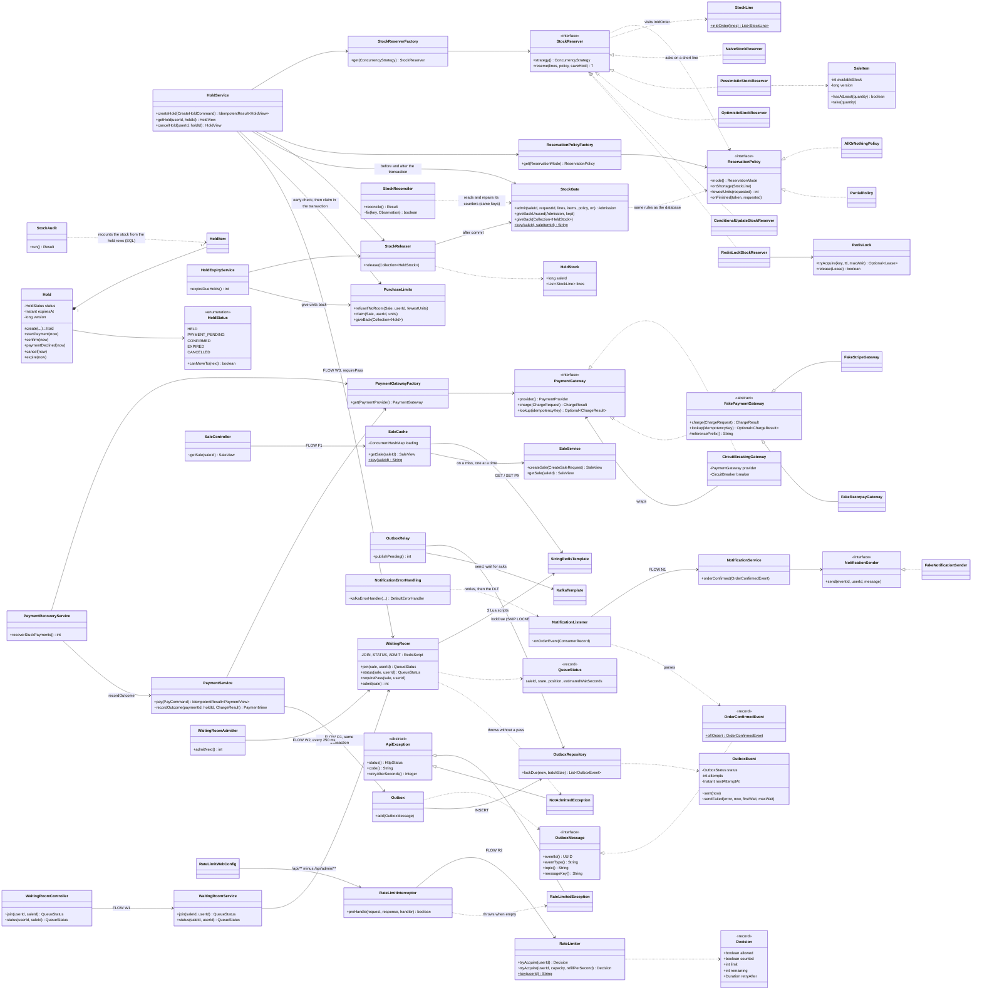

# Flash-Sale Booking Engine: Low-Level Design (LLD)

> **What this doc is:** how the code is built: classes, design patterns, transactions, locks and tests, with the
> *why* behind each choice. For the system view (architecture, flows, scaling) read [HLD.md](HLD.md) first.
>
> **Status:** Phase 1 and Phase 2 built. Phase 2 has six steps: the multi-item cart, the Redis stock gate, payment
> safety, the per-user purchase limit, the rate limiter with error codes on every error, and the sale-page cache
> (2026-10-04 to 09). Phase 3 is complete (2026-10-10): the transactional outbox, Kafka and the notification
> worker; two app instances behind nginx with a per-IP limit; the stock reconciliation job; and the waiting room.
> Phase 4 is complete (2026-10-10): Prometheus and a Grafana dashboard with gauges that recount the stock, k6 load
> tests against the running cluster, and failure tests under load (`loadtest/`). After the plan (2026-10-11): a React
> web app in `frontend/` and the `demo` package behind its demo console.
> 136 source files + 39 test files, 275 tests passing.

## Contents

1. [How to read the code](#1-how-to-read-the-code)
2. [Package structure and layers](#2-package-structure-and-layers)
3. [Class diagram](#3-class-diagram)
4. [Domain model](#4-domain-model)
5. [The hold state machine in code](#5-the-hold-state-machine-in-code)
6. [Strategy pattern #1: taking stock](#6-strategy-pattern-1-taking-stock)
7. [Strategy, Factory and Template Method #2: payment gateways](#7-strategy-factory-and-template-method-2-payment-gateways)
8. [Transactions in code](#8-transactions-in-code)
9. [Locks and lock ordering](#9-locks-and-lock-ordering)
10. [Idempotency in code](#10-idempotency-in-code)
11. [Error handling](#11-error-handling)
12. [Java concurrency tools used](#12-java-concurrency-tools-used)
13. [SOLID and design patterns map](#13-solid-and-design-patterns-map)
14. [Testing](#14-testing)
15. [How to run, and how to extend in Phase 2](#15-how-to-run-and-how-to-extend-in-phase-2)
16. [Interview questions and answers](#16-interview-questions-and-answers)

---

## 1. How to read the code

Read in this order. Each step builds on the previous one.

| # | File | What you learn |
|---|---|---|
| 1 | `hold/HoldStatus.java` | The state machine: which status changes are allowed |
| 2 | `hold/Hold.java` | A rich entity: business rules live inside it |
| 3 | `inventory/StockReserver.java` + `ReservationPolicy.java` | The two strategy interfaces: HOW stock is taken safely, and WHAT happens when a cart item is short |
| 4 | `inventory/NaiveStockReserver.java` | The bug, on purpose |
| 5 | `inventory/PessimisticStockReserver.java`, `ConditionalUpdateStockReserver.java` | The fixes |
| 6 | `hold/HoldService.java` | How a hold is created from a cart: idempotency, validation, the Redis gate, two strategies, one transaction |
| 7 | `inventory/StockGate.java` | The Redis pre-check in front of every strategy: one Lua script, and the "give it back" rule |
| 8 | `payment/PaymentService.java`, then `PaymentRecoveryService.java` | The 3-step payment flow and its four endings, then the job that finishes payments whose answer was lost |
| 9 | `hold/HoldExpiryService.java` + `HoldRepository.lockHoldsDueForExpiry` | Expiry with `SKIP LOCKED` |
| 10 | `ratelimit/RateLimitInterceptor.java`, then `RateLimiter.java` | The middleware in front of every write: one Redis token bucket per buyer, 429 when it is empty |
| 11 | `catalog/SaleCache.java` | The read side: a one-second copy of the sale page in Redis, and one PostgreSQL read per sale at a time |
| 12 | `outbox/Outbox.java`, `OutboxRelay.java`, then `notification/NotificationListener.java` | After the purchase: the event is a row in the order's transaction, a relay sends it to Kafka, a worker tells the customer once |
| 13 | `src/test/.../inventory/OversellTest.java`, `CartTest.java`, `StockGateTest.java` | Proof that it all works under concurrency, for single items, carts and the gate |

All paths are under `src/main/java/com/flashsale/` unless they start with `src/test`.

---

## 2. Package structure and layers

**Package by feature**, not by layer. Everything about holds lives in `hold/`. You don't jump between giant
`controllers/`, `services/` and `repositories/` folders.

```text
com.flashsale
├── common/            shared bits: Clock, ApiHeaders, IdempotentResult, RequestFingerprint, Pause,
│                      KafkaTopics (the topic names, and the topics created at startup)
│   └── error/         ApiException (base), NotFoundException, GlobalExceptionHandler
├── catalog/           Product, Sale, SaleItem (+ stock), repositories, SaleService,
│                      SaleCache (the sale page's copy in Redis) + SaleCacheProperties
│   └── web/           SaleController, AdminSaleController
├── inventory/         HOW stock is taken safely: StockReserver + 5 strategies, ReservationPolicy + 2 policies,
│                      StockLine (the lock order), StockGate (the Redis pre-check), RedisLock, StockReleaser,
│                      HeldStock, StockReconciler (+ its scheduler, ReconciliationProperties): the job that
│                      compares the gate's counters with PostgreSQL, StockAudit (the oversell gauges)
├── hold/              Hold, HoldItem, HoldStatus, HoldService, HoldExpiryService (+ scheduler), MixedSalesException,
│                      PurchaseLimits (+ PurchaseLimitExceededException): the per-user limit
│   └── web/           HoldController, CreateHoldRequest
├── ratelimit/         RateLimiter (a Redis token bucket per buyer), RateLimitInterceptor (the middleware),
│                      RateLimitWebConfig (which routes), RateLimitProperties, RateLimitedException (429)
├── payment/           Payment, PaymentService, PaymentRecoveryService (+ its scheduler)
│   ├── gateway/       PaymentGateway + fake Stripe/Razorpay + factory, CircuitBreakingGateway (a decorator),
│   │                  GatewayException (+ Unavailable, Timeout), PaymentResilienceConfig
│   └── web/           PaymentController
├── order/             Order, OrderService, OrderConfirmedEvent (the event a paid order publishes)
│   └── web/           OrderController
├── outbox/            Outbox (writes an event row), OutboxEvent (the row) + OutboxStatus, OutboxMessage (what any
│                      event must say about itself), OutboxRepository, OutboxRelay (sends rows to Kafka)
│                      + OutboxRelayScheduler, OutboxProperties
├── notification/      NotificationListener (@KafkaListener), NotificationService (once per event),
│                      NotificationSender + FakeNotificationSender, NotificationErrorHandling (retries, then the DLT),
│                      NotificationProperties, NotificationFailedException, UnreadableEventException
├── waitingroom/       WaitingRoom (the queue and the passes in Redis: 3 Lua scripts), QueueStatus (the JSON answer),
│   │                  NotAdmittedException (403), WaitingRoomService, WaitingRoomAdmitter (+ WaitingRoomScheduler),
│   │                  WaitingRoomProperties
│   └── web/           WaitingRoomController (POST and GET /api/sales/{saleId}/queue)
└── demo/              For the web app's demo console only: CrowdSimulator (fake buyers, one virtual thread each,
    │                  outcomes counted in a Redis hash), SaleStatsService + SaleStats (one sale's live numbers),
    │                  CrowdRequest, CrowdTooEarlyException, DemoProperties (flashsale.demo.enabled=false removes it)
    └── web/           DemoController (POST .../crowd, GET .../stats)
```

The React web app lives outside the Java code, in `frontend/`. It only talks HTTP to `/api`, like any
other client. `demo/` depends on the feature services (`HoldService`, `PaymentService`, `WaitingRoomService`), and no
feature depends on `demo/`, so deleting the package leaves the shop unchanged.

### Layers inside each feature

```text
web (controller)  ->  service  ->  domain (entities)  +  repository  ->  database
```

| Layer | Does | Doesn't |
|---|---|---|
| **Controller** | Read headers/body, validate, call one service method, choose the status code | Contain business rules or touch repositories |
| **Service** | Run a use case: decide the transaction boundary, call domain methods and repositories | Know about HTTP |
| **Domain (entity)** | Hold the rules about its own data (`Hold.startPayment`, `SaleItem.take`) | Know about Spring, HTTP or other aggregates |
| **Repository** | Talk to the database (Spring Data JPA) | Contain business decisions |

### Dependency direction (no cycles)

```text
catalog    uses  common
inventory  uses  catalog, common
hold       uses  inventory, catalog, waitingroom, common
payment    uses  hold, order, outbox, common
order      uses  outbox, common
outbox     uses  (nothing of ours: only Spring, Kafka, JPA)
notification uses order, common
ratelimit  uses  common
waitingroom uses catalog, common
```

- `inventory` knows about `catalog` (it changes `SaleItem` stock) but **not** about `hold`. When stock is given back,
  `hold` converts its items into neutral records (`HeldStock` = sale id + `StockLine`s), so `inventory` never imports
  `Hold`. The sale id is there because the Redis gate's keys contain it.
- `order` knows nothing about `payment` or `hold`: `Order.place(holdId, paymentId, ...)` takes plain ids.
- `SaleCache` sits in `catalog`, next to the service it wraps. Only `SaleController` calls it. `SaleService` does not
  know it exists, so admin code and tests still read PostgreSQL directly.
- `outbox` knows nothing about orders. An event reaches it through the `OutboxMessage` interface, which
  `OrderConfirmedEvent` (in `order`) implements. A new event type needs no change in `outbox`.
- `notification` depends on `order` only for the `OrderConfirmedEvent` record (the message format). It never calls
  `OrderService` or reads the `orders` table: the event carries everything it needs.
- `waitingroom` knows nothing about holds. `HoldService` calls `WaitingRoom.requirePass(sale, userId)`; the waiting
  room only needs the `Sale` (its id and `admitPerSecond`) and the buyer id. So the direction is
  `hold -> waitingroom -> catalog`, never back.
- `ratelimit` knows nothing about holds or payments, and nothing knows about it. It reads one header and works on
  URL patterns, so the controllers don't change when it is switched on or off.
- **Visibility is used as a design tool:** the five strategy classes and the two policy classes are package-private.
  Outside `inventory`, code can only reach them through the `StockReserver` / `ReservationPolicy` interfaces and
  their factories.

### Before the controller: the rate-limit middleware (`ratelimit`)

The rate limiter is the one piece of code that runs **for many routes, before any controller**. HLD section 9.10
explains *why* it exists; this is *how* it is wired.

```text
curl -> Tomcat -> DispatcherServlet -> picks HoldController.createHold (routing)
                                    -> RateLimitInterceptor.preHandle      FLOW R1 to R3   <- here
                                    -> binds headers + JSON, runs @Valid   FLOW A1
                                    -> HoldController.createHold           FLOW A2...
```

| Class | Job |
|---|---|
| `RateLimitWebConfig` (a `WebMvcConfigurer`) | Registers the interceptor for `/api/**`, minus `/api/admin/**`. Actuator (`/actuator/**`) is outside `/api` |
| `RateLimitInterceptor` (a `HandlerInterceptor`) | R1: skips GET, HEAD and OPTIONS, and requests with no usable `X-User-Id` (blank or over 64 characters: the controller answers 400 for those). R2: asks the limiter. R3: sets `X-RateLimit-Limit` and `X-RateLimit-Remaining`, then returns `true` (= `next()`), or throws `RateLimitedException` |
| `RateLimiter` | Runs the `TOKEN_BUCKET` Lua script on `rl:<userId>` and returns a `Decision`. Fails open on any `DataAccessException`. Counts `flashsale.rate.limit{outcome=allowed\|limited\|redis_down}` |
| `RateLimitProperties` | `flashsale.rate-limit.enabled`, `capacity` (10), `refill-per-second` (5). `@Validated` + `@Positive`: a refill of 0 stops the app at startup |
| `RateLimitedException` | 429, `RATE_LIMITED`, `retryAfterSeconds()` = the time to the next token, rounded up to whole seconds (at least 1) |

**The `Decision` record** carries everything the interceptor needs, so the interceptor has no Redis code:

```java
public record Decision(boolean allowed, boolean counted, int limit, int remaining, Duration retryAfter) {
    static final Decision NOT_COUNTED = new Decision(true, false, 0, 0, Duration.ZERO);   // off, or Redis down
}
```

`counted = false` means "there is no real number to show": the limiter is switched off, or Redis was down. Then the
request goes through and no `X-RateLimit-*` headers are sent.

**The `TOKEN_BUCKET` script's contract:**

| Input / field | Meaning |
|---|---|
| `KEYS[1]` | The bucket, `rl:<userId>`: a Redis hash with two fields |
| field `tokens` | How many tokens the bucket had at `at`. A decimal (`4.6`), because the refill is gradual |
| field `at` | When `tokens` was last worked out, in milliseconds of **Redis's** clock (`TIME`) |
| `ARGV[1]`, `ARGV[2]` | The capacity, and the refill in tokens per second |
| Answer | `{allowed 1/0, whole tokens left, ms until the next token}` |

The script reads the hash, adds `(now - at) x rate` (never above the capacity), spends one token if there is a
whole one, writes both fields back, and sets `PEXPIRE` to the time a bucket needs to fill up again (`capacity /
rate` = 2 s). A missing bucket counts as full, so an expired bucket and a full one behave the same and no cleanup job
is needed.

**Design choices in the code:**

- **An interceptor, not a servlet filter.** A filter runs before Spring MVC, so an exception thrown there never
  reaches `GlobalExceptionHandler`: it goes to Spring Boot's `/error` page, in another JSON shape. The interceptor
  runs inside `DispatcherServlet`, throws `RateLimitedException`, and the 429 gets the same Problem Details body and
  `Retry-After` header as every other error. The cost: it runs after routing, so a request to an unknown URL is
  never counted (it gets a 404 anyway).
- **Before argument binding.** `preHandle` runs before Spring reads the JSON body and runs `@Valid`, so a refused
  request costs one Redis call and nothing else. The headers it sets stay on the response, also on the 429.
- **Redis's clock, not the app's `Clock` bean.** Two app instances share one bucket. If each used its own clock, a
  server a little ahead would add tokens that a server a little behind then counts again. `TIME` inside the script
  gives every instance the same "now". The price: tests can't move Redis's clock, so they "age" a bucket instead
  (section 14).
- **One script, not `INCR` then `EXPIRE`.** Reading the tokens and writing them back as two commands lets two
  requests read the same last token. The experiment in section 14 shows exactly that.
- **A package-private overload for tests:** `tryAcquire(userId, capacity, refillPerSecond)`. The public
  `tryAcquire(userId)` uses `application.yml`; tests in the same package pass a very slow refill, so no token drips
  in while they count. Changing the settings for one test class would start a second Spring context instead.
- **Fails open, like the stock gate.** Both only protect the system; PostgreSQL still decides every sale. A limiter
  that failed closed would turn a Redis outage into "nobody can buy".

### The read side: the sale-page cache (`SaleCache`)

The sale page (`GET /api/sales/{id}`) is the most-read endpoint in a flash sale. People refresh it while they wait
for the start. `SaleCache` keeps a copy of each sale page in Redis for one second. HLD section 9.11 explains *why*;
this is *how*.

```text
curl -> SaleController.getSale                        FLOW F1
     -> SaleCache.getSale: GET cache:sale:42          FLOW F2   hit -> F4
     -> miss: one request per sale loads it           FLOW F3   SaleService.getSale (SELECTs), SET ... PX 1000
     -> view.at(now): "active" worked out again       FLOW F4   -> JSON
```

| Class | Job |
|---|---|
| `SaleCache` | Cache-aside: look in Redis, on a miss read PostgreSQL and store the answer. Only one request per sale and app instance reads PostgreSQL at a time (the "single flight"). Fails open. Counts `flashsale.sale.cache{outcome=hit\|miss\|shared\|redis_down}` |
| `SaleCacheProperties` | `flashsale.sale-cache.enabled` and `ttl` (1 s). `@DurationMin(millis = 1)`: `ttl=0s` stops the app at startup ("must be longer than or equal to 1 milli") |
| `SaleView.at(now)` | A copy of the view with `active` worked out for `now`. The rule itself is `Sale.isActiveAt(startsAt, endsAt, now)`, a static overload that the entity method also uses |

**The Redis key:** `cache:sale:<saleId>`, a plain string that holds the `SaleView` as JSON. `SaleCache` uses
Jackson's `JsonMapper` bean, the same one that writes the HTTP responses. `SET ... PX 1000` stores it, and Redis
deletes it after one second.

**The single flight, in code:**

```java
CompletableFuture<SaleView> mine = new CompletableFuture<>();
CompletableFuture<SaleView> running = loading.putIfAbsent(saleId, mine);   // atomic: one thread wins
if (running != null) {
    return waitFor(running);          // the others: running.join(), same answer or same exception
}
try {
    SaleView view = readQuietly(saleId);              // look once more (see below)
    if (view == null) {
        view = saleService.getSale(saleId);           // the one PostgreSQL read
        write(saleId, view);                          // SET cache:sale:42 ... PX 1000
    }
    mine.complete(view);
    return view;
} catch (RuntimeException e) {
    mine.completeExceptionally(e);                    // e.g. 404 for every waiter
    throw e;
} finally {
    loading.remove(saleId, mine);                     // only OUR entry
}
```

**Design choices in the code:**

- **A separate bean, not code inside `SaleService`.** `SaleService.getSale` is `@Transactional(readOnly = true)`. If
  the Redis calls ran inside it, every page view would hold a database connection while it waited for Redis. Also,
  a call from one method of a bean to another `@Transactional` method of the same bean skips Spring's proxy
  (self-invocation), so no transaction would start. The order is controller -> `SaleCache` -> `SaleService`.
- **No invalidation.** Stock changes on every purchase. Deleting the copy on each hold would empty the cache when it
  is needed most. The copy expires after one second instead, and nothing listens for that.
- **"Active" is never cached.** The stock numbers in a copy can be one second old. The start and end times never
  change, so `view.at(clock.instant())` makes `active` exact on every read. Without this, a page cached just before
  the start would say "not live" for up to a second after it.
- **One loader per sale, per instance.** When the copy expires, every request that arrives before it is refilled
  misses. Without the single flight, 50 parallel misses made 50 PostgreSQL reads (section 14). The map entry lives
  only while one load runs. With two instances, at most two loads of a sale run at once.
- **The loader looks once more.** A request can miss just before the last loader stores its copy and leaves the map.
  Without a second look, it would load again. This costs one Redis read per real miss. No test catches its removal
  (the window is too small to hit on purpose), so it is a cheap guard, not a proven fix.
- **Fails open, and tries Redis once.** If the first `GET` fails, the request skips the second look and the `SET`.
  With a hanging Redis and a 1 s timeout, three tries would make one page view wait 3 s. A copy that Jackson cannot
  read (for example from an older app version) counts as a miss, and the reload overwrites it.
- **A missing sale is not cached.** A 404 reads PostgreSQL every time. Waiters in a crowd all get the same
  `NotFoundException`. The per-IP limit at nginx (built in Phase 3) is the defence against someone asking for random
  ids.
- **Why not `@Cacheable(sync = true)`?** Spring's cache annotation can do cache-aside and even a per-instance single
  flight. But it hides every step, it needs a `CacheErrorHandler` to fail open and a JSON serializer set up for
  records, and it cannot work out `active` again on the way out. Written by hand, each step is visible and tested.

### After the purchase: the outbox and the notification worker (`outbox`, `notification`)

When a payment succeeds, the customer must get a "your order is confirmed" message. The message must never be lost,
and a slow or dead Kafka must never slow down or fail a payment. HLD section 9.12 explains *why* an outbox. This is
*how* the code is built.

```text
PaymentService.recordOutcome (tx)  ->  Outbox.add: INSERT outbox_events (PENDING)     FLOW O1, same COMMIT as the order
OutboxRelayScheduler (every 500 ms) ->  OutboxRelay: claim due rows (SKIP LOCKED)       FLOW O2
                                    ->  send each to Kafka, wait for acks, mark SENT     FLOW O3  (or back off)
Kafka flashsale.orders              ->  NotificationListener.onOrderEvent               FLOW N1  route on the header
                                    ->  NotificationService: seen before? send, record   FLOW N2 to N4
                                    ->  on an exception: NotificationErrorHandling       FLOW N5  retry 3 x, then .DLT
```

| Class | Job |
|---|---|
| `OutboxMessage` | An interface: `eventId`, `eventType`, `aggregateType`, `aggregateId`, `topic`, `messageKey`. The event record itself becomes the JSON payload |
| `OrderConfirmedEvent` | A record in `order` that implements `OutboxMessage`. Its six fields are the JSON. Named in the past tense: it reports a fact |
| `Outbox` | `add(OutboxMessage)`: JSON with Jackson's `JsonMapper`, then one `INSERT`. `@Transactional(propagation = MANDATORY)` |
| `OutboxEvent` | The row (entity). State methods `sent(now)` and `sendFailed(error, now, firstWait, maxWait)` |
| `OutboxRepository` | `lockDue(now, batchSize)`: native SQL with `FOR UPDATE SKIP LOCKED`, and `countByStatus` for the gauge |
| `OutboxRelay` | One transaction per batch of 100: claim, send all, wait for the answers under ONE deadline, mark each row. Counters `flashsale.outbox.sent` and `send_failed`, gauge `flashsale.outbox.pending` |
| `OutboxRelayScheduler` | `@Scheduled(fixedDelay = 500 ms)`. Switched off in tests, which call the relay by hand |
| `KafkaTopics` | The topic names as constants, and `NewTopic` beans: `flashsale.orders` (3 partitions), `flashsale.orders.DLT` (1) |
| `NotificationListener` | `@KafkaListener(topics = flashsale.orders, groupId = notifications)`: reads the `eventType` header, parses the JSON, calls the service |
| `NotificationService` | The idempotent consumer: skip a known event id, else send, then `INSERT ... ON CONFLICT DO NOTHING` |
| `NotificationSender` / `FakeNotificationSender` | A Strategy, like `PaymentGateway`. The fake logs the message, and fails for a user id that starts with `bounce` |
| `NotificationErrorHandling` | A `@Configuration` with one `DefaultErrorHandler` bean: 3 retries 1 s apart, then `DeadLetterPublishingRecoverer` to `<topic>.DLT`. `UnreadableEventException` skips the retries |

**Design choices in the code:**

- **The outbox knows nothing about orders.** `Outbox.add` takes an `OutboxMessage`. Jackson writes only a record's
  own fields, so the interface methods (`topic()`, `messageKey()` and so on, which are not `getX` getters) stay out
  of the payload. The routing details live in their own columns. A test checks that `topic` is not in the JSON.
- **`MANDATORY` is a guard.** Called without a transaction, `Outbox.add` throws `IllegalTransactionStateException`.
  The default (`REQUIRED`) would quietly start its own transaction and commit the event even if the order then
  rolled back. A test proves the guard.
- **The entity owns its retry timing.** `sendFailed` doubles the wait after each failure (1 s, 2 s, 4 s ... ) and
  caps it at a minute. The exponent is capped at 20 (`1L << Math.min(attempts - 1, 20)`), so a broker that is down
  for days never overflows a `long`. The error text is cut to the column's 500 characters. There is no `FAILED`
  status: an event is never given up on.
- **The relay sends a batch, then waits once.** `KafkaTemplate.send` returns a `CompletableFuture` at once. The relay
  hands every row to the producer, then waits for all the answers within one deadline (`send-timeout`, 5 s). If
  `send()` itself throws (the broker cannot be found within `max.block.ms`), the rest of the batch fails fast instead
  of waiting 2 s each. A small private `Batch` record (`claimed`, `sent`, `anyFailed`) tells the loop whether to
  claim another batch.
- **The relay keeps its transaction open while Kafka answers.** That is at most `send-timeout`, and it only locks
  outbox rows that nobody waits for (other relays skip them). The other way (a lease column, commit, send, a second
  transaction to mark) is in HLD 9.12.
- **The listener is a controller for messages.** It reads and checks the input, calls one service method, and does
  nothing else, like `HoldController` does for HTTP. An unknown `eventType` is skipped (a newer producer may publish
  types this version does not know). Bad JSON becomes `UnreadableEventException`.
- **Error handling is configuration, not code in the listener.** Spring Boot gives the one `CommonErrorHandler` bean
  to the listener container. `FixedBackOff(retry-backoff, max-retries)` sets the retries, and
  `addNotRetryableExceptions(UnreadableEventException.class)` sends poison messages straight to the DLT.
- **The idempotent consumer.** The relay and Kafka both deliver "at least once", so the same event can come twice.
  `NotificationService` checks the `notifications` table first (primary key `event_id`), sends, then records. The
  event id is random (`UUID`), not the row id, so it never repeats after a restore or a test that resets the tables.
- **Send outside a transaction.** The worker does not hold a database connection while the email provider answers.
  The cost is a small window: a crash after the send and before the `INSERT` sends again. The event id is passed to
  the sender as the provider's idempotency key, which closes that window with a real provider.

### Two instances: what each JVM keeps, and why the design stays correct

Phase 3 runs two copies of the app (`app1`, `app2`) behind nginx. They share PostgreSQL, Redis and Kafka, and nothing
else. HLD section 9.13 has the system view. In code, this is what each instance keeps in its own memory, and why that
is safe:

| Kept in one JVM | Why it is safe with two JVMs |
|---|---|
| Spring beans (services, factories, strategies) | They are stateless: no field changes after startup, so each instance has its own identical copy |
| `SaleCache.loading` (the single flight map) | It only groups page loads inside one instance. Two instances means at most two PostgreSQL reads of a sale at a time, not one. The copy itself lives in Redis, so both instances share it |
| The HikariCP pool (20 connections) | Per instance: two instances can use 40 connections. PostgreSQL's default limit is 100 |
| The five `@Scheduled` jobs | Both instances run each job. Expiry and the outbox relay claim rows with `FOR UPDATE SKIP LOCKED`, so they take different rows. Payment recovery locks the hold row and does nothing if the payment is already finished. The reconciliation job fixes with a compare-and-set, so a second fix does nothing. The waiting room's admitter shares one admission credit per sale in Redis, so two admitters still let in `admitPerSecond` buyers a second |
| The Kafka consumer | Both instances join the consumer group `notifications`, and Kafka splits the 3 partitions between them (seen live: app1 got partitions 0 and 1, app2 got 2). Each message is read by one instance |
| Resilience4j circuit breakers | Per instance: each instance opens its own breaker after its own failures. That is fine: a breaker protects the instance that holds it |

The rule behind this: **no `synchronized` block or Java lock protects shared data.** A Java lock only works inside
one JVM. Every lock that guards stock, holds, payments or rate-limit buckets lives in PostgreSQL (row locks,
`@Version`, a conditional `UPDATE`, unique constraints) or in Redis (`RedisLock`, the Lua scripts of `StockGate` and
`RateLimiter`). The rate limiter is one bucket per buyer in Redis, so a buyer who alternates between instances still
gets 10 requests, not 20. `TwoInstancesTest` proves each of these points.

Nothing in the Java code changed for this step. The new files are for running it: a `Dockerfile` (two stages, runs as
a normal user), a `cluster` profile in `docker-compose.yml` (`app1`, `app2`, `nginx`), Kafka with a second listener
(`kafka:19092` for containers, `localhost:9092` for your Mac), and `nginx/templates/default.conf.template` (round
robin with a shared `zone`, failover, and the per-IP limit). Flyway takes a database lock while it migrates, so two
instances that start together never run the same migration twice: live, app1 migrated and app2 found the schema up to
date.

### Before the hold: the waiting room (`waitingroom`, FLOW W)

A sale created with `admitPerSecond` gets a waiting room. Buyers join a queue in Redis, and an admitter lets the
first ones in, at most `admitPerSecond` a second. An admitted buyer gets a **pass**, and only a buyer with a pass can
create a hold. Sales without `admitPerSecond` are not affected. HLD section 9.15 has the system view.

```text
POST /api/sales/5/queue   WaitingRoomController -> WaitingRoomService.join   (W1: JOIN script; 404 / 409 checks)
GET  /api/sales/5/queue   WaitingRoomController -> WaitingRoomService.status (W1: STATUS script)
every 250 ms              WaitingRoomScheduler -> WaitingRoomAdmitter.admitNext -> WaitingRoom.admit per live sale
                          (W2: ADMIT script)
POST /api/holds           HoldService.createHold -> WaitingRoom.requirePass  (W3: 403 NOT_ADMITTED without a pass)
```

| Class | Role |
|---|---|
| `WaitingRoom` | The Redis side. Per sale, all keys share the hash tag `{saleId}`: the queue (a sorted set, score = turn number), the turn counter, the admission credit (a hash) and one pass key per admitted buyer. Three Lua scripts: `JOIN`, `STATUS`, `ADMIT` |
| `QueueStatus` | The JSON answer: `state` (`WAITING`, `ADMITTED`, `NOT_QUEUED`), plus `position` and `estimatedWaitSeconds` while waiting. Null fields are left out |
| `WaitingRoomService` | Loads the sale: 404 if unknown, 409 `SALE_NOT_ACTIVE` once it has ended. Joining before the start is allowed: the line forms early |
| `WaitingRoomAdmitter` + `WaitingRoomScheduler` | Every 250 ms: `SaleRepository.findLiveWithWaitingRoom` (JPQL), then one `ADMIT` call per sale |
| `NotAdmittedException` | 403 `NOT_ADMITTED`, thrown by `requirePass` |
| `WaitingRoomProperties` | `admitter-enabled`, `admit-interval` (250 ms), `pass-ttl` (5 minutes) |

Design choices:

- **`WaitingRoom` takes a `Sale`, not a sale id.** Both callers already loaded the sale (`HoldService` for its sale
  window, `WaitingRoomService` for 404 and 409). Passing the entity costs no extra query, and the waiting room reads
  `hasWaitingRoom()` and `getAdmitPerSecond()` from it. A sale without a waiting room returns at once, with no Redis
  call.
- **One shared credit makes the admitter safe on N instances, with no lock.** The `ADMIT` script keeps a small token
  bucket per sale in Redis (`credit`, `at`), timed with Redis's own clock (`TIME`). It adds credit, pops that many
  buyers with `ZPOPMIN`, writes their passes and subtracts what it used, all in one atomic script. Two admitters at the
  same moment run one after the other inside Redis, and the second finds the credit already used. So two instances
  admit `admitPerSecond` a second, not twice that. The credit is capped at one second's worth.
- **A turn counter, not a timestamp, orders the queue.** `JOIN` gives each new buyer `INCR turn` as their score. Two
  instances can never hand out the same number, and no clock is involved, so "first come, first served" is exact.
  Joining again finds the buyer already in the set and keeps the place: the POST is idempotent by design.
- **The pass is a Redis key with an expiry, not a database row.** It lives 5 minutes and nobody needs it afterwards,
  so Redis deletes it by itself. There is no table to clean, and checking it is one `EXISTS`.
- **Fail open.** If Redis is unreachable, `join` and `status` answer `ADMITTED` and `requirePass` lets the hold
  through, with a warning and the counter `flashsale.waiting_room{outcome=redis_down}`. The waiting room protects
  PostgreSQL's capacity; it never decides who gets stock. Failing closed would stop the whole sale because a helper is
  down. This is the same choice as the stock gate and the rate limiter.
- **403, not 429 or 409.** The buyer is not sending too much (429), and nothing is wrong with the sale (409). They are
  known, but not allowed to buy yet: that is 403 Forbidden. The message tells them where to join.
- **Where the check sits.** `requirePass` runs right after the sale-window check and before the per-buyer limit, the
  stock gate and the locks. A buyer without a pass costs one Redis `EXISTS` and nothing else.

---

## 3. Class diagram



---

## 4. Domain model

### Entities and aggregates

An **aggregate** is a group of objects that change together and are saved together, with one "root" as the entry
point. Rule: **only touch the inside through the root.**

| Aggregate (root) | Contains | Rules it protects |
|---|---|---|
| **`Hold`** | `HoldItem` lines | State machine; expiry time; total = sum of lines; prices are snapshots |
| **`SaleItem`** | | Stock never goes below 0 (`take()`); `version` for optimistic locking |
| **`Payment`** | | Only `PENDING` can become `SUCCEEDED` or `FAILED` |
| **`Order`** | | Created once per hold |
| `Sale`, `Product` | | `Sale.isActiveAt(now)` |

**Aggregates refer to each other by id, not by object.** `HoldItem` stores `saleItemId` (a `Long`), not a `SaleItem`
object. Why:

- loading a hold never accidentally loads (or locks) stock rows;
- each aggregate can be saved and locked on its own;
- it's how you'd keep them if they ever moved to different services.

Inside an aggregate we do use object references: `Hold` has `List<HoldItem>`, and `HoldItem` points back to its `Hold`
(`@ManyToOne`), with `cascade = ALL`, so saving a hold saves its lines.

### Rich entities, not "bags of getters and setters"

There are **no setters**. State changes only through methods that check the rules:

```java
// hold/Hold.java
public void startPayment(Instant now) {
    if (status == HoldStatus.EXPIRED || (status == HoldStatus.HELD && isPastExpiry(now))) {
        throw new HoldExpiredException(id);
    }
    if (status == HoldStatus.PAYMENT_PENDING) {
        throw new PaymentInProgressException(id);
    }
    moveTo(HoldStatus.PAYMENT_PENDING, now);
}
```

```java
// catalog/SaleItem.java
public void take(int quantity) {
    if (quantity <= 0) throw new IllegalArgumentException("quantity must be positive, got " + quantity);
    if (availableStock < quantity) throw new SoldOutException(id, quantity);
    availableStock -= quantity;
}
```

Benefits: the rules live in one place, can't be skipped, and can be unit-tested without a database
(`HoldTest`, `HoldStatusTest`).

### Small but important entity details

| Detail | Where | Why |
|---|---|---|
| `protected` no-arg constructor | every entity | JPA needs it; `protected` stops normal code from using it |
| Static factory methods (`Hold.create`, `Payment.start`, `Order.place`) | entities | Named construction; an object is valid from birth |
| `@Version long version` | `SaleItem`, `Hold`, `Payment` | Optimistic-locking check on every update |
| `@Enumerated(EnumType.STRING)` | statuses | Stores `"HELD"`, not `0`. Reordering the enum can't corrupt data |
| `getItems()` returns `Collections.unmodifiableList` | `Hold` | Nobody can add lines from outside the aggregate |
| Money as `BigDecimal`, compared with `compareTo` | everywhere | `new BigDecimal("2.0").equals(new BigDecimal("2.00"))` is **false** |
| `HoldView`, `PaymentView`... are Java `record`s | API responses | Immutable; no JPA proxies or lazy-loading surprises in JSON |

---

## 5. The hold state machine in code

The whole state machine is one table in `hold/HoldStatus.java`:

```java
private static final Map<HoldStatus, Set<HoldStatus>> ALLOWED_MOVES = Map.of(
        HELD,            EnumSet.of(PAYMENT_PENDING, EXPIRED, CANCELLED),
        PAYMENT_PENDING, EnumSet.of(CONFIRMED, HELD),
        CONFIRMED,       EnumSet.noneOf(HoldStatus.class),
        EXPIRED,         EnumSet.noneOf(HoldStatus.class),
        CANCELLED,       EnumSet.noneOf(HoldStatus.class));

public boolean canMoveTo(HoldStatus next) {
    return ALLOWED_MOVES.get(this).contains(next);
}
```

Every change goes through one private method in `Hold`:

```java
private void moveTo(HoldStatus next, Instant now) {
    if (!status.canMoveTo(next)) {
        throw new IllegalHoldTransitionException(id, status, next);   // HTTP 409
    }
    status = next;
    updatedAt = now;
}
```

### Transition table vs the "State pattern"

| | Enum + transition table (our choice) | State pattern (one class per state) |
|---|---|---|
| Code | One enum, one map | `HeldState`, `PaymentPendingState`... each with `pay()`, `cancel()`... |
| Good when | States differ mainly in *which moves are allowed* | Each state has very different *behaviour* |
| Readability | All rules visible in 6 lines | Rules spread over 5 classes |

Our states differ only in allowed moves, so the table is simpler. **Interview line:** "If each state needed different
behaviour, like different pricing per state, I'd switch to the State pattern."

**Concurrency note:** the state machine alone doesn't stop two requests changing the same hold at once. That is the
lock's job (section 9): we always `SELECT ... FOR UPDATE` the hold before calling these methods, and `@Version` is a
backup check.

---

## 6. Strategy pattern #1: taking stock

### The problem the pattern solves

There are several ways to take stock safely, and we want to compare them all, switch between them at runtime, and
add new ones without touching `HoldService`. That is exactly the **Strategy pattern**: one interface, several
interchangeable implementations. Since Phase 2 a hold is a **cart** of 1 to 10 items, so the job is "take the stock
for these lines".

```java
// inventory/StockReserver.java
public interface StockReserver {
    ConcurrencyStrategy strategy();
    <T> T reserve(List<StockLine> lines, ReservationPolicy policy, Function<List<StockLine>, T> saveHold);
}
```

Every implementation follows the same three rules:

1. **One database transaction for the whole cart**: every stock change and `saveHold`. A rollback undoes the cart.
2. **Visit the lines in `StockLine.inIdOrder(lines)` order**, so every transaction locks rows in the same order
   (section 9).
3. **A short line goes to `policy.onShortage(line)`**, which throws (give up, roll back) or returns (skip the line).

### Why the `saveHold` callback?

`reserve` doesn't just take stock. It also runs **our** "save the hold" code **inside its transaction**, passing the
lines it actually took (with PARTIAL that can be fewer than were asked for):

```java
// hold/HoldService.java (simplified)
HoldView created = reserver.reserve(wanted, policy, taken -> {
    policy.onFinished(taken, wanted);                                  // e.g. never an empty hold
    Hold hold = Hold.create(userId, saleId, linesWithPrices(taken), now, ttl, idempotencyKey, fingerprint);
    return HoldView.of(holds.saveAndFlush(hold), notTaken(wanted, taken));
});
```

Why not take stock first, commit, then save the hold?

1. **Crash in between = stock leaked forever.** Taken, but no hold exists to give it back.
2. **The duplicate-key check (idempotency) happens at insert time.** It must be able to roll back the stock.
3. **REDIS_LOCK must keep the lock until the hold is committed** too, or the next buyer reads old data.

So each strategy owns the transaction and calls us back inside it. This is the **callback** ("execute around")
idea, the same one Spring uses in `TransactionTemplate.execute(...)` and `JdbcTemplate`.

### Reservation policies: a second strategy, combined with the first

A cart adds a second, separate question: **what happens when one item is short?** The buyer picks with the request's
`"mode"`:

| | ALL_OR_NOTHING (`AllOrNothingPolicy`, the default) | PARTIAL (`PartialPolicy`) |
|---|---|---|
| `onShortage(line)` | throws `SoldOutException`: the transaction rolls back, earlier items included | returns: skip this line |
| `onFinished(taken, requested)` | default rule: refuse an empty hold | same default rule |
| Answer | 409 `SOLD_OUT`, naming the short item | 201 with the items held + `"unavailable": [...]`; the total counts only what was held |
| Use for | Bundles, combo offers, seats that must be together | Normal shopping carts |

```java
// inventory/ReservationPolicy.java
public interface ReservationPolicy {
    ReservationMode mode();
    int fewestUnits(List<StockLine> requested);   // the smallest hold this mode can make (for the purchase limit)
    void onShortage(StockLine line);     // throw = give up on the whole cart; return = skip this line
    default void onFinished(List<StockLine> taken, List<StockLine> requested) {
        if (taken.isEmpty()) throw SoldOutException.noneLeft(requested.size());   // no empty holds
    }
}
```

- **Why two interfaces instead of one?** They answer independent questions: HOW to protect a row (5 answers) and
  WHAT to do with a short item (2 answers). Combined at runtime, 7 small classes give all 10 behaviours. One class
  per combination would be 10 classes with copied locking code.
- **Open/Closed:** a new rule such as "partial, but at least 2 items" is one new policy class that overrides
  `onFinished`. No strategy changes. `ReservationPolicyFactory` is built exactly like `StockReserverFactory`.
- **`fewestUnits`** (added with the purchase limit): ALL_OR_NOTHING holds every line, so the sum; PARTIAL skips lines
  but never makes an empty hold, so the smallest line. `HoldService` uses it to refuse a request early when even that
  can't fit the buyer's limit. Each policy knows its own minimum, so no `switch` on the mode is needed.
- **Why does "throw" mean "undo"?** Both policy methods run inside the strategy's transaction, so an exception
  escaping `tx.execute(...)` rolls back the stock already taken for earlier lines. The all-or-nothing guarantee comes
  from the transaction; the policy only decides to throw.
- **Rejected alternative (the original plan):** `ReservationPolicy.reserve(cart)` doing the reservation itself.
  Every policy would then need its own copy of the locking code for every strategy.

### The five implementations

Each one loops over `StockLine.inIdOrder(lines)`. What changes is how each row is protected.

#### NAIVE: broken on purpose (`NaiveStockReserver`)

```java
for (StockLine line : StockLine.inIdOrder(lines)) {
    int available = saleItems.findAvailableStock(line.saleItemId()).orElseThrow(...);   // plain SELECT
    if (available < line.quantity()) { policy.onShortage(line); continue; }
    Pause.of(properties.naiveRaceWindow());                                             // "some work" (tests: 50 ms)
    saleItems.overwriteAvailableStock(line.saleItemId(), available - line.quantity());  // UPDATE ... SET stock = :value
    taken.add(line);
}
return saveHold.apply(taken);
```

The write sets a **number computed in Java from a stale read**. Concurrent buyers overwrite each other: a lost
update. `naive-race-window` only widens the gap so the test fails every time. The bug exists without it. One buyer on
their own still gets the right answer, so the single-buyer cart tests pass for NAIVE too.

#### PESSIMISTIC (`PessimisticStockReserver`)

```java
for (StockLine line : StockLine.inIdOrder(lines)) {
    SaleItem item = saleItems.findByIdForUpdate(line.saleItemId()).orElseThrow(...);  // SELECT ... FOR (NO KEY) UPDATE
    if (!item.hasAtLeast(line.quantity())) { policy.onShortage(line); continue; }
    item.take(line.quantity());
    taken.add(line);
}
return saveHold.apply(taken);   // the COMMIT after this releases the row locks; the next buyer reads the new stock
```

```java
// catalog/SaleItemRepository.java
@Lock(LockModeType.PESSIMISTIC_WRITE)
@Query("select s from SaleItem s where s.id = :id")
@Transactional(propagation = Propagation.MANDATORY)
Optional<SaleItem> findByIdForUpdate(long id);
```

The real SQL for a two-item cart (sale items 4 and 5, `learn` profile) shows Hibernate's **auto-flush**: before the
second `SELECT` on `sale_items`, it sends the pending `UPDATE` for item 4, so that query can't miss our own change.
The locks are still taken lowest id first:

```text
select ... from sale_items where id=? for no key update of si1_0         <- item 4: lock 1
update sale_items set available_stock=?, ... where id=? and version=?    <- item 4, auto-flushed under lock 1
select ... from sale_items where id=? for no key update of si1_0         <- item 5: lock 2
insert into holds (...) values (...)
insert into hold_items (...) values (...)                                <- x2
update sale_items set available_stock=?, ... where id=? and version=?    <- item 5
COMMIT
```

#### OPTIMISTIC (`OptimisticStockReserver`)

```java
for (int attempt = 1; ; attempt++) {
    try {
        return tx.execute(status -> {                    // a NEW transaction per attempt: fresh data
            ... the same loop, with findById (no lock) ...
            return saveHold.apply(taken);                // flush: UPDATE ... WHERE id = ? AND version = ?, per item
        });
    } catch (ObjectOptimisticLockingFailureException clash) {
        if (attempt >= properties.optimisticMaxAttempts()) throw new StockBusyException(lines);
        Pause.randomMillis(1, 10L * attempt);            // back off + jitter
    }
}
```

Points to notice:

- The retry loop is **outside** the transaction. After a clash, the transaction is dead (marked rollback-only), so
  you must start a new one to retry. A clash on any item retries the **whole** cart.
- **Jitter** (random wait): without it, the retrying buyers wake together and clash again.
- Retries are capped (10). After that, 503 `STOCK_BUSY` with `Retry-After: 1`.

#### CONDITIONAL_UPDATE (`ConditionalUpdateStockReserver`)

```java
for (StockLine line : StockLine.inIdOrder(lines)) {
    if (saleItems.takeIfAvailable(line.saleItemId(), line.quantity()) == 1) { taken.add(line); continue; }
    if (!saleItems.existsById(line.saleItemId())) throw new NotFoundException("Sale item", line.saleItemId());
    policy.onShortage(line);          // ALL_OR_NOTHING throws: the ROLLBACK also undoes the earlier UPDATEs
}
return saveHold.apply(taken);
```

```java
// catalog/SaleItemRepository.java
@Modifying
@Query("""
        update SaleItem s
           set s.availableStock = s.availableStock - :quantity, s.version = s.version + 1
         where s.id = :id and s.availableStock >= :quantity
        """)
int takeIfAvailable(long id, int quantity);
```

The check and the write are **one statement**, so there is no gap for anyone to sneak into. It also bumps `version`,
so optimistic readers still notice the change.

#### REDIS_LOCK (`RedisLockStockReserver` + `RedisLock`)

```java
List<RedisLock.Lease> leases = acquireAllOrFailClosed(ordered);  // one lock per item, lowest id first;
                                                                  // busy OR Redis down -> 503 STOCK_BUSY
try {
    return tx.execute(status -> {
        ... the same loop, with findById; item.take(...) keeps the @Version check = fencing token ...
        return saveHold.apply(taken);
    });
} catch (ObjectOptimisticLockingFailureException lockExpiredWhileWorking) {
    throw new StockBusyException(ordered);
} finally {
    releaseAll(leases);                     // AFTER commit; best effort, the TTL is the backstop
}
```

- **A cart's locks** are taken lowest id first, all within ONE shared wait budget (`redis-lock-wait`). If one lock
  can't be had in time, the locks already held are released **before** answering 503. Sitting on some locks while
  waiting for others is the "hold and wait" deadlock condition.
- **Redis unreachable while locking:** `acquireAllOrFailClosed` turns `RedisConnectionFailureException` into 503.
  The database is never touched. No lock, no sale (**fail closed**).
- **Redis unreachable while unlocking:** `RedisLock.release` logs and returns `false` instead of throwing. The
  purchase has already committed, so turning it into an error would only confuse the client; the lock's TTL frees it.
- Both Redis-down cases are covered by `RedisLockFailureTest` (Mockito, no containers).

```java
// inventory/RedisLock.java
// lock:   SET key token NX + expiry   (on the wire: SET lock:sale-item:2 <uuid> EX 5 NX)
redis.opsForValue().setIfAbsent(key, token, ttl);

// unlock: only if it is still OUR token (atomic Lua)
if redis.call('get', KEYS[1]) == ARGV[1] then
    return redis.call('del', KEYS[1])
end
return 0
```

### Picking a strategy and a policy: the factories

```java
// inventory/StockReserverFactory.java
public StockReserverFactory(List<StockReserver> reservers, InventoryProperties properties) {
    for (StockReserver reserver : reservers) {
        if (byStrategy.put(reserver.strategy(), reserver) != null) {
            throw new IllegalStateException("Two StockReservers registered for " + reserver.strategy());
        }
    }
    this.defaultStrategy = properties.defaultStrategy();
}

public StockReserver get(ConcurrencyStrategy requested) {
    ConcurrencyStrategy strategy = requested != null ? requested : defaultStrategy;
    ...
}
```

- Spring injects **every** `StockReserver` bean as a `List`. The factory indexes them by enum in an `EnumMap`.
- **Adding a 6th strategy = writing one new class.** The factory, the service and the controller don't change.
  That's the **Open/Closed principle**.
- It fails fast at startup if two classes claim the same enum.
- The request header `X-Concurrency-Strategy` picks one per request (great for benchmarks); otherwise
  `flashsale.inventory.default-strategy` decides.
- `ReservationPolicyFactory` is the same idea for `ReservationMode`. It also fails at startup if a mode has no policy.

### Comparison

| | NAIVE | PESSIMISTIC | OPTIMISTIC | CONDITIONAL_UPDATE | REDIS_LOCK |
|---|---|---|---|---|---|
| Correct? | ❌ | ✅ | ✅ | ✅ | ✅ |
| Lock held | none | row, until commit | none while working; row lock from the final UPDATE to commit | row, until commit | Redis key; row lock from the UPDATE to commit |
| Waiting happens in | | PostgreSQL (holds a DB connection) | retry loop | PostgreSQL | Redis (no DB connection held) |
| Retries | | no | yes | no | spin until `redis-lock-wait` |
| A cart of N items | the same race, per item | N row locks, id order | N version checks; any clash retries the cart | N conditional UPDATEs, id order | N Redis locks, id order, one wait budget |
| Measured, 10 units / 50 buyers | 50 holds (oversold) | ~35 to 40 ms | ~78 to 107 ms | ~32 to 38 ms | ~90 to 98 ms |

(Measured with the Redis stock gate off. With it on, see the next section.)

### In front of every strategy: the Redis stock gate (`StockGate`)

The gate is **not a sixth strategy**. It sits in front of all five, so `HoldService` calls it as its own step:
FLOW A5b before the transaction, FLOW A6b after it. HLD section 9.8 explains *why*; this is *how*.

```java
// hold/HoldService.createHold (trimmed)
StockGate.Admission admission = stockGate.admit(sale.getId(), command.requestId(), wanted, itemsById, policy,
        command.stockGate());                         // A5b: may throw SOLD_OUT; PostgreSQL never touched
List<StockLine> keptByDatabase = List.of();
try {
    HoldView created = reserver.reserve(admission.letThrough(), policy, taken -> ...);   // A6
    keptByDatabase = linesOf(created);
    return IdempotentResult.created(created);
} catch (DataIntegrityViolationException | SoldOutException lostToACopy) {
    IdempotentResult<HoldView> replay = findEarlierResult(...).map(IdempotentResult::replayed)
            .orElseThrow(() -> lostToACopy);          // a copy of this request saved the hold first
    keptByDatabase = linesOf(replay.body());          // so the units Redis gave us belong to that hold
    return replay;
} finally {
    stockGate.giveBackUnused(admission, keptByDatabase);   // A6b: whatever PostgreSQL didn't keep goes back
}
```

**The API** (`inventory/StockGate.java`):

| Method | When | What |
|---|---|---|
| `admit(saleId, requestId, lines, itemsById, policy, on)` | A5b | Runs the `TAKE` script. Returns an `Admission`: the lines to try in PostgreSQL, and `takenInRedis` |
| `giveBackUnused(admission, kept)` | A6b, in `finally` | Gives back `letThrough` minus `kept`. If nothing was kept, also deletes the request marker |
| `giveBack(Collection<HeldStock>)` | after an expiry or cancel commits | Groups by sale (one script call per sale) and runs `GIVE_BACK` |
| `key(saleId, saleItemId)` | everywhere | `"stock:{" + saleId + "}:" + saleItemId`: the braces are a Redis Cluster hash tag |

**The `TAKE` script's contract:**

| Input | Meaning |
|---|---|
| `KEYS[1]` | The request marker `stock:{5}:request:<requestId>` (`requestId` = `CreateHoldCommand.requestId()`, the user id's length + user + key, so `"a:b"+"c"` and `"a"+"b:c"` can't collide) |
| `KEYS[2..n+1]` | One counter per cart line, lowest id first |
| `ARGV[1]`, `ARGV[2]` | The mode, and the TTL in ms for a newly seeded counter or marker |
| `ARGV[2i+1]`, `ARGV[2i+2]` | Line i's quantity, and its seed (the `available_stock` this request read in A4) |
| Answer | One character per line: `1` taken, `0` short, `-` fits but not taken, `=` a copy (take nothing) |

**Design choices in the code:**

- **The same `ReservationPolicy` object answers in Redis and in PostgreSQL.** A `0` goes to `policy.onShortage`
  (ALL_OR_NOTHING throws `SoldOutException` with the same message the database path gives; PARTIAL skips), and
  `policy.onFinished(letThrough, lines)` refuses a cart with nothing let through. A third caller of the policy needed
  no change to it (Open/Closed), and the API answers the same with or without the gate. Only the script needs the
  mode itself, to take nothing at all when one ALL_OR_NOTHING line is short.
- **`Admission.takenInRedis`** makes the give-back impossible to get wrong: it is false when the gate was off, Redis
  was down, or the request is a copy, and then `giveBackUnused` returns without touching Redis.
- **Give back after commit, for releases.** `StockReleaser.release` is `@Transactional(MANDATORY)`, so it runs
  inside the expiry or cancel transaction. It updates PostgreSQL there, and registers a callback for Redis:

  ```java
  TransactionSynchronizationManager.registerSynchronization(new TransactionSynchronization() {
      @Override
      public void afterCommit() {
          stockGate.giveBack(toGiveBack);   // runs right after COMMIT; never after a ROLLBACK
      }
  });
  ```

  (`@TransactionalEventListener(phase = AFTER_COMMIT)` with an event would do the same and decouple the two classes
  further; with one listener the direct callback is easier to follow.)
- **Errors:** every Redis call catches `DataAccessException`, Spring's parent of all Redis errors. In `admit` that
  means fail open (`Admission.skipped`); in the give-backs it means log and move on (a counter is then a little off
  until it expires). Catching only `RedisConnectionFailureException` was a real bug: see section 14.
- **Metrics:** a Micrometer counter `flashsale.stock.gate` with an `outcome` tag: `passed`, `refused`, `copy`, `off`,
  `redis_down`.
- **Rejected: a Decorator around each `StockReserver`.** It would hide the gate inside the factory, so `HoldService`
  would no longer show the flow step by step. It would also need the sale id (for the keys) and the saved hold
  (for the give-back), which only `HoldService` has.

### Checking the gate: the reconciliation job (`StockReconciler`, FLOW S)

The gate's counters can drift from PostgreSQL: a crash between the Redis step and the commit, or a give-back lost
while Redis was unreachable. Each counter heals itself when it expires (60 s), so the job is mostly a measuring
tool. Every 10 s (`StockReconciliationScheduler`, FLOW S1) it reads the items of live sales from PostgreSQL, then
their counters with one `MGET` per sale (S2), and compares (S3):

| What it sees | What it does |
|---|---|
| Counter equals `available_stock` | Nothing (`match`) |
| No counter | Nothing. It never creates one: the next buyer seeds it |
| Counter HIGH | Reports it (`high`) and leaves it to its expiry. Too high is harmless: PostgreSQL still decides every sale |
| Counter LOW, first time seen | Reports it (`low`) and remembers the pair (Redis value, PostgreSQL value) |
| Counter LOW, the same pair as last run | Fixes it (S4): sets PostgreSQL's number, with compare-and-set (`fixed`, or `changed_meanwhile`) |

- **Compare-and-set in Redis.** The fix is a small Lua script: `SET` the new value only if `GET` still returns the
  value the job saw, with `KEEPTTL` so the counter expires like a seeded one. A buyer who moved the counter after the
  job read it wins, and the job looks again next run.
- **Only the safe direction.** The job can't tell real drift from a purchase or a cancel that is half done, so any fix
  may be a mistake. Raising a low counter can at worst leave it a little high (harmless). Lowering a high counter
  could leave it low, and a low counter turns buyers away while units are left. So it only ever raises.
- **Seen twice.** Most differences are in flight and last milliseconds. Requiring the same pair on two runs (10 s
  apart) makes a mistaken fix rare. It does not make it impossible, which is why the direction rule exists.
- **State.** The last run's differences live in a `ConcurrentHashMap` in the bean (each instance has its own, which is
  enough: the compare-and-set makes a second instance's fix a no-op). After a Redis outage the map is cleared:
  values seen before an outage prove nothing after it. Records: `Observation(redis, postgres)` with `drift()`, and
  `Result(checked, drifted, fixed)`. `forgetLastRun()` lets each test start fresh.
- **Metrics:** gauge `flashsale.stock.drift` (units of difference in the last run, 0 when healthy) and counter
  `flashsale.stock.reconcile{outcome=match|high|low|fixed|changed_meanwhile|redis_down}`.
- **The honest history.** The first version fixed both directions. A test that ran the job non-stop while 60 buyers
  held and 30 cancelled demanded "Redis equals PostgreSQL" at the end, and failed with 140 vs 139: a mistaken fix had
  left the counter one unit high. That proved mistaken fixes are real, and led to the direction rule. The opposite
  mistake (lowering a high counter in the middle of a cancel) needs a sub-millisecond timing and did not show up in
  10 runs, even with every rule removed, so that rule is guarded by a plain test instead (see section 14).

### Watching the promise: the oversell gauges (`StockAudit`, Phase 4)

`StockAudit` is a small component with two Micrometer gauges. Each time Prometheus scrapes an instance
(`/actuator/prometheus`, every 5 s), the gauges run one aggregate SQL query. It joins `sale_items` to their
`hold_items` and live `holds`, groups per sale item, and returns two numbers:

| Gauge | Counts | Healthy value |
|---|---|---|
| `flashsale.stock.oversold` | Units in live holds and orders beyond an item's `total_stock`, summed over all items | 0, always |
| `flashsale.stock.mismatch` | Sale items where `available_stock` + units held or sold is not `total_stock` | 0 |

- **Why recount from the source rows.** The stock column is the number the code changes, so it is the number a bug
  would get wrong. The hold rows are an independent record of what was sold. Comparing the two catches what a CHECK
  constraint cannot: under NAIVE, each buyer writes "0 left", which is a valid value, but 20 holds exist for 1 unit.
- **Why a gauge and not a counter.** A gauge is computed when someone asks. Nothing in the hold path changes, and the
  number is always the current truth, not a running total that could drift itself.
- **The cost.** One query per scrape per instance: with two instances and a 5 s scrape, about 0.4 queries a second.
  The query reads every sale item and its holds, which is fine for this project's data. With millions of holds it
  would need a summary table, or would run on a replica every minute instead.
- **Where it shows.** The top row of the Grafana dashboard ("Is it correct?") turns red above 0. The live NAIVE demo
  (gate off, 20 buyers, 1 unit) sold the unit 20 times and showed oversold 19, mismatch 1.

---

## 7. Strategy, Factory and Template Method #2: payment gateways

```text
PaymentGateway (interface)            <- Strategy: what every provider must do (charge, lookup)
   ├── FakePaymentGateway (abstract)  <- Template Method: the fixed steps of a charge, with a timeout
   │      ├── FakeStripeGateway       <- only says "I'm STRIPE, my ids start with pi_"
   │      └── FakeRazorpayGateway     <- only says "I'm RAZORPAY, my ids start with pay_"
   └── CircuitBreakingGateway         <- Decorator: wraps any gateway in its own circuit breaker
PaymentGatewayFactory                  <- Factory: provider enum -> that provider, already wrapped
```

### Template Method in `FakePaymentGateway`

```java
@Override
public final ChargeResult charge(ChargeRequest request) {      // final: subclasses can't change the steps
    ChargeResult earlier = resultsByIdempotencyKey.get(request.idempotencyKey());
    if (earlier != null) return answerAfter(latency, earlier);  // 1. same key, same answer
    if ("tok_unavailable".equals(token)) throw new GatewayUnavailableException(...);  // 2a. provider down
    if ("tok_lost".equals(token)) return answerAfter(NEVER, null);                     // 2b. lost on the way
    ChargeResult result = decide(request);                      // 3. decide by test token
    ChargeResult racedResult = resultsByIdempotencyKey.putIfAbsent(request.idempotencyKey(), result);
    ChargeResult recorded = racedResult != null ? racedResult : result;                // 4. remember (atomic)
    return answerAfter("tok_timeout".equals(token) ? NEVER : latency, recorded);       // 5. the answer travels back
}

private ChargeResult answerAfter(Duration responseTime, ChargeResult answer) {
    if (responseTime.compareTo(timeout) > 0) {                  // longer than we're willing to wait:
        Pause.of(timeout);
        throw new GatewayTimeoutException(provider(), timeout); // "unknown", like an HTTP read timeout
    }
    Pause.of(responseTime);
    return answer;
}

protected abstract String referencePrefix();                    // the one "hook" subclasses fill in
```

**Template Method** = the parent class fixes the algorithm (marked `final`); subclasses fill in small steps
("hooks"). Adding a PayU fake means writing a 15-line subclass.

**Why `putIfAbsent`, not `get` then `put`?** Two threads with the same key could both see "not there" and both
store a result: a **check-then-act race**. `putIfAbsent` checks and stores in one atomic step; the loser gets the
winner's result.

In production, each subclass would be a real HTTP client (with its own connect and read timeouts), but
`PaymentService` wouldn't change at all, because it only knows the `PaymentGateway` interface. That is the
**Dependency Inversion principle** in action.

### Decorator: the circuit breaker (`CircuitBreakingGateway`)

```java
// PaymentGatewayFactory: every provider is wrapped in ITS OWN breaker, named after it
PaymentGateway guarded = new CircuitBreakingGateway(gateway, circuitBreakers.circuitBreaker(gateway.provider().name()));

// CircuitBreakingGateway
private <T> T throughBreaker(Supplier<T> call) {
    try {
        return breaker.executeSupplier(call);          // permission, the call, and recording the result
    } catch (CallNotPermittedException open) {         // OPEN: the call was never sent, so nothing was charged
        throw new GatewayUnavailableException(provider(), "circuit breaker is open: call not sent");
    }
}
```

- **Decorator** = an object with the same interface as the one it wraps, adding behaviour around it. `PaymentService`
  gets a `PaymentGateway` from the factory and can't tell it is wrapped. Adding the breaker changed no gateway and
  no service (Open/Closed).
- The rules come from `application.yml` (`PaymentResilienceConfig` builds Resilience4j's `CircuitBreakerConfig`):
  50% of the last 10 calls failed (at least 5 calls) opens it; 10 s later 2 trial calls are allowed.
- `recordExceptions(GatewayException.class)`: only provider trouble counts. A declined card is an answer.
- A `GatewayUnavailableException` means "known: nothing charged"; a `GatewayTimeoutException` means "unknown". Both
  extend `GatewayException`, and both are internal: `PaymentService` turns them into 503 or 202.

### The four endings in `PaymentService.pay`

```java
try {
    charge = gateways.get(command.provider()).charge(request);             // B4: no transaction, at most 2 s
} catch (GatewayUnavailableException nothingCharged) {                     // 3. provider down
    tx.executeWithoutResult(status -> undoAttempt(pending.getId(), command.holdId()));   // delete it, hold -> HELD
    throw new PaymentProviderUnavailableException(command.provider(), properties.retryAfterSeconds());   // 503
} catch (GatewayTimeoutException maybeCharged) {                           // 4. no answer in time
    return IdempotentResult.created(toView(pending, HoldStatus.PAYMENT_PENDING, null));   // 202, still PENDING
}
PaymentView result = tx.execute(status -> recordOutcome(pending.getId(), command.holdId(), charge));  // 1. and 2.
```

`recordOutcome` (step B5) is shared with the recovery job (step H3), and is **safe to call twice**: it locks the
hold row, and if the payment is no longer `PENDING` it changes nothing. If that "second finisher" brings a success
for a payment already marked `FAILED`, it logs an error and counts `flashsale.payments.needs_refund`.

### The recovery job (`PaymentRecoveryService`, FLOW H)

```java
List<Payment> stuck = payments.findStuck(clock.instant().minus(properties.recoverAfter()), Limit.of(batchSize));  // H1
for (Payment payment : stuck) {
    Optional<ChargeResult> answer = gateways.get(payment.getProvider()).lookup(payment.getGatewayKey());   // H2
    ChargeResult outcome = answer.orElse(ChargeResult.declined("never_reached_provider"));
    tx.execute(status -> paymentService.recordOutcome(payment.getId(), payment.getHoldId(), outcome));     // H3
}
```

A `GatewayException` during the lookup leaves the payment `PENDING` for the next run: changing anything without
knowing could lose a paid order. `findStuck` is a JPQL query with Spring Data's `Limit`; the `V2` migration adds the
partial index it uses (`payments (updated_at) WHERE status = 'PENDING'`).

---

## 8. Transactions in code

### Two styles, used on purpose

| Style | Where | Why there |
|---|---|---|
| `@Transactional` annotation | `SaleService`, `StockReleaser` (`MANDATORY`), `Outbox.add` (`MANDATORY`), repository lock methods (`MANDATORY`) | Simple: the whole method is one transaction |
| `TransactionTemplate.execute(...)` (programmatic) | strategies, `HoldService.cancelHold`, `PaymentService`, `HoldExpiryService` | **You can see exactly where the transaction starts and ends**, which matters when locks, retries and network calls are involved |
| After-commit hook (`TransactionSynchronizationManager.registerSynchronization`) | `StockReleaser` | Code that must run only if, and right after, the transaction commits (telling the Redis gate) |

`TransactionTemplate` is auto-configured by Spring Boot and injected like any bean:

```java
return tx.execute(status -> {
    // everything here is one transaction; a RuntimeException rolls it back
});
```

### Every transaction in the app

| Operation | Transactions | Inside | Locks taken |
|---|---|---|---|
| Create hold: the Redis gate (A5b) | **none** | one Lua script, before the transaction | none (the script itself is atomic) |
| Create hold: the early limit check (A5a) | **none** | one read of the buyer's `user_sale_units` row | none |
| Create hold (a cart) | 1 (owned by the strategy) | take stock for every line Redis let through + insert hold + items + add the units to the buyer's row (if the sale has a limit) | `sale_items` rows in id order (OPTIMISTIC: only from the flushed UPDATEs to commit), then the buyer's `user_sale_units` row |
| Create hold: give-back (A6b) | **none** | units PostgreSQL didn't keep go back to Redis, after the transaction | none |
| Cancel hold | 1 | lock hold, `CANCELLED`, give stock back, take the units off the buyer's row; after COMMIT, stock to the Redis gate too | `holds` row, then `sale_items` row(s), then the buyer's row |
| Pay, step 1 | 1 | lock hold, `PAYMENT_PENDING`, insert payment | `holds` row |
| Pay, step 2 | **none** | gateway call (at most 2 s, through the provider's circuit breaker) | none |
| Pay, step 3 | 1 | lock hold, record outcome (only if still `PENDING`), maybe insert order | `holds` row |
| Pay, provider down | 1 | lock hold, delete the `PENDING` payment, hold back to `HELD` (undo step 1) | `holds` row |
| Pay, no answer in time | **none** | nothing: the payment stays `PENDING` for the recovery job | none |
| Pay, step 3 on success: the outbox | (same transaction) | insert one `outbox_events` row with the order | none extra (a new row) |
| Payment recovery (per stuck payment) | **none**, then 1 | ask the provider (no transaction); then step 3 as above (so it writes the event too) | `holds` row |
| Outbox relay | 1 per batch of 100 | claim due rows (`SKIP LOCKED`), send them to Kafka, wait for the answers (at most 5 s), mark each `SENT` or back off | `outbox_events` rows |
| Notification worker | **none**, then 1 statement | read `notifications`, send (no transaction), `INSERT ... ON CONFLICT DO NOTHING` (auto-commit) | none |
| Expire holds | 1 per batch of 100 | claim holds (`SKIP LOCKED`), `EXPIRED`, give stock back, take the units off each buyer's row; after COMMIT, stock to the Redis gate too | `holds` rows, then `sale_items` rows in id order, then buyer rows in (sale, user) order |
| Read endpoints | read-only | | none |

### The rules this code follows

1. **A row lock lives until its transaction ends.** So keep transactions short.
2. **No network calls inside a transaction** (payment step 2 runs outside). One deliberate exception: the outbox
   relay waits for Kafka inside its batch transaction, for at most `send-timeout`, holding only outbox rows that
   other relays skip (section 2).
3. **A lock must cover the commit.** The Redis lock is released in `finally`, *after* `tx.execute` returns.
4. **Lock in one global order:** hold row first, then stock rows sorted by id (section 9).
5. **Methods that lock or write are `@Transactional(propagation = MANDATORY)`.** Called without a transaction, they
   throw instead of silently running with no protection (a lock outside a transaction is released immediately).
6. **`spring.jpa.open-in-view: false`.** The DB session closes when the service returns. Lazy loading in the
   controller would throw instead of firing hidden queries. Views are built inside the service.
7. **Redis is never touched inside a transaction, and only told about a change after it commits.** The gate runs
   before the transaction and gives back after it; releases reach Redis through an after-commit hook. Otherwise a
   rollback would leave Redis believing in units that never came back.

### `@Transactional` gotchas (classic interview questions)

| Gotcha | Explanation |
|---|---|
| **Self-invocation** | `@Transactional` works through a Spring proxy. Calling the method from inside the same class skips the proxy, so there is no transaction. (One reason we use `TransactionTemplate` in services.) |
| **Checked exceptions** | By default only `RuntimeException` and `Error` trigger rollback. All our business exceptions extend `RuntimeException` (via `ApiException`). |
| **readOnly** | `readOnly = true` is a hint for optimisations, not a security wall. |
| **Retrying inside a failed transaction** | After an `OptimisticLockException` the transaction is rollback-only. Retry with a **new** transaction (the loop is outside `tx.execute`). |

---

## 9. Locks and lock ordering

### Every kind of lock and check in the app

| Mechanism | Used in | Lasts | Purpose |
|---|---|---|---|
| Row lock via `SELECT ... FOR UPDATE` | PESSIMISTIC (one per cart item), `HoldRepository.findByIdForUpdate` | until commit | One writer at a time |
| Row lock via `UPDATE` | CONDITIONAL_UPDATE (one per cart item), `StockReleaser`, every flushed UPDATE | until commit | Same, implicit |
| `FOR UPDATE SKIP LOCKED` | expiry job, outbox relay | until batch commit | Split work between instances: no hold expired twice, no event sent twice at the same moment |
| Primary key on `notifications.event_id` | `NotificationService` | permanent | One message per event, even when Kafka delivers it twice |
| `@Version` check | OPTIMISTIC, REDIS_LOCK (fencing), `Hold`, `Payment` | no lock | Detect a concurrent change |
| Redis lock `lock:sale-item:{id}` | REDIS_LOCK (one per cart item) | until commit (TTL 5 s max) | One buyer per item across instances |
| Redis gate counter `stock:{saleId}:{itemId}` | the stock gate | no lock: one atomic Lua script per cart | Turn most buyers away before any lock is taken (counter TTL 60 s) |
| Redis request marker `stock:{saleId}:request:...` | the stock gate | 60 s | Copies of one request take units only once |
| Unique constraints | idempotency, one success per hold | permanent | Final guarantee |
| Row lock via `INSERT ... ON CONFLICT DO UPDATE` | `PurchaseLimits.claim` (the buyer's `user_sale_units` row) | until commit | One change at a time to a buyer's total: two tabs take turns |
| Redis token bucket `rl:<userId>` (a hash) | `RateLimiter`, before the controller | no lock: one atomic Lua script per request; the key expires 2 s after its last use | One buyer can't send more than a burst of 10, then 5 a second |
| In-process single flight (`ConcurrentHashMap<Long, CompletableFuture>`) | `SaleCache`, on a miss | while one PostgreSQL read of a sale runs | One page load per sale and app instance at a time. Not a lock across instances, and it guards no data: it only saves work |

### How we prevent deadlocks

A **deadlock** happens when A waits for B while B waits for A. It needs all four **Coffman conditions**: mutual
exclusion, hold-and-wait, no preemption, and **circular wait**. We break **circular wait** with a fixed order:

```text
Rule: lock the hold row first, then sale_items rows in ascending id order, then buyer rows (user_sale_units)
in (sale, user) order.
```

Since Phase 2 a cart locks **several** `sale_items` rows in one transaction, so the order between them matters too.

Where the order is enforced:

| Code | How |
|---|---|
| `HoldService.cancelHold` | `holds.lockOwnedBy(...)` (hold row) **then** `stockReleaser.release(...)` (stock rows) |
| `HoldExpiryService` | claims hold rows **then** releases stock |
| `StockReleaser.release` | merges lines into a `TreeMap` (sorted by id), then updates in that order |
| `HoldService` (create) | counts the buyer's units only after `saveAndFlush`, which has sent every stock `UPDATE`: buyer row last |
| `PurchaseLimits.giveBack` | called after `StockReleaser.release`; sorts buyers by (sale, user) in a `TreeMap` before updating |
| Every `StockReserver` | loops over `StockLine.inIdOrder(lines)`: a cart is taken lowest id first, whatever order the buyer listed it in |
| `RedisLockStockReserver` | takes the Redis locks lowest id first, and gives back the ones it holds if it can't get the next in time |
| `application.yml` | `hibernate.order_updates: true`: the UPDATEs Hibernate flushes at commit (OPTIMISTIC, REDIS_LOCK) go out in primary-key order too |

**A concrete deadlock we avoided:** if cancel updated stock *first* and the hold *second*, while the expiry job
locked the hold first and stock second, then cancel holds the stock lock and waits for the hold, and expiry holds
the hold lock and waits for the stock. That's a cycle, and PostgreSQL would kill one of them after ~1 s.

**Tested, and shown to matter.** `CartTest.cartsWithTheSameItemsInOppositeOrderNeverDeadlock` sends 40 carts at
once: half list [A, B], half [B, A]. With the sort it passes for every safe strategy. With the sort removed from
`StockLine.inIdOrder` (an experiment), PESSIMISTIC and CONDITIONAL_UPDATE fail with PostgreSQL's
`deadlock detected` (Spring: `CannotAcquireLockException`):

```text
ERROR: deadlock detected
  Detail: Process 78 waits for ExclusiveLock on tuple (0,2) of relation 16409 of database 16384; blocked by process 65.
Process 65 waits for ShareLock on transaction 746; blocked by process 76.
```

OPTIMISTIC still passed (its UPDATEs are sorted by `order_updates`), and so did REDIS_LOCK: its lock wait has a time
limit, so it gives up (503) instead of waiting forever.

---

## 10. Idempotency in code

### Create hold (`HoldService.createHold`)

```java
String fingerprint = command.fingerprint();   // SHA-256 of the mode + sorted "saleItemId x quantity" lines

// 1. seen this key before?
Optional<HoldView> earlier = findEarlierResult(command, fingerprint, wanted);
if (earlier.isPresent()) return IdempotentResult.replayed(earlier.get());

// 2. validate, 2b. the Redis gate, 3. reserve + save hold in one transaction
try {
    HoldView created = reserver.reserve(admission.letThrough(), policy, taken -> ... HoldView.of(holds.saveAndFlush(hold), notTaken(wanted, taken)));
    return IdempotentResult.created(created);
} catch (DataIntegrityViolationException | SoldOutException lostToACopy) {
    // A twin request won the race: the UNIQUE (user_id, idempotency_key) constraint fired, or the twin took the
    // LAST units so we found none. Our transaction (and the stock we took) was rolled back. Return the twin's result.
    return findEarlierResult(command, fingerprint, wanted)
            .map(IdempotentResult::replayed)
            .orElseThrow(() -> lostToACopy);
} finally {
    stockGate.giveBackUnused(admission, keptByDatabase);   // section 6
}
```

```java
private Optional<HoldView> findEarlierResult(CreateHoldCommand command, String fingerprint, List<StockLine> wanted) {
    return holds.findByUserIdAndIdempotencyKey(command.userId(), command.idempotencyKey()).map(hold -> {
        if (!hold.getRequestHash().equals(fingerprint)) throw new IdempotencyKeyReusedException(...); // 422
        return HoldView.of(hold, notTaken(wanted, hold.stockLines()));   // same "unavailable" list as the first time
    });
}
```

**Replaying a PARTIAL cart** needs nothing extra in the database. The fingerprint matched, so this request asked for
the same lines; the lines the stored hold doesn't contain are exactly the ones that were skipped the first time.

| Piece | Job |
|---|---|
| `RequestFingerprint.of(...)` | Hash of what makes requests "the same": the items (in any order) and the mode. The strategy header is left out on purpose |
| Look-up first | Retries get the original answer, even after sell-out, and before the Redis gate can say "sold out" |
| `UNIQUE (user_id, idempotency_key)` | Handles twins arriving at the same instant |
| `SoldOutException` re-checked against the look-up | A twin that took the last unit: the loser finds no stock, not a duplicate key, and must still get the twin's hold |
| `PurchaseLimitExceededException` re-checked the same way | A twin whose units filled the buyer's limit: the loser must get the twin's hold, not "over the limit" (`replayOr`, used by the early check and the catch block) |
| The request marker in Redis | Twins take units in the gate only once; the later twins go to PostgreSQL and become replays there |
| `IdempotentResult<T>(body, replayed)` | Lets the controller answer 201 vs 200 and set `Idempotent-Replayed` |

### Pay (`PaymentService.pay`)

Same pattern, plus: if the stored payment is still `PENDING`, the answer is 409 `PAYMENT_IN_PROGRESS`. The key is
checked **twice**: once up front, and again inside transaction 1 after the hold's row lock is taken, because a copy
of the same request may have paid while this one waited for the lock (see section 14, "Bugs the tests caught"). And
the gateway gets a **separate random key** (`Payment.gatewayKey`, a UUID created in `Payment.start`) that is saved
**before** calling the gateway, so a crash can always be reconciled later: the recovery job asks the provider about
exactly that key (section 7).

Two endings change what a retry with the same key gets:

- **No answer in time (202):** the payment is `PENDING`, so a retry gets 409 `PAYMENT_IN_PROGRESS`, and once the
  recovery job has finished it, the final answer (200, replayed).
- **Provider down (503):** the attempt was deleted, so a retry is **not** a replay: it really tries again. That is
  what `Retry-After` promises.

---

## 11. Error handling

All business errors extend one base class:

```java
public abstract class ApiException extends RuntimeException {
    private final HttpStatus status;   // e.g. 409
    private final String code;         // e.g. "SOLD_OUT", stable, for clients to switch on
    public Integer retryAfterSeconds() { return null; }   // overridden by the 503s and the 429
}
```

`GlobalExceptionHandler` (`@RestControllerAdvice`) turns any `ApiException` into an RFC 9457 Problem Details
response. Because it extends Spring's `ResponseEntityExceptionHandler`, Spring's own errors (bad JSON, failed
validation, missing header) get the same JSON shape. Since Phase 2 step 5, **every** error also has a `code`: there
are 13 `ApiException` subclasses, Spring's own errors get a code added, and a bug becomes `INTERNAL_ERROR`.

| Exception | HTTP | `code` | When |
|---|---|---|---|
| `NotFoundException` | 404 | `NOT_FOUND` | Unknown id, or someone else's hold/order |
| `NotAdmittedException` | 403 | `NOT_ADMITTED` | The sale has a waiting room and the buyer has no pass: never joined, still in line, or the pass ran out. The message says where to join |
| `SoldOutException` | 409 | `SOLD_OUT` | Not enough stock: ALL_OR_NOTHING names the short item; PARTIAL when nothing at all could be held. The Redis gate throws the same exception through the same policy, so the answer is identical either way |
| `SaleNotActiveException` | 409 | `SALE_NOT_ACTIVE` | Outside the sale window, or joining the waiting room of a sale that has ended |
| `HoldExpiredException` | 409 | `HOLD_EXPIRED` | Paying an expired hold |
| `PaymentInProgressException` | 409 | `PAYMENT_IN_PROGRESS` | A payment is already running for the hold |
| `IllegalHoldTransitionException` | 409 | `ILLEGAL_STATE_TRANSITION` | e.g. cancelling a confirmed hold |
| `PurchaseLimitExceededException` | 409 | `PURCHASE_LIMIT_EXCEEDED` | The buyer would go over the sale's per-user limit (refused early, or by the atomic check in the transaction) |
| `IdempotencyKeyReusedException` | 422 | `IDEMPOTENCY_KEY_REUSED` | Same key, different request (other items, or another mode) |
| `MixedSalesException` | 422 | `MIXED_SALES` | A cart with items from different sales (a hold belongs to one sale) |
| `StockBusyException` | 503 + `Retry-After: 1` | `STOCK_BUSY` | Lock wait or retries ran out, or Redis unreachable or too slow (REDIS_LOCK; any `DataAccessException`) |
| `PaymentProviderUnavailableException` | 503 + `Retry-After` (the circuit's wait, rounded up) | `PAYMENT_PROVIDER_UNAVAILABLE` | The payment provider said 503, or its circuit breaker is open. Nothing was charged and the attempt was undone |
| `RateLimitedException` | 429 + `Retry-After` (time to the next token, rounded up) | `RATE_LIMITED` | The buyer's token bucket is empty. Thrown by `RateLimitInterceptor`, so the controller never ran |
| `ObjectOptimisticLockingFailureException` | 409 | `CONCURRENT_UPDATE` | Safety net for version clashes |
| Failed validation (body or headers) | 400 | `VALIDATION_FAILED` + `errors: ["field: message"]` | Bad input |
| Spring's own errors: a missing header, broken JSON, a wrong value for an enum, a wrong method, an unknown URL | 400, 405, 404... (Spring decides) | `MISSING_HEADER`, `MISSING_PARAMETER`, `UNREADABLE_BODY`, `INVALID_VALUE`, `METHOD_NOT_ALLOWED`, `UNSUPPORTED_MEDIA_TYPE`, `NOT_FOUND`; any other: the status's name (e.g. `NOT_ACCEPTABLE`) | Added by `handleExceptionInternal` (below) |
| Anything else (a bug) | 500 | `INTERNAL_ERROR` | `handleUnexpected`: the stack trace goes to the log, the client gets a short message |

Not every outcome is an error: a payment whose provider didn't answer in time is **202 Accepted** with
`paymentStatus: PENDING` and `Location: /api/holds/{id}` (`PaymentController`). And `GatewayException`,
`GatewayUnavailableException` and `GatewayTimeoutException` are **internal**: `PaymentService` and the recovery job
always catch them, so they never reach the error handler.

**How Spring's own errors get a code.** Every error Spring answers itself passes through one protected method of
`ResponseEntityExceptionHandler`. Spring has already built the `ProblemDetail` (status, title, detail). We add the
missing `code` with a Java 21 pattern-matching `switch` on the exception's type:

```java
// common/error/GlobalExceptionHandler.java (trimmed)
@Override
protected ResponseEntity<Object> handleExceptionInternal(Exception ex, Object body, HttpHeaders headers,
        HttpStatusCode statusCode, WebRequest request) {
    ResponseEntity<Object> response = super.handleExceptionInternal(ex, body, headers, statusCode, request);
    if (response != null && response.getBody() instanceof ProblemDetail problem && /* no code yet */ ...) {
        problem.setProperty("code", codeFor(ex, statusCode));
    }
    return response;
}

private static String codeFor(Exception ex, HttpStatusCode statusCode) {
    return switch (ex) {
        case MissingRequestHeaderException missing -> "MISSING_HEADER";
        case HttpMessageNotReadableException unreadable -> "UNREADABLE_BODY";
        case TypeMismatchException mismatch -> "INVALID_VALUE";      // X-Concurrency-Strategy: FASTEST
        case NoResourceFoundException notFound -> "NOT_FOUND";
        // ... MISSING_PARAMETER, METHOD_NOT_ALLOWED, UNSUPPORTED_MEDIA_TYPE
        default -> HttpStatus.resolve(statusCode.value()) != null ? ... .name() : "ERROR";
    };
}
```

- **The order of `case`s matters:** the first match wins, so a subclass must come before its parent. Java rejects a
  `case` that an earlier one already covers ("dominated" pattern), which catches that mistake at compile time.
- **The validation errors keep their own code.** `handleMethodArgumentNotValid` and
  `handleHandlerMethodValidationException` build their response directly (`VALIDATION_FAILED` + `errors`), and the
  "no code yet" check means nothing overwrites a code that is already there.
- **`@ExceptionHandler(Exception.class)` is the catch-all.** Spring picks the handler whose exception type is
  closest to the thrown one, so every more specific handler still wins. Before this, a bug went to Spring Boot's
  `/error` page, in another JSON shape with no code.

**Design notes:**

- **Exceptions live in their feature package** (`SoldOutException` in `catalog`, `HoldExpiredException` in `hold`):
  they're part of that feature's language.
- **404 instead of 403 for other people's holds:** a 403 would confirm the id exists.
- **Validation happens at the edge:** Jakarta Bean Validation on request records (`@NotBlank`, `@Positive`,
  `@Size(min = 1, max = 10)` on a cart, an `@AssertTrue` rule that no item is listed twice...) and on headers. Spring
  MVC validates method parameters that carry constraint annotations. Rules that need the database (every item exists,
  all items are in one live sale) are checked in `HoldService` instead.

---

## 12. Java concurrency tools used

Revision-friendly: every tool below is in the code, with the reason.

| Tool | Where | Why |
|---|---|---|
| `ExecutorService` (fixed pool) | `support/Concurrently` (tests) | Run 50 buyers as 50 threads |
| `CountDownLatch` x2 | `Concurrently` | "Everyone ready" + "starting gun", so all threads really start together |
| `Future.get(timeout)` | `Concurrently` | Collect each thread's result or exception; never hang forever |
| `ConcurrentHashMap.putIfAbsent` | `FakePaymentGateway`, `SaleCache.loadOnce` | Atomic check-then-act (no race between "is it there?" and "store it"). In `SaleCache`, exactly one of the threads that miss a sale at once gets to put its future in, and that one loads |
| `CompletableFuture` + `join()` | `SaleCache` | A result that is not there yet. The loader calls `complete` (or `completeExceptionally`). The waiters block in `join()` and get the same page, or the same exception unwrapped from `CompletionException` |
| `ConcurrentHashMap.remove(key, value)` | `SaleCache.loadOnce` (in `finally`) | Removes the entry only if it is still OUR future. A plain `remove(key)` could delete a newer load's entry |
| `volatile` | `MutableClock.now` | One thread moves the clock; other threads must **see** the new value (visibility) |
| `ThreadLocalRandom` | `Pause.randomMillis` | Random jitter without threads contending on one shared `Random` |
| `Thread.sleep(Duration)` + restore interrupt flag | `Pause` | Never swallow an interrupt: `Thread.currentThread().interrupt()` then rethrow |
| `System.nanoTime()` for deadlines | `RedisLock.tryAcquire` | Monotonic clock, not affected by wall-clock changes |
| Immutable `record`s | commands, views, `StockLine` | Safe to share between threads without locks |
| Stateless singleton beans | all services | Spring beans are shared by all request threads. No mutable fields = thread-safe |
| `EnumMap` | factories | Fast, ordered map for enum keys; read-only after construction |
| A Redis Lua script | `StockGate`, `RateLimiter`, `WaitingRoom` (`JOIN`, `STATUS`, `ADMIT`) | Atomic check-and-take **across processes and keys**: Redis runs one script at a time, like a lock around the whole cart (or the whole bucket) |
| Redis's clock (`TIME`) instead of each JVM's | `RateLimiter`'s script, `WaitingRoom`'s `ADMIT` script | Every app instance measures a bucket's refill with the same clock, so clock drift between servers can't add or remove tokens |
| A scheduled thread pool of 5 (`spring.task.scheduling.pool.size`) | `HoldExpiryScheduler`, `PaymentRecoveryScheduler`, `OutboxRelayScheduler`, `StockReconciliationScheduler`, `WaitingRoomScheduler` | Five `@Scheduled` jobs, one thread each: a slow provider lookup, a relay waiting on a dead Kafka or a slow Redis cannot delay hold expiry or the waiting room's admitter |
| One shared admission credit in Redis, taken atomically | `WaitingRoom`'s `ADMIT` script | Like a token bucket shared by every instance: "how many may go in?", `ZPOPMIN` and "use up the credit" are one step, so two admitters at the same moment admit `admitPerSecond` a second in total, with no lock and no leader |
| `INCR` as a ticket dispenser | `WaitingRoom`'s `JOIN` script | Each new buyer gets the next turn number from one Redis counter: strict arrival order across instances, with no clock |
| Compare-and-set in Redis (a Lua script) | `StockReconciler.fix` | `AtomicInteger.compareAndSet` for a Redis key: write only if the value is still the one read. A buyer who changed it meanwhile wins |
| `ConcurrentHashMap` as a small memory between runs | `StockReconciler.lastRun` | The job's thread writes it; a test may call `reconcile()` at the same time |
| `CompletableFuture.get(timeout)` against one deadline | `OutboxRelay` | Kafka's answer for each message of a batch, all waited for within one `send-timeout`, computed with `System.nanoTime()`. `InterruptedException` restores the interrupt flag |
| A Kafka consumer thread (`@KafkaListener`) | `NotificationListener` | Spring Kafka polls the topic on its own thread and calls the listener once per message, in partition order. Retries happen on that thread, so a partition waits while one message is retried |
| Resilience4j `CircuitBreaker` | `CircuitBreakingGateway` | Thread-safe counting and state (CLOSED / OPEN / HALF_OPEN) shared by every request thread |

**Why the database, not Java locks, protects stock:** Java locks (`synchronized`, `ReentrantLock`) only coordinate
threads in **one JVM**, and can be released before the DB commit. Stock is shared by all instances, so its
protection must live in the shared place: the database (or Redis). `TwoInstancesTest` now runs two JVMs' worth of
app against one database and shows no oversell for every safe strategy.

---

## 13. SOLID and design patterns map

### SOLID, with real examples from this code

| Principle | Meaning in one line | Where |
|---|---|---|
| **S**ingle responsibility | One reason to change per class | `HoldService` (hold use cases), `HoldExpiryService` (expiry only), `StockReleaser` (give stock back), `RedisLock` (locking only), `RequestFingerprint` (hashing). Rate limiting is split too: `RateLimiter` (the bucket), `RateLimitInterceptor` (HTTP), `RateLimitWebConfig` (which routes) |
| **O**pen/closed | Add behaviour by adding code, not editing it | New strategy, reservation policy or payment provider = new class; the factories discover it through Spring's `List` injection. The Redis gate reused `ReservationPolicy` without changing it; the circuit breaker was added as a Decorator without changing any gateway |
| **L**iskov substitution | Any implementation can replace another | `OversellTest` runs the **same assertions** against every `StockReserver`; `HoldService` never knows which one it has |
| **I**nterface segregation | Small, focused interfaces | `StockReserver` (2 methods), `ReservationPolicy` (3), `PaymentGateway` (2), `NotificationSender` (1) |
| **D**ependency inversion | Depend on abstractions; inject them | `HoldService` -> `StockReserver` + `ReservationPolicy`; `PaymentService` -> `PaymentGateway`; `Outbox` -> `OutboxMessage` (the outbox package never imports `order`); `NotificationService` -> `NotificationSender`; time comes from an injected `Clock` |

### Design patterns

| Pattern | Where | In one line |
|---|---|---|
| **Strategy** | `StockReserver` (5), `ReservationPolicy` (2), `PaymentGateway` (2 providers) | Swap algorithms behind one interface |
| **Strategy composition** | `StockReserver` x `ReservationPolicy` | Two independent choices combined at runtime: 7 classes give 10 behaviours |
| **Factory / Registry** | `StockReserverFactory`, `ReservationPolicyFactory`, `PaymentGatewayFactory` | Map an enum to the right implementation |
| **Template Method** | `FakePaymentGateway.charge()` (final) + `referencePrefix()` hook | Fixed algorithm, small overridable steps |
| **State machine** | `HoldStatus` transition table | Allowed moves in one place |
| **Callback / execute-around** | `reserve(..., saveHold)`, `TransactionTemplate.execute(...)` | Run caller code inside a managed context (a transaction) |
| **Repository** | Spring Data interfaces | Collection-like access to stored aggregates |
| **Aggregate** (DDD) | `Hold` + `HoldItem` | Change and save together through the root |
| **Command object** | `CreateHoldCommand`, `PayCommand` | Everything a use case needs, in one immutable record |
| **DTO / View** | `HoldView`, `PaymentView`, `SaleView`, `OrderView` | What the API shows, decoupled from entities |
| **Static factory method** | `Hold.create`, `Payment.start`, `Order.place`, `IdempotentResult.created`, `SoldOutException.noneLeft` | Named, always-valid construction |
| **Fencing token** | `@Version` behind the Redis lock | Storage rejects writes from a stale lock holder |
| **Compensating action** | `StockGate.giveBackUnused`, `giveBack`; `PaymentService.undoAttempt` | Undo a step by hand when no shared transaction can roll it back (Redis + PostgreSQL; a committed transaction 1) |
| **Counter row + conditional upsert** | `PurchaseLimits.claim` (`user_sale_units`) | A check-and-add in one SQL statement: the database version of compare-and-set |
| **Decorator** | `CircuitBreakingGateway` around every `PaymentGateway` | Add behaviour behind the same interface; callers can't tell |
| **Circuit breaker** | `CircuitBreakingGateway` (Resilience4j) | Fail fast while a dependency is down, then let a few trial calls through |
| **Recovery job / reconciliation** | `PaymentRecoveryService`, `StockReconciler` | Finish half-done work by asking the other side what really happened; compare a copy with the source of truth and repair it, in the safe direction only |
| **Pre-check / guard in front of the source of truth** | `StockGate` | A cheap, possibly stale check that can only say "no"; the source of truth decides every "yes" |
| **Middleware / chain of responsibility** | `RateLimitInterceptor` (a Spring `HandlerInterceptor`) | Code that runs for a group of routes before the handler, and can stop the request (429) or pass it on (`return true` = `next()`) |
| **Token bucket** | `RateLimiter` (one Lua script) | Allow a burst, then a steady rate, without a timer: the refill is worked out from the time that passed |
| **Cache-aside** | `SaleCache` in front of `SaleService.getSale` | Look in the cache; on a miss, read the source of truth and fill the cache. The cache never writes to the database |
| **Single flight** (request coalescing) | `SaleCache.loadOnce` | Many callers want the same missing value: one computes it, the rest wait for that answer |
| **Wrapper around a service** (Decorator-like) | `SaleCache` wraps `SaleService.getSale` | Same answer, extra behaviour around it. Not a strict Decorator: it is a separate class with its own method, not the same interface |
| **Transactional outbox** | `Outbox` + `OutboxRelay` | Write the event as a row in the business transaction; send it to the broker later. No lost event, no event for a rolled-back change |
| **Domain event** | `OrderConfirmedEvent` (a record) | A fact in the past tense, published without knowing who listens |
| **Idempotent consumer** | `NotificationService` (`notifications.event_id` primary key) | Remember each event id, so a second delivery does nothing |
| **Dead-letter queue** | `NotificationErrorHandling` (`flashsale.orders.DLT`) | Park a message that keeps failing, so it is kept for a person and does not block the rest |
| **Exponential back-off with a cap** | `OutboxEvent.sendFailed` | Wait 1 s, 2 s, 4 s ... at most 1 min between tries, so a dead broker is not hammered |
| **Waiting room / load leveling** | `WaitingRoom` + `WaitingRoomAdmitter` | A queue in front of the expensive step: buyers wait in line, and a fixed number a second goes through, so the checkout sees a steady flow instead of a spike |
| **Admission ticket with an expiry** | `WaitingRoom.requirePass` (`wr:{saleId}:pass:<userId>`) | Permission to go on, as a key that deletes itself: no table, no clean-up job |

---

## 14. Testing

### What each test class proves

| Test class | Type | Proves |
|---|---|---|
| `inventory/OversellTest` | integration, concurrent | With the Redis gate **off**: NAIVE oversells; all 4 safe strategies sell the last unit exactly once and never oversell 10 units to 50 buyers |
| `inventory/StockGateTest` | integration, concurrent | With the gate on, 50 buyers for the last unit: 1 sale and 49 refused by Redis, for all 5 strategies (NAIVE too). Redis "lying" (50 vs 1 real unit): safe strategies still sell 1, NAIVE oversells again. Units PostgreSQL rejects go back to Redis; a retry of the request that took the last unit gets its hold; a missing counter is re-seeded from PostgreSQL; cancel and expiry give back; a rolled-back release never reaches Redis; after a mix of everything, Redis equals PostgreSQL |
| `inventory/StockGateFailureTest` | unit (Mockito) | The gate fails open when Redis is down, too slow, or the connection breaks mid-command; a failed give-back never fails the request; with the gate off Redis is never called |
| `inventory/RedisOutageTest` | integration, failure injection | Stops a **real** Redis container mid-test (its own Spring context and containers): holds still succeed and sell-out still works (PostgreSQL alone), cancel works, REDIS_LOCK answers 503, an HTTP request (erin's) passes the rate limiter uncounted (201, no `X-RateLimit-*` headers), the sale page still answers 200 with PostgreSQL's up-to-date stock, and the reconciliation job skips its run instead of failing |
| `inventory/StockReconcilerTest` | integration, concurrent | A counter that agrees is left alone, and a missing one is not created; a counter left low is reported on the first run and fixed on the second (expiry kept); a difference that moves between runs is not fixed until it stands still; a high counter is reported but left for its expiry; the compare-and-set never overwrites a counter a buyer changed after the job read it; ended sales are not checked; a give-back lost after a cancel is repaired; with the job running non-stop while 60 buyers hold and 30 cancel, nobody is turned away and the counter never ends low (8 tests) |
| `catalog/SaleCacheTest` | integration, concurrent | The first read comes from PostgreSQL and is stored as JSON for at most 1 s (`PTTL`); the next one comes from Redis (PostgreSQL is changed behind the cache's back, and the page still shows the old number); once the copy is gone, the page sees PostgreSQL again; a stale page never sells a gone unit (the hold still gets `SOLD_OUT`); `active` turns true at the start time even from an old copy; **50 page views that miss at once read PostgreSQL once**; an unknown sale is a 404 for all 20 of a crowd and is not cached; an unreadable copy is replaced; the HTTP page reads through the cache (9 tests) |
| `catalog/SaleCacheFailureTest` | unit (Mockito) | Redis down: the page comes from PostgreSQL (`redis_down` and `miss` counted); Redis too slow: it is called only **once** per page view; switched off, Redis is never called |
| `ratelimit/RateLimiterTest` | integration, concurrent | The real bucket in Redis: a burst of 10, then the 11th waits (`Remaining` counts 9 down to 0); the refill at 5 a second; an hour idle still gives only 10; one bucket per buyer; an idle bucket expires within 2 s; **20 requests of one buyer at once: exactly 10 allowed** |
| `ratelimit/RateLimitApiTest` | HTTP (MockMvc) | `X-RateLimit-Limit: 10` and `X-RateLimit-Remaining: 9` on a counted response; an empty bucket gives 429 `RATE_LIMITED` + `Retry-After: 1` as Problem Details, with no hold, no stock taken and the gate never asked; the same request succeeds a second later; another buyer is not affected; reads, the admin API and requests without `X-User-Id` (400 `MISSING_HEADER`) are not counted; `/actuator/metrics` counts the refusals |
| `ratelimit/RateLimiterFailureTest` | unit (Mockito) | The limiter fails open when Redis is down, too slow, or resets the connection (allowed, not counted, `redis_down` counted); switched off, it never calls Redis |
| `outbox/OutboxEventTest` | unit | The retry timing while Kafka is down: 1, 2, 4, 8, 16, 32, then 60 s and 60 s again; 100 failures in a row do not overflow; a long error is cut to 500 characters, and `sent` clears it (3 tests) |
| `outbox/OutboxTest` | integration, concurrent (real Kafka) | A paid order writes **one** event row in its transaction, with the right topic, key and JSON (and no routing details in the JSON); a decline writes none; the recovery job writes one too; a rolled-back transaction leaves none; `Outbox.add` outside a transaction is refused; the relay puts the message on Kafka with its key and headers and marks the row `SENT`; **four relays at once send 250 events exactly once** (7 tests) |
| `notification/NotificationTest` | integration, end to end (real Kafka and the app's listener) | pay -> outbox -> relay -> Kafka -> worker: one message with the right text; **the same event delivered twice notifies once** (`duplicate` counted); a `bounce-...` customer is retried, then parked on `flashsale.orders.DLT` with the original message and the reason in headers, while the next customer is still notified; bad JSON goes straight to the DLT and is read **once** (4 tests) |
| `outbox/KafkaOutageTest` | integration, failure injection | `docker pause` on this class's own Kafka: the buyer still pays in under 500 ms; the event stays `PENDING` with `attempts`, `last_error` and the next try 1 s later; a relay run before that does not try at all; after `unpause` the event is sent and the customer notified. While Kafka stays down, the waits are 1, 2, 4 s (2 tests) |
| `TwoInstancesTest` | system: two real app instances, a real nginx (Testcontainers) | Two complete apps in one JVM, each with its own port, beans, pools, jobs and Kafka consumer, on the same PostgreSQL, Redis and Kafka. 100 buyers hold on one instance and pay on the other: **no oversell for all 4 safe strategies**, and Redis's gate equals PostgreSQL; every order is announced **exactly once** with two relays and two consumers (the group has 2 members); one buyer's 20 requests spread over both instances get 9 or 10 x 429 (one shared bucket); nginx spreads 10 new connections over both instances, turns away a burst of 100 from one IP (at least 41 pass, the rest get 429 `IP_RATE_LIMITED` from nginx), and after one instance is closed sends every GET and a POST to the other (9 tests) |
| `waitingroom/WaitingRoomTest` | integration, concurrent | A sale without a waiting room sells as before; with one, a hold without a pass is 403 `NOT_ADMITTED` before anything is reserved (stock unchanged, the gate never asked); buyers queue in arrival order and joining again keeps the place; the admitter lets the first 5 in (rate 5), only they can buy, and the next groups follow one second later; **four admitters at once still let in only 5**; a pass that runs out means 403 again; the line forms before the start and moves only once the sale is live; an unknown sale is 404 and an ended one 409; over HTTP, the queue endpoints and the 403 body, and the sale page shows `admitPerSecond` (9 tests) |
| `waitingroom/WaitingRoomFailureTest` | unit (Mockito) | With Redis down, joining answers `ADMITTED` and the pass check lets the hold through (`redis_down` counted twice) |
| `MonitoringTest` | integration, concurrent | `/actuator/prometheus` serves what the dashboard reads: the oversell gauges, our counters (with `_total`), the request-time buckets for p99, the connection pool, and the `application` tag; after 20 buyers race for 3 units with a safe strategy, the audit reads (0, 0); **with NAIVE and the gate off, 20 buyers for 1 unit: the audit reads oversold = winners - 1 and mismatch 1** (3 tests) |
| `common/error/GlobalExceptionHandlerTest` | unit | A bug becomes 500 `INTERNAL_ERROR`, and the exception's message (here, SQL) never reaches the client |
| `hold/CartTest` | integration, concurrent | For every strategy, with the gate on: ALL_OR_NOTHING holds every item or none; PARTIAL holds what is in stock, lists the rest, never makes an empty hold. Expiry, cancel and payment cover every item; mixed sales are refused; a retried PARTIAL cart replays the same answer; another mode is another request. 40 carts at once in opposite item order: no deadlock, no oversell. After **every** test, each Redis counter equals PostgreSQL's stock |
| `hold/PurchaseLimitTest` | integration, concurrent | Up to the limit and no more; an ALL_OR_NOTHING cart over it is refused before Redis or stock is touched; a PARTIAL cart that ends up over it is refused whole (stock and Redis given back); cancel and expiry give units back; paid holds keep counting; per buyer and per sale; a sale without a limit counts nothing; **10 tabs of one buyer at once: exactly 3 holds for a limit of 3, for all 5 strategies**; 10 copies of a double-click get one hold and count once |
| `hold/CartWithoutGateTest` | the same, gate off | Reruns every `CartTest` test with the gate off (a subclass that overrides one hook), so the database path alone is proven too; checks Redis was never asked |
| `IdempotencyTest` | integration, concurrent | Retries replay; reused keys are rejected; 10 identical requests at once create 1 hold and take 1 unit in Redis; 10 copies racing for the **last** unit all get the same hold (gate on and off); 5 identical payments at once charge once |
| `hold/HoldExpiryTest` | integration, concurrent | Expiry returns stock; not before time; can't pay after expiry even before the job runs; `PAYMENT_PENDING` is not expired; two jobs at once expire each hold exactly once |
| `hold/HoldLifecycleTest` | integration | Pay confirms + creates an order; a declined card keeps the hold (retry works); cancel returns stock; paid holds can't be cancelled; users can't touch others' holds; sale window enforced |
| `payment/PaymentResilienceTest` | integration, failure injection | A provider that answers too late: 202, payment `PENDING`, hold not expired, retry gets 409, the gateway timeout respected. The recovery job confirms a payment the provider charged, fails one it never received (hold freed, user pays again), leaves young payments alone, and waits while the provider can't answer. A provider 503 leaves no payment row and the same request can retry. Five failures open the circuit; then a good card fails fast without being sent; after the wait the same request pays (HALF_OPEN), and a second trial closes it. Razorpay works while Stripe's circuit is open; declines don't open it. Finishing a payment twice changes nothing; a late success on a `FAILED` payment is flagged `needs_refund` |
| `inventory/RedisLockTest` | integration | One owner at a time; only the owner unlocks; a dead owner's lock expires |
| `inventory/RedisLockFailureTest` | unit (Mockito) | Redis down (or the connection breaking mid-command) while locking gives 503 and the DB is never touched; Redis down while unlocking doesn't fail a committed purchase |
| `ApiTest` | HTTP (MockMvc) | Status codes, headers (`Idempotent-Replayed`, `Location`, `Retry-After`, `X-Stock-Gate: off`), JSON shape (including a PARTIAL cart's `unavailable` list, left out of GET), Problem Details errors with field-level messages, 422 `MIXED_SALES`, a busy item gives 503 and takes nothing, a sale's `perUserLimit` (shown in its JSON; a second hold gives 409 `PURCHASE_LIMIT_EXCEEDED`; 0 is a 400), a late payment gives 202 + `Location`, a provider outage gives 503 `PAYMENT_PROVIDER_UNAVAILABLE` + `Retry-After`, the gate's refusals and the circuit breakers' state in `/actuator/metrics`, full purchase over HTTP. Spring's own errors carry a `code`: `MISSING_HEADER`, `INVALID_VALUE` (an unknown strategy or gate value), `UNREADABLE_BODY` (broken JSON), `METHOD_NOT_ALLOWED`, `NOT_FOUND` (22 tests) |
| `hold/HoldStatusTest` | unit | Every allowed/forbidden transition |
| `hold/HoldTest` | unit | Entity rules without a database |

**Result: 270 tests, 0 failures** (64 from Phase 1, 36 for the cart, 63 for the gate: its own tests plus every cart
test again with the gate off, 14 for payment safety, 15 for the per-user limit, 20 for the rate limiter and the error
codes, 12 for the sale-page cache, 16 for the outbox and the notification worker, 9 for two instances behind nginx,
8 for the reconciliation job, 10 for the waiting room, 3 for monitoring).
`TwoInstancesTest` passed 4 runs in a row. The concurrency tests (`IdempotencyTest`, `StockGateTest`, both cart tests, `OversellTest`) passed 8 reruns
in a row, the payment tests (which wait on real timeouts) 5, and the rate limit tests 5, checked for flakiness.

The tests were also checked against broken code:

- Removing the pass check from `HoldService.createHold`: 4 waiting room tests fail (the refusal, the admitter, the
  expired pass and the HTTP test). Never using up the `ADMIT` script's credit: the four-admitters test fails with
  `expected: 5 but was: 20`, and the admitter test lets 5 more in within the same second.
- The reconciliation job fixing a difference on first sight: 2 tests fail (the "reported, then fixed" test and the
  "moves between runs" test). The fix's Lua script without its compare (a plain `SET`): the compare-and-set test
  fails. The job allowed to lower high counters: the "too high is left for its expiry" test fails. The concurrency
  test did not catch that last one in 10 runs: the race it guards against needs a sub-millisecond timing.

- Removing `recordOutcome`'s "only if still `PENDING`" guard: two payment tests fail with
  `IllegalStateException: Payment 1 is already SUCCEEDED` (and `FAILED`).
- Replacing the limit's conditional upsert with a read-check-write in Java: the 10-tabs test fails. With the table's
  CHECK still in place the limit holds, but the extra tabs crash on `user_sale_units_in_range` (a 500); with the
  CHECK removed too, **10 of 10** tabs get a hold for a limit of 3, for every strategy.
- Replacing the token bucket's Lua script with a read in Java, then a write back (two Redis commands): the 20-at-once
  test fails with `Expected size: 10 but was: 20`. All 20 requests read the same full bucket. It failed in 3 of 3
  runs with no pause at all between the read and the write.
- Removing the one line that adds a `code` to Spring's own errors: 6 tests fail with
  `No value at JSON path "$.code"`.
- Removing the sale cache's single flight (every miss loads): the crowd test fails with
  `[PostgreSQL reads for 50 page views] expected: 1.0 but was: 50.0`, in 3 of 3 runs. Every one of the 50 page views
  read PostgreSQL.
- Returning the cached view without `.at(now)`: the "active" test fails (`Expecting value to be true but was false`).
- Removing only the loader's second look in Redis: the crowd test still passed 5 of 5 runs. The race it guards
  against is too short to hit on purpose, so no test proves that line. It stays as a cheap guard.
- Removing `FOR UPDATE SKIP LOCKED` from `OutboxRepository.lockDue`: the four-relays test fails with
  `expected: 250 but was: 700`. Every relay read the same PENDING rows, so Kafka got most events two or three times.
- Removing the worker's "seen before?" check: the duplicate test fails (it waits 20 s for a `duplicate` count that
  never comes). The customer got the message twice.
- Removing `addNotRetryableExceptions(UnreadableEventException.class)`: at first, the poison-message test **still
  passed**, because a retried bad message also ends on the DLT. That was a gap: the test did not prove the "no
  retries" rule. **Fix:** the listener now counts `flashsale.notifications{outcome=unreadable}` each time it reads a
  bad message, and the test checks the count is exactly 1. Without the rule it fails with
  `expected: 1.0 but was: 4.0` (the first read plus 3 retries).

### How the oversell test works

```java
// support/Concurrently.java
CountDownLatch everyoneReady = new CountDownLatch(threads);
CountDownLatch startingGun = new CountDownLatch(1);
for (int i = 0; i < threads; i++) {
    futures.add(pool.submit(() -> {
        everyoneReady.countDown();
        startingGun.await();          // all 50 threads park here...
        return task.apply(threadNumber);
    }));
}
everyoneReady.await();
startingGun.countDown();              // ...and are released at the same instant
```

Then it checks the **invariant**, counting from the hold rows rather than trusting the stock column:

```java
assertThat(availableStock(saleItemId) + unitsHeldOrSold(saleItemId)).isEqualTo(10);
```

The NAIVE test is the **control group**: it proves the test *can* catch the bug (a concurrency test that never fails
proves nothing). The safe strategies run as a `@ParameterizedTest` over the enum, the same assertions for each.

### Test infrastructure

| Piece | What | Why |
|---|---|---|
| **Testcontainers** (`TestcontainersConfiguration`) | Real PostgreSQL 17 + Redis 7.4 + Kafka 4.1 (`apache/kafka`, KRaft) in Docker, started once for all tests | Locking behaviour is the thing under test; an in-memory DB like H2 locks differently |
| `@ServiceConnection` | Spring Boot wires the containers' URLs/ports automatically | No hard-coded ports |
| **One shared Spring context** (`support/IntegrationTest`) | All integration tests use identical settings | Spring caches the context, so containers start once (~6 s) instead of per class |
| **Clean slate per test** | `TRUNCATE ... RESTART IDENTITY CASCADE` + Redis `FLUSHALL` in `@BeforeEach` | Tests can't affect each other |
| **`MutableClock`** (`@Primary` Clock) | Time stands still until the test calls `clock.advance(...)` | "11 minutes later" in zero real time; no flaky timing |
| Test-only settings | expiry and recovery jobs, the outbox relay, the reconciliation job and the waiting room's admitter off, fake gateway latency 0, gateway timeout 200 ms, circuit wait 500 ms, naive race window 50 ms, notification retries 100 ms apart | Deterministic and fast |
| `KafkaTopicReader` (`support/`) | Reads a topic from the start with a brand-new consumer group, keeps the messages a test asks for, then listens 0.5 s more | A test sees what is on a topic (and that no extra copy arrived) without moving the app's own consumer group |
| Awaitility (`await().atMost(...).until(...)`) | Waits for the worker's result, up to a limit | The worker runs on Kafka's consumer thread; a fixed `sleep` would be slow or flaky |
| Event ids are random UUIDs | `TRUNCATE` resets row ids, but not event ids | Messages left on Kafka by an earlier test can never be mistaken for this test's event |
| Time in Redis: `emptyBucket` / `ageBucket` (`IntegrationTest`) and a `NO_REFILL` rate | `emptyBucket` writes `tokens = 0` at Redis's `TIME`; `ageBucket` moves the bucket's `at` back ("one second later"). Exact counts use a refill of one token per 100 s | The bucket script reads Redis's clock, which `MutableClock` can't move. Changing the stored time is the same as waiting, with no `sleep` and no flaky timing |
| Circuit breakers reset before each test (`IntegrationTest`) | `circuitBreakers.getAllCircuitBreakers().forEach(CircuitBreaker::reset)` | A test that "broke" a provider can't fail the next test's payments |
| `assertGateMatchesDatabase()` (`IntegrationTest`) | Every Redis gate counter equals `available_stock` | The gate's one rule, checked after every `CartTest` test |
| A class with its own context (`@TestPropertySource` in `RedisOutageTest`, `KafkaOutageTest`) | A different setting = a separate Spring context with its **own** containers | It can stop its Redis, or pause its Kafka, without breaking any other test class. Kafka is paused, not stopped: a stopped Testcontainers broker would come back on a new random port |
| Two apps in one JVM (`TwoInstancesTest`) | `new SpringApplicationBuilder(FlashSaleEngineApplication.class).run("--server.port=0", "--spring.datasource.url=...", ...)`, twice, on shared containers the class starts itself | Settings go in as command-line arguments, which win over `application.yml`. The builder's `.properties(...)` are DEFAULT values, the lowest priority: the first run used them and both apps tried `localhost:5432` |
| nginx in a container, apps on this machine | The repo's own `default.conf.template`, with `UPSTREAM_1/2` set to this machine's IPv4 address, found by the container's start command (`getent ahostsv4 host.docker.internal`) | `host.docker.internal` resolves to an IPv6 and an IPv4 address, and nginx made an upstream server from each (4 in all; the IPv6 ones could not connect) |
| Prometheus export on in tests (`IntegrationTest`) | `management.prometheus.metrics.export.enabled=true` | Spring Boot switches metric exporters off in tests, so `/actuator/prometheus` answered 404 until `MonitoringTest`'s settings turned it back on, in the shared context (no extra containers) |
| `@Order` and a 2.5 s wait (`TwoInstancesTest`) | The spread test runs first on a fresh nginx; the burst and failover tests wait 2.5 s first | All test requests come from one IP, so they share one per-IP bucket (a burst of 40, drained at 20 a second). The wait lets it empty |

### Bugs the tests caught

The declined-card test failed: the fake gateway said "approved". Cause: the gateway key was `"payment-" + id`.
`RESTART IDENTITY` reset ids between tests, so a later "payment-1" got an earlier test's cached answer. The same
thing could happen in production after a DB restore, or with two environments on one gateway account.
**Fix:** a random UUID per payment attempt (`gateway_key` column). See HLD section 10.

A second one (2026-10-03): `IdempotencyTest.theSamePaymentSentFiveTimesAtOnceChargesOnce` failed **now and then**.
Five copies of the same pay request ran at once. A copy checked the Idempotency-Key (nothing yet), then waited for
the hold's row lock. Sometimes the first copy finished the whole payment while it waited, so it woke up to a
`CONFIRMED` hold and got 409 `ILLEGAL_STATE_TRANSITION` instead of the first copy's result. That is a
**check-then-act** race: the check ran before the lock, so its answer was stale.
**Fix:** check the key again inside transaction 1, after taking the lock (`PaymentService.pay`). A 40-run stress test
failed 3 times before the fix and 0 times after it.
**Lesson: a check made before you take a lock must be repeated while you hold it.**

Three more, from the Redis gate (2026-10-04):

1. **Double-clicks starved each other in Redis.** `IdempotencyTest.theSameRequestArrivingTenTimesAtOnceCreatesOneHold`
   failed on the first run with the gate: all 10 copies passed the replay check and each took a unit in Redis, so with
   5 left, 5 copies got 409 for a purchase that succeeded. **Fix:** the first copy to take units marks the request
   in Redis; later copies take nothing and become replays in PostgreSQL.
2. **...which exposed an older gap.** On the **last** unit, the losing copy doesn't hit the unique constraint; it
   finds no stock and throws `SOLD_OUT`. So a double-click on the last unit got one 201 and nine 409s, **gate or no
   gate**. **Fix:** `HoldService` re-checks the replay store on `SoldOutException` too. Undoing either fix makes the
   new tests fail (the second one with the gate off as well).
3. **A real outage gave 500s; the mocks said it was fine.** The unit tests mocked `RedisConnectionFailureException`.
   Stopping the real Redis (`docker compose stop redis`) threw `RedisSystemException` ("Connection reset"), so every
   purchase got 500, and `REDIS_LOCK` had given 500 instead of 503 since Phase 1. **Fix:** catch
   `DataAccessException`. `RedisOutageTest` now stops a real container; with the old catch it fails with the exact
   live error. (Removing the container instead only made calls time out, which the old code handled: the test had to
   *stop* it to reproduce the bug.)

**Lesson: mock the failure you think will happen, but also cause the real one.**

One more, from the nginx step (2026-10-10). In the live cluster, 10 page views through nginx all went to the same
instance. nginx runs one worker process per CPU (12 here), and each worker keeps its own round-robin turn, which starts
at `app1`. Each new curl connection landed on a fresh worker, so every one chose `app1`. **Fix:** `zone flashsale_app
64k;` in the upstream block, which keeps the turn in memory shared by all workers. Then the views split 5 and 5.

The test did not catch this at first. With the zone removed, `nginxSpreadsRequestsOverBothInstances` still passed,
twice: first because Java's `HttpClient` reused one connection (one worker saw all 10 requests and alternated
correctly), then because the 100-request burst test ran before it and had already moved every worker's turn. It
fails without the zone (`Expected size: 2 but was: 1`) only since it opens a new connection per request and runs
first, on an nginx that has served nothing yet.

**Lesson: a test that passes with the fix removed proves nothing. Break the code on purpose and watch the test fail.**

### Measured results

See [HLD section 9.3](HLD.md#93-what-we-measured) for the per-strategy table (who got the last unit, timings), and
[HLD section 9.8](HLD.md#98-the-redis-stock-gate-phase-2-built) for the same race with the Redis gate on.

The sale-page cache, measured on the running app (2026-10-09, a laptop):

| Check | Result |
|---|---|
| First page view (a miss: PostgreSQL) | 34 ms |
| Second page view (a hit: Redis) | 8 ms; `PTTL cache:sale:1` showed 805 ms left |
| 2,000 page views from 50 parallel clients | 3.8 s in total, **4 PostgreSQL reads** (about one a second, as the 1 s TTL predicts) |
| Redis stopped | Every page view still 200, in 5 to 16 ms, from PostgreSQL; one `WARN Sale cache skipped ...` line each |
| `--flashsale.sale-cache.ttl=0s` | The app refuses to start: `Reason: must be longer than or equal to 1 milli` |

The outbox and the notification worker, measured with docker compose (2026-10-10, a laptop):

| Check | Result |
|---|---|
| A paid order, Kafka up | The event was in Kafka and `SENT` **193 ms** after the order; the worker logged `Notification to alice: Your order #1 is confirmed. Total: INR 59999.00` |
| `docker compose stop kafka`, then a purchase | The payment answered 200 in **0.13 s**. The relay tried 4 times (waits 1, 2, 4 s, plus 2 s `max.block.ms` each), and the gauge `flashsale.outbox.pending` showed 1 |
| `docker compose start kafka` | The event went out about **2 s** later (18 s after the order) and bob was notified. Alice was not notified again |
| A `bounce-carol` purchase | 3 retries, then the message was on `flashsale.orders.DLT` with `kafka_dlt-exception-cause-fqcn: NotificationFailedException` |

Two instances behind nginx, measured with `docker compose --profile cluster` (2026-10-10, a laptop):

| Check | Result |
|---|---|
| Image build (`docker build`) | 57 s from fresh base images; the image is 596 MB |
| Both instances start together | app1 ran the 4 migrations; app2 logged `Schema "public" is up to date` |
| Kafka consumer group | app1 got partitions 0 and 1, app2 got partition 2 |
| 10 page views, new connection each | Before the `zone` fix: 10 on one instance. After: 5 and 5 |
| alice holds, then pays | The hold went to one instance, the payment to the other; app1 sent the notification |
| 100 page views at once from one IP | 47 x 200 and 53 x 429 `IP_RATE_LIMITED` (with `Retry-After: 1`, answered by nginx) |
| `docker compose stop app1` | 10 of 10 views answered 200 (the first after a 2 s connect timeout, then retried on app2); bob held and paid |
| `docker compose start app1` | Both instances served again (6 and 4 of 10 views) |

### Load tests (k6, Phase 4)

The JUnit concurrency tests start a fixed number of threads (50 buyers, 40 carts) inside one JVM and check the
result. The load tests in `loadtest/` add three things the JUnit tests cannot show:

| What | How |
|---|---|
| An open crowd against the real cluster | k6 starts a new buyer at a constant rate (`constant-arrival-rate`), whether or not earlier buyers have finished, as a real crowd does. It runs in a container on the Docker network and calls `app1` and `app2` directly: through nginx, all its requests would come from one IP address and hit the per-IP limit |
| The tails, not only the median | Each run records the hold request's p50, p95 and p99, and the buyers k6 could not start on time ("dropped") |
| Correctness after every run | After each run, `loadtest/run.sh` recounts the stock in PostgreSQL with `StockAudit`'s query: "oversold" must be 0 |

Each buyer views the sale page, holds 1 unit, and pays if the hold worked. Each app container has 1 CPU. `run.sh`
runs every setup 3 times (about 5 minutes) and writes `loadtest/RESULTS.md`. Results:

- **0 oversold and 0 errors in every run.** The median hold took 1 to 3 ms in every setup.
- **Two instances vs one, at 450 buyers a second:** two had the lower hold p95 in 5 of 6 pairs, roughly half.
  Not more, because PostgreSQL, Redis, Kafka and k6 share the laptop's CPUs.
- **OPTIMISTIC is the only strategy that ever answered 503 STOCK_BUSY:** in 6 of its 12 runs, with p95 up to about
  1.8 s. Its retries collide again, so a few clashes grow into a retry storm. The Redis gate does not stop it: the gate
  turns the losers away, but the winners still update the same row at the same moment.
  PESSIMISTIC, CONDITIONAL_UPDATE and REDIS_LOCK were never busy, and their tails were within noise of each other.

**This is the evidence behind the default.** `flashsale.inventory.default-strategy` is `PESSIMISTIC`: it waits in line
for the row lock instead of retrying, so it never sends a buyer away as "busy", and it needs no extra system (unlike
REDIS_LOCK). OPTIMISTIC stays in the code as the comparison: it is the right choice when clashes are rare, and a
flash sale is the case where they are not. HLD.md 15 has the full analysis.

Four lessons from building the load test itself:

| Lesson | What happened |
|---|---|
| Do not rebuild between runs | `docker compose up --build` in the runner recreated `app1` and `app2` before each run, so the first runs measured freshly started JVMs (p50 about 1 s at 50 buyers a second). Without `--build`, the warm p50 was 5 ms |
| One run is noise | Run once each, CONDITIONAL_UPDATE's p95 went 221, 19 and 5 ms. Every setup now runs 3 times and every run is a row |
| Pick a rate that separates the setups | At 250 buyers a second a warm instance mostly kept up, so one and two instances looked the same. At 450 they differ |
| Unique buyer ids per run | Repeating a run name reused the buyers' Idempotency-Keys against a new sale, and the app rightly answered 422. Buyer ids now include the sale id |

### Failure tests (k6 + chaos, Phase 4)

`loadtest/chaos.sh` runs a steady crowd (100 new buyers a second for 60 s) through nginx, breaks one part at 15 s
and brings it back at 35 s. A buyer that gets a gateway error (502/504) retries once with the same Idempotency-Key.
Afterwards the script waits for the outbox to drain and checks the data. It writes `loadtest/CHAOS.md`, with a
hold-latency timeline per 10 s window.

What they add to the JUnit failure tests (`RedisOutageTest`, `KafkaOutageTest`, `TwoInstancesTest`): real failures
in the middle of real traffic, so the code paths that only matter during a failure run many times over. The
idempotent retry, the payment recovery job, nginx's failover, the fail-open Redis helpers and the outbox all ran here
under load, not in a single prepared request.

| What broke | What buyers saw | What the code did |
|---|---|---|
| Redis killed | 0 failed; holds about 2 s while Redis was gone, and for about 15 s after it came back | The rate limiter and the stock gate each waited their 1 s timeout, then failed open; PostgreSQL sold alone. The client took about 15 s to reconnect |
| app1 killed | holds stayed about 2 ms; 6 retries with the same key succeeded; 5 payments did not finish | nginx failed over at once. The 5 payments were PENDING on app1; `PaymentRecoveryService` found no record at the (in-memory) fake provider, marked them FAILED and put their holds back to HELD |
| Kafka stopped | no effect (p95 23 ms) | Order events waited in `outbox_events` (peak 2,930); `OutboxRelay` backed off, then sent them; every order notified exactly once |

0 oversold in every scenario. The limit of the test: the fake payment provider lives in the app's memory and died
with app1, so this run cannot show the case "charged, then the instance died". With a real provider the same job
would find the charge and confirm the order.

Two lessons from building the failure test itself:

| Lesson | What happened |
|---|---|
| Keep a test setting on every command that recreates a container | The per-IP limit was raised for the run on one `docker compose up` only. The "bring everything back" call after the first scenario recreated nginx at 20 a second, and the next two scenarios measured 429s (5,987 of 6,001 buyers "failed"). The setting is now exported for the whole script, and 429s are counted in their own column |
| Warm up before every scenario | The script warmed up once. The Kafka scenario ran right after the app scenario had restarted app1, so it measured a cold JVM (hold p50 1.6 s) and blamed Kafka. Rerun alone, the Kafka scenario showed holds of 2 to 3 ms. Now each scenario warms up first |

---

## 15. How to run, and how to extend in Phase 2

### Run

```bash
./mvnw test                          # all 270 tests (needs Docker running; no other setup)
docker compose up -d                 # PostgreSQL + Redis + Kafka for running the app locally
./mvnw spring-boot:run               # app on http://localhost:8080
docker compose --profile cluster up -d --build   # or: two instances in containers behind nginx, also on :8080
docker compose --profile cluster --profile monitoring up -d --build
                                     # ...plus Prometheus (http://localhost:9090, /targets) and Grafana
                                     # (http://localhost:3000: the "Flash sale engine" dashboard, no login)
./mvnw spring-boot:test-run          # alternative: app + throwaway containers, no docker compose needed
```

Useful settings in `src/main/resources/application.yml`:

| Setting | Default | Meaning |
|---|---|---|
| `flashsale.holds.ttl` | `10m` | How long a hold lasts |
| `flashsale.holds.expiry-job-interval` | `PT5S` | How often expired holds are cleaned up |
| `flashsale.inventory.default-strategy` | `PESSIMISTIC` | Strategy when no `X-Concurrency-Strategy` header is sent |
| `flashsale.inventory.optimistic-max-attempts` | `10` | Retries before 503 |
| `flashsale.inventory.redis-lock-ttl` / `redis-lock-wait` | `5s` / `3s` | Redis lock expiry / max wait |
| `flashsale.inventory.stock-gate-enabled` | `true` | The Redis stock gate; one request can switch it off with `X-Stock-Gate: off` |
| `flashsale.inventory.stock-gate-ttl` | `60s` | A gate counter lives this long after it is seeded, then the next buyer re-seeds it |
| `spring.data.redis.timeout` | `1s` | Longest wait for one Redis command; then the gate and the rate limiter fail open and `REDIS_LOCK` answers 503 |
| `flashsale.rate-limit.enabled` / `capacity` / `refill-per-second` | `true` / `10` / `5` | Each buyer's token bucket: a burst of 10 writes, then 5 a second; past that, 429 |
| `flashsale.payments.fake-latency` | `100ms` | Pretend gateway delay |
| `flashsale.payments.gateway-timeout` | `2s` | Longest wait for a provider's answer; then the outcome is "unknown" (202) |
| `flashsale.payments.circuit-breaker.*` | 50%, last 10 calls, min 5, open 10 s, 2 trials | When a provider's circuit opens, and how it closes again |
| `flashsale.payments.recover-after` / `recovery-job-interval` | `1m` / `PT30S` | When a `PENDING` payment counts as stuck, and how often the job looks |
| `spring.task.scheduling.pool.size` | `5` | Scheduler threads: the expiry job, the recovery job, the outbox relay, the reconciliation job and the waiting room's admitter do not wait for each other |
| `flashsale.reconciliation.enabled` / `interval` | `true` / `10s` | The stock reconciliation job, and how often it runs (a real difference is fixed within about 20 s) |
| `spring.kafka.bootstrap-servers` | `localhost:9092` | Where Kafka is (docker compose publishes it) |
| `spring.kafka.producer.acks` / `max.block.ms` / `delivery.timeout.ms` | `all` / `2000` / `3000` | Kafka confirms only when every in-sync copy has the message; the relay never waits 60 s (the default) for a dead broker |
| `flashsale.outbox.relay-interval` / `batch-size` / `send-timeout` | `500ms` / `100` / `5s` | How often the relay runs, rows per transaction, longest wait for one batch's answers |
| `flashsale.outbox.retry-backoff` / `max-retry-backoff` | `1s` / `1m` | The wait after a failed send doubles from 1 s, up to a minute |
| `flashsale.notifications.max-retries` / `retry-backoff` | `3` / `1s` | Tries after the first, before the dead-letter topic |
| `management.endpoints.web.exposure.include` | `health,info,metrics,prometheus` | `/actuator/prometheus` is what Prometheus scrapes. nginx answers 404 for `/actuator/`, so it is reachable only on the instances themselves |
| `management.metrics.distribution.percentiles-histogram.http.server.requests` | `true` | Request times in buckets, so Prometheus can work out p99 across both instances |
| `flashsale.waiting-room.admit-interval` / `pass-ttl` | `250ms` / `5m` | How often the admitter runs, and how long an admitted buyer may create holds. The rate itself is per sale: `admitPerSecond` when the sale is created |

### Where Phase 2 plugs in

| Phase 2 feature | Change |
|---|---|
| **Multi-item cart** ✅ built 2026-10-04 | `CreateHoldRequest` takes 1 to 10 items and a `mode`; every strategy loops over `StockLine.inIdOrder(lines)` in one transaction; the `ReservationPolicy` strategy (`AllOrNothingPolicy`, `PartialPolicy`) decides what a short item means. Section 6 |
| **Redis stock gate** ✅ built 2026-10-04 | `StockGate`: one Lua script per cart before `reserver.reserve(...)` (FLOW A5b), give-back after (A6b), give-back after commit on expiry and cancel. Section 6 |
| **Per-user limit** ✅ built 2026-10-05 | `sales.per_user_limit` + a `user_sale_units` row per buyer (V3), changed by one conditional upsert in the hold's transaction (`PurchaseLimits`); an early read in A5a; cancel and expiry give units back. Not a Redis counter: it is a hard rule and must commit with the hold |
| **Rate limiting** ✅ built 2026-10-09 | `RateLimitInterceptor` (a `HandlerInterceptor`, not a filter, so the 429 goes through `GlobalExceptionHandler`) + `RateLimiter`: one Lua token bucket per buyer in Redis; 429 `RATE_LIMITED` + `Retry-After`; fails open. Spring's own errors got a `code` in the same step. Section 2 |
| **Sale page cache** ✅ built 2026-10-09 | `SaleCache` between `SaleController` and `SaleService`: cache-aside on `cache:sale:<saleId>` (JSON, 1 s TTL, no invalidation), one PostgreSQL read per sale and instance at a time (single flight), `active` worked out on every read, fails open. Section 2 |
| **Payment timeouts + circuit breaker** ✅ built 2026-10-04 | The timeout on every call (`FakePaymentGateway`), a `CircuitBreakingGateway` decorator per provider (Resilience4j). `PaymentService` did change after all: it now handles "provider down" (undo, 503) and "no answer" (leave `PENDING`, 202) differently. Section 7 |
| **Payment recovery job** ✅ built 2026-10-04 | `PaymentRecoveryService` + scheduler: stuck `PENDING` payments, `lookup(gatewayKey)`, then the same step 3. Section 7 |
| **Kafka notifications (outbox)** ✅ built 2026-10-10 (Phase 3 step 1) | `Outbox.add` in `PaymentService.recordOutcome` (same transaction), `OutboxRelay` (SKIP LOCKED, back-off), `NotificationListener` + `NotificationService` (idempotent), retries then the DLT. V4 migration. Section 2 |
| **Two instances behind nginx** ✅ built 2026-10-10 (Phase 3 step 2) | No Java change. A `Dockerfile`, a `cluster` profile in `docker-compose.yml`, `nginx/templates/default.conf.template` (round robin with a shared `zone`, failover, a per-IP limit of 20 a second with a burst of 40). `TwoInstancesTest` proves it. Section 2 |
| **Stock reconciliation** ✅ built 2026-10-10 (Phase 3 step 3) | `StockReconciler` + its scheduler (every 10 s): report every difference between the gate's counters and PostgreSQL, raise a low counter seen twice with a Lua compare-and-set, leave high ones to their expiry. Section 6 |
| **Waiting room** ✅ built 2026-10-10 (Phase 3 step 4) | `sales.admit_per_second` (V5). `WaitingRoom`: a Redis queue per sale, a pass per admitted buyer, three Lua scripts; `WaitingRoomAdmitter` every 250 ms; `HoldService` refuses a hold without a pass (403 `NOT_ADMITTED`); fails open. Section 2 |
| **Monitoring** ✅ built 2026-10-10 (Phase 4 step 1) | `micrometer-registry-prometheus`, `StockAudit` (the oversell gauges), `monitoring/` (Prometheus config, Grafana data source and dashboard as files), a `monitoring` profile in `docker-compose.yml`. Section 6 |
| **Load tests** ✅ built 2026-10-10 (Phase 4 step 2) | `loadtest/sale.js` (k6), `loadtest/run.sh` (3 runs per setup, an oversell recount after each), `loadtest/RESULTS.md`. Section 14 has the results |
| **Next: the rest of Phase 4** | Failure tests, then the final README. See PLAN.md |
| **New DB columns** | Add a new `V6__...sql` (`V2` added the recovery job's index, `V3` the per-user limit, `V4` the outbox and notifications, `V5` the waiting room's rate). Never edit a migration once it has run anywhere: Flyway checksums would fail, and other databases would miss the change |

---

## 16. Interview questions and answers

**Q1. Walk me through your class design for taking stock.**
One interface, `StockReserver`, with five implementations (Strategy pattern), picked by a factory that Spring fills
with every implementation. Each implementation owns its transaction, takes a cart's lines in id order, and runs a
callback that saves the hold inside it, so stock and hold commit together. A second strategy, `ReservationPolicy`,
decides what a short item means (abort the cart, or skip the item).

**Q2. Why does `reserve` take a callback (`Function<List<StockLine>, T> saveHold`)?**
Taking stock and saving the hold must be atomic. The callback gets the lines that were actually taken (PARTIAL may
take fewer than asked). If the hold were saved after the strategy committed, a crash in
between would leak stock, and a duplicate idempotency key couldn't roll the stock back. The callback runs inside the
strategy's transaction (execute-around, like `TransactionTemplate`).

**Q3. Why is the optimistic retry loop outside the transaction?**
After a version clash the transaction is marked rollback-only; you can't continue in it. Each retry needs a new
transaction that reads fresh data. I add jitter so retrying threads don't collide again, and cap the attempts.

**Q4. When would you release a distributed lock, and why does that matter?**
After the commit. If I release before commit, the next holder can read the old stock value and oversell. That's why
`release` is in `finally` after `tx.execute` returns.

**Q5. What's a fencing token, and where is yours?**
A value the storage checks so a holder whose lock expired can't write. Our `@Version` column does this: if the Redis
lock expired and someone else updated the row, our `UPDATE ... WHERE version = ?` matches 0 rows and fails.

**Q6. Why enum + transition table instead of the State pattern?**
Our states differ only in which moves are allowed, so a 6-line table is clearer than five classes. I'd use the State
pattern if each state had different behaviour.

**Q7. How do you stop two requests changing the same hold?**
`SELECT ... FOR UPDATE` on the hold row before every status change, so they run one after another. The state machine
then rejects the second if the move is no longer valid. `@Version` is a backup.

**Q8. How do you prevent deadlocks in code?**
One lock order everywhere: hold row, then stock rows sorted by id. Every strategy takes a cart through
`StockLine.inIdOrder`, `StockReleaser` sorts with a `TreeMap`, and `hibernate.order_updates` sorts the UPDATEs Hibernate
flushes. A fixed order makes circular waiting impossible. I proved it matters: with the sort removed, the
opposite-order cart test fails with PostgreSQL's `deadlock detected`.

**Q9. Why `Propagation.MANDATORY` on locking repository methods?**
A row lock lasts only as long as its transaction. Called without one, the lock would be released immediately and
protect nothing. `MANDATORY` throws instead of failing silently.

**Q10. Why `open-in-view: false`?**
With it on, the DB session stays open while JSON is written, so lazy collections load during serialisation: hidden
queries and connections held longer. Off, everything is loaded in the service and mapped to a `record`.

**Q11. How do you avoid the N+1 query problem?**
`@EntityGraph(attributePaths = "items")` loads a hold and its items in one query, and
`hibernate.default_batch_fetch_size: 50` loads lazy items for many holds at once (the expiry job).

**Q12. Why `BigDecimal.compareTo` instead of `equals`?**
`equals` also compares scale, so `2.0` is not equal to `2.00`. `compareTo` compares the value. Tests use
`isEqualByComparingTo`.

**Q13. How are the payment providers designed?**
Strategy (`PaymentGateway`), Template Method (`FakePaymentGateway.charge` is `final`; subclasses provide a prefix) and
a Factory by enum, which wraps every provider in a circuit breaker (a Decorator). A new provider is one class;
`PaymentService` doesn't change.

**Q14. Why `putIfAbsent` in the fake gateway?**
`get` then `put` is a check-then-act race: two threads can both see "absent". `putIfAbsent` is atomic, and the loser
gets the winner's result.

**Q15. How did you make time testable?**
A `Clock` bean is injected everywhere; no `Instant.now()` in business code. Tests swap in a `MutableClock` and call
`advance(Duration.ofMinutes(11))`. `now` is `volatile` because other threads read it.

**Q16. Why Testcontainers instead of H2?**
I'm testing locking and isolation, and those differ between databases. A real PostgreSQL in Docker gives real
`FOR UPDATE`, `SKIP LOCKED` and constraint behaviour.

**Q17. How do you know your concurrency test can actually catch a bug?**
The NAIVE strategy is a control group. The same test shape makes it fail visibly (20 winners for 1 unit), so the
test is sensitive enough. The safe strategies then pass the identical check.

**Q18. Where's the validation, and why there?**
At the edge: Bean Validation on request records and headers, so bad input never reaches services. Business rules
(stock, expiry, transitions) live in the domain, because they depend on state, not input shape.

**Q19. Why package-private strategy classes?**
Nothing outside `inventory` should depend on a concrete strategy. Visibility enforces that only the interface and
factory are used.

**Q20. Why records for commands and views?**
They're immutable (thread-safe to share), short to write, and have value-based `equals`. They also keep JPA entities
from leaking into the HTTP layer.

**Q21. How would you add a 6th strategy?**
Write a class implementing `StockReserver`, annotate it `@Component`, add an enum value. The factory picks it up; the
parameterized `OversellTest` automatically tests it against the same rules. (The Redis gate was *not* built as a
strategy: it belongs in front of all of them. See Q26.)

**Q22. What does `Idempotent-Replayed` buy the client?**
It can tell "I created it now" from "you already created it earlier" without comparing bodies. The same convention
is used by Stripe.

**Q23. How do you support all-or-nothing and partial carts without copying the locking code?**
Two Strategy interfaces that answer different questions. `StockReserver` decides HOW each row is protected (5
implementations); `ReservationPolicy` decides WHAT a short item means (throw to abort, return to skip). The reserver
calls `policy.onShortage(line)`; because that runs inside the transaction, throwing rolls back the items already
taken. 7 classes give all 10 combinations, and a new policy touches no reserver.

**Q24. A retried PARTIAL cart must answer exactly like the first time, "unavailable" list included. What do you store?**
Nothing extra. The fingerprint (items + mode) matched, so the retry asked for the same lines, and the lines the stored
hold doesn't contain are exactly the ones that were skipped.

**Q25. Why reject a cart that lists the same item twice instead of merging the lines?**
It's almost always a client bug, and merging would guess at what they meant (add the quantities? take the last
one?). A 400 with `eachItemListedOnce: each saleItemId may appear only once` is explicit, and it keeps one line per
item, which the lock-order code relies on.

**Q26. Why is the Redis gate a step in `HoldService`, not a Decorator around each strategy?**
A Decorator would hide the gate inside the factory, so reading `HoldService` would no longer show the flow. It would
also need things only `HoldService` has: the sale id (for the keys) and the saved hold (to know what to give back).
As an explicit step it is two lines: `admit` before the transaction, `giveBackUnused` in `finally`.

**Q27. How does the gate know what to give back?**
`admit` returns an `Admission`: the lines Redis took, and `takenInRedis`. After the transaction, `HoldService`
passes the lines the saved hold really contains (its own, or a twin's on a replay; nothing on failure).
`giveBackUnused` returns the difference, and does nothing when `takenInRedis` is false (gate off, Redis down, or a
copy of a request that already took units).

**Q28. Why does `StockReleaser` use `registerSynchronization` instead of calling Redis directly?**
It runs inside the expiry or cancel transaction (`MANDATORY`). Calling Redis right there would tell Redis about units
before PostgreSQL has committed them; if the transaction then rolled back, Redis would count units that never came
back. The after-commit callback runs only after a successful COMMIT. A test releases inside a transaction that throws
and checks Redis didn't move.

**Q29. Why catch `DataAccessException` and not `RedisConnectionFailureException`?**
Because the real outage didn't throw `RedisConnectionFailureException`. Stopping the Redis container gave
`RedisSystemException` ("Connection reset"); a hung Redis gives `QueryTimeoutException`. All of them extend Spring's
`DataAccessException`. The narrow catch made a real outage return 500s, which only a test that stops a real Redis
container could show.

**Q30. Why is the circuit breaker a Decorator around the gateway rather than code in `PaymentService`?**
It is a cross-cutting concern about talking to a provider, not about paying. As a Decorator it wraps any
`PaymentGateway` (charge and lookup) without changing the gateways or the service, and the factory gives each
provider its own breaker. `PaymentService` only sees the outcome: an answer, or one of the two gateway exceptions.

**Q31. Why two gateway exceptions instead of one?**
Because they mean opposite things for money. `GatewayUnavailableException`: the provider refused before charging,
so we *know* nothing was taken and can undo the attempt (503). `GatewayTimeoutException`: no answer, so the card
*may* have been charged and the payment must stay `PENDING` (202). One exception type would force the code to
guess.

**Q32. How do you make `recordOutcome` safe when two callers finish the same payment?**
It locks the hold row first (the same lock order as everywhere), then re-reads the payment in that transaction, and
does nothing unless it is still `PENDING`. So the second caller is a no-op. Without that check, `Payment.failed` or
`succeeded` throws `IllegalStateException`, and two tests fail, which I checked by removing it.

**Q33. Why does the recovery job only touch payments untouched for a minute?**
A live request can't take longer than the gateway timeout (2 s) plus a few milliseconds of database work. A minute is
far beyond that, so the job never races a request that is still running normally. If one stalls for longer anyway
(a long GC pause), `recordOutcome`'s guard and the `needs_refund` flag cover it.

**Q34. How is the per-user limit kept atomic in code?**
`PurchaseLimits.claim` runs one statement inside the hold's transaction: `INSERT ... ON CONFLICT (sale_id, user_id)
DO UPDATE SET units = units + EXCLUDED.units WHERE units + EXCLUDED.units <= max_units`, and treats "0 rows changed"
as a refusal. It uses `JdbcTemplate` because JPA can't express an upsert; inside a transaction `JdbcTemplate` shares
Hibernate's connection, so the count and the hold commit or roll back together.

**Q35. Why is the claim made after `saveAndFlush`, not before taking stock?**
Two reasons. Lock order: the flush has already sent the stock `UPDATE`s, so the buyer's row is always locked after
the stock rows, the same order as cancel and expiry. And a duplicate Idempotency-Key fails at that flush first, so a
double-click copy becomes a replay before it can be mistaken for "over the limit".

**Q36. What does `fewestUnits` on `ReservationPolicy` do?**
It tells the early check the smallest hold a request could produce: every unit for ALL_OR_NOTHING, the smallest line
for PARTIAL. If even that doesn't fit, `HoldService` refuses before touching Redis or stock. Keeping it on the policy
means a new mode brings its own rule instead of a new `switch` case.

**Q37. Where does the per-user limit's code live, and why there?**
In the `hold` package (`PurchaseLimits`): every caller is a hold use case (create, cancel, expire), and the count is
"the units of this buyer's live holds". The `Sale` only carries the number; `inventory` doesn't know about it, so no
package cycle appears.

**Q38. Why is the rate limiter a `HandlerInterceptor` and not a servlet filter?**
Because of where errors go. A filter runs before Spring MVC, so an exception thrown there skips
`@RestControllerAdvice` and reaches Spring Boot's `/error` page, in a different JSON shape. The interceptor runs
inside `DispatcherServlet`: it throws `RateLimitedException`, and the 429 gets the same Problem Details body, `code`
and `Retry-After` as every other error. It still runs before the body is read and validated, so a refusal costs one
Redis call.

**Q39. How does the token bucket script avoid a race between two requests of the same buyer?**
Redis runs a Lua script from start to end with no other command in between. The script reads the bucket, works out
the refill, spends a token and writes the bucket back as one step, so two requests can't both read "1 token left".
When the script was replaced by a read and a write from Java, 20 requests at once all got through instead of 10.

**Q40. How do you test code that depends on time, when you can't control the clock?**
Use time the test can control where possible (`MutableClock` for holds). The rate limiter reads Redis's clock on
purpose, so the tests change the stored time instead: `ageBucket` moves the bucket's `at` back one second, which is
the same as waiting a second. Tests that count exact numbers use a refill so slow that nothing drips in while they
run. No test sleeps.

**Q41. Why does the bucket use Redis's `TIME` instead of `System.currentTimeMillis()`?**
Two app instances share one bucket. Each JVM's clock drifts a little, so a server slightly ahead adds tokens for time
that a server slightly behind then counts again. `TIME` inside the script gives every instance the same "now".

**Q42. How does every error get a `code`, including the ones Spring produces?**
Business errors carry their code in `ApiException`. Spring's own errors all pass through
`ResponseEntityExceptionHandler.handleExceptionInternal`. We override it, let Spring build the `ProblemDetail`, and add
a code chosen by a pattern-matching `switch` on the exception type (`MISSING_HEADER`, `UNREADABLE_BODY`,
`INVALID_VALUE`...). Anything else is a bug and goes to `@ExceptionHandler(Exception.class)`: 500 `INTERNAL_ERROR`,
with the details only in the log.

**Q43. How does the sale-page cache work, in one sentence?**
Cache-aside: `SaleCache` looks for `cache:sale:<saleId>` in Redis; on a miss it reads PostgreSQL through
`SaleService.getSale`, stores the JSON with a one-second expiry (`SET ... PX 1000`) and returns it. The database stays
the source of truth, and buying never reads the cache.

**Q44. Why no cache invalidation when stock changes?**
Stock changes on every purchase. Deleting the copy on each hold would empty the cache exactly when the crowd is
biggest. A one-second TTL bounds how stale the page can be, which is fine for display. The hold step checks stock in
the gate and PostgreSQL, so a stale page can't sell a unit that is gone (`SaleCacheTest.aStalePageNeverSellsWhatIsGone`).

**Q45. What is a cache stampede, and how does this code limit it?**
When a hot key expires, every request that arrives before it is refilled misses and runs the same queries. `SaleCache`
keeps a `ConcurrentHashMap<Long, CompletableFuture<SaleView>>`: `putIfAbsent` lets exactly one thread per sale load,
and the others `join()` its future. 50 parallel misses made 1 PostgreSQL read with it and 50 without it. It works per
app instance; stopping a stampede across instances needs a Redis lock or early refresh (design only).

**Q46. Why is `SaleCache` a separate bean instead of code inside `SaleService.getSale`?**
Two reasons. `getSale` is `@Transactional`, so Redis calls inside it would hold a database connection while waiting on
Redis. And calling one `@Transactional` method from another method of the same bean skips Spring's proxy
(self-invocation), so the transaction would not start. A separate bean calls the service through its proxy.

**Q47. The cached page is up to a second old. Why is `active` still exact?**
`active` depends only on the current time and the sale's start and end, which never change. `SaleCache` returns
`view.at(clock.instant())`, a copy with `active` worked out again, using the same rule as the `Sale` entity
(`Sale.isActiveAt(startsAt, endsAt, now)`). Without it, a page cached just before the start would say "not live" late.

**Q48. Why not Spring's `@Cacheable(sync = true)`?**
It would work: `sync = true` even gives the per-instance single flight. But it hides each step behind an annotation,
it needs a `CacheErrorHandler` to fail open and a JSON serializer configured for records, and it cannot change the
value on the way out (`active`). Writing it by hand keeps every step visible and tested. In a larger team,
`@Cacheable` with those settings is a reasonable choice.

**Q49. What happens to the sale page when Redis is down or hangs?**
It fails open: the page comes from PostgreSQL. After the first Redis call fails, the request skips the second look
and the `SET`, so a hanging Redis costs one 1 s timeout, not three (`SaleCacheFailureTest`). The single flight still
groups the PostgreSQL reads. Live, with Redis stopped, every page view answered 200 in 5 to 16 ms.

**Q50. Why not send the Kafka message straight from `PaymentService`?**
A database and Kafka cannot share one transaction. Sending inside the transaction can announce an order that then rolls
back. Sending after the commit loses the message if the app crashes in between. So `PaymentService` writes the event
as a row (`Outbox.add`) in the same transaction as the order, and `OutboxRelay` sends it later. Kafka being down then
never fails or slows a payment: live, a purchase with Kafka stopped answered in 0.13 s.

**Q51. Why is `Outbox.add` `@Transactional(propagation = MANDATORY)`?**
The whole point is that the event commits with the order. With the default `REQUIRED`, a call outside a transaction
would quietly start its own one and commit the event alone, even if the order later failed. `MANDATORY` throws
`IllegalTransactionStateException` instead, so the mistake shows up at once (`OutboxTest`).

**Q52. How do you keep the `outbox` package free of `order` code?**
`Outbox.add` takes an `OutboxMessage` interface (event id, type, topic, key, aggregate). `OrderConfirmedEvent` is a
record in `order` that implements it, and Jackson turns the record's own fields into the payload. The dependency
points from `order` to `outbox`, never back. A new event type is a new record, with no change in `outbox`.

**Q53. Two app instances run the relay. How do you stop an event going out twice at the same moment?**
The relay claims rows with `SELECT ... FOR UPDATE SKIP LOCKED`, the same pattern as the expiry job: a row another
relay has locked is skipped. The test runs four relays at once over 250 events and Kafka gets exactly 250 messages.
With `SKIP LOCKED` removed, it got 700. A crash after Kafka confirmed but before the commit can still send an event
again later, so delivery is "at least once", and the consumer handles that.

**Q54. How does the notification worker avoid emailing a customer twice?**
It is an idempotent consumer. `NotificationService` checks the `notifications` table (primary key `event_id`), sends
only for a new event, then records it with `INSERT ... ON CONFLICT DO NOTHING`. The event id is a random UUID, so it
never repeats. The send is outside a transaction, so a crash between the send and the insert can still send twice.
Passing the event id as the email provider's idempotency key closes that last gap.

**Q55. What happens to a message the worker cannot handle?**
`NotificationErrorHandling` defines one `DefaultErrorHandler` bean: a failure such as `NotificationFailedException` is
retried 3 times, 1 s apart, then `DeadLetterPublishingRecoverer` copies the message to `flashsale.orders.DLT` with the
reason in headers, and the worker moves on. A message that cannot be read (`UnreadableEventException`) skips the
retries. The test first missed that rule. A counter of bad reads now proves the message is read once, not 4 times.

**Q56. How does the relay behave while Kafka is down?**
It hands the batch to the producer and waits under one deadline. If `send()` itself throws (no broker within
`max.block.ms`), the rest of the batch fails at once. Each failed row stays `PENDING`. `OutboxEvent.sendFailed` adds
an attempt, keeps the error and sets the next try 1 s, 2 s, 4 s ... later, at most one minute, with the exponent capped
so it cannot overflow. There is no `FAILED` state: once Kafka is back, every waiting event goes out
(`KafkaOutageTest`, and live: sent 2 s after `docker compose start kafka`).

**Q57. What changes in the code when you run two instances of the app?**
Nothing in the Java code. The app was built stateless: beans have no changing fields, and everything shared lives in
PostgreSQL, Redis or Kafka. Each instance keeps only per-instance things: its connection pool, `SaleCache`'s single
flight map, its circuit breakers, its scheduled jobs and its Kafka consumer. Each of those is safe to have twice: the
jobs claim rows with `SKIP LOCKED`, and the consumers share the topic's partitions in one consumer group. The new
files are for running it: a `Dockerfile`, a `cluster` profile in `docker-compose.yml` and the nginx configuration.

**Q58. Why would `synchronized` around the stock update be a bug with two instances?**
A `synchronized` block locks inside one JVM. Two instances are two JVMs, so a buyer on app1 and a buyer on app2
would both enter "their" block at the same time and both read "1 left". The lock must live where both instances can
see it: a row lock or a conditional `UPDATE` in PostgreSQL, or a Lua script or lock in Redis. `TwoInstancesTest`
runs 100 buyers over two real instances for every safe strategy and finds no oversell.

**Q59. How do you test two instances in one test class?**
`TwoInstancesTest` starts the shared services with Testcontainers, then starts the app twice with
`SpringApplicationBuilder.run("--server.port=0", "--spring.datasource.url=...", ...)`. The settings must be
command-line arguments: `.properties(...)` on the builder sets defaults, which `application.yml` overrides (the first
run connected to `localhost:5432` because of that). The test talks to both instances with real HTTP, and runs the
repo's nginx configuration in a container in front of them.

**Q60. Your nginx test passed even with the fix removed. What did you do?**
The fix was the shared `zone` in nginx's upstream block, which makes all worker processes use one round-robin turn.
Without it, the test still passed: one reused HTTP connection reached one worker, and an earlier burst test had moved
every worker's turn. So the test was changed to open a new connection per request and to run first, on a fresh nginx.
Then removing the zone failed it (`Expected size: 2 but was: 1`). A test only counts once you have seen it fail
against broken code.

**Q61. Why does the reconciliation job only ever raise a counter, never lower it?**
Because it can't tell real drift from work in flight: during a purchase Redis takes the unit a few milliseconds
before PostgreSQL commits, and after a cancel PostgreSQL gets the unit back a moment before Redis does. So any fix
may be a mistake, and the question is which mistake is safe. A counter that ends too high is harmless, since
PostgreSQL still decides every sale and the counter expires within 60 s. A counter that ends too low tells buyers
"sold out" while units are left. Raising can only cause the harmless mistake, so that is the only direction it fixes.

**Q62. How does the job avoid overwriting a buyer's change?**
With compare-and-set in Redis: a Lua script sets the new value only if the counter still holds the value the job
read, and keeps the expiry (`KEEPTTL`). Redis runs a script without any other command in between, so "check" and
"set" are one step, like `AtomicInteger.compareAndSet`. If a buyer moved the counter in the meantime, the script
does nothing and the job looks again on its next run. The test that sets the counter between the read and the fix
fails if the compare is removed.

**Q63. A test of yours failed, and the fix was to weaken the assertion. Isn't that cheating?**
Only if the assertion was right. The concurrency test first demanded "Redis equals PostgreSQL" at the end, and failed
with 140 vs 139. Reading why showed that equality is not a property the system can promise while a job races with
buyers: a fix can land in the middle of a purchase. The property that matters is "nobody is turned away and the
counter never ends low", and the design was changed (fix only in the safe direction) so that it holds. The opposite
race was not reproducible, so it is guarded by a plain test that fails when the direction rule is removed, and the
docs say so.

**Q64. Your waiting room's admitter runs on every instance. How do you stop two instances from letting in twice as
many buyers?**
The admission rate lives in Redis, not in Java. One Lua script (`ADMIT`) keeps a small token bucket per sale: it adds
credit for the time that passed (on Redis's own clock), pops that many buyers with `ZPOPMIN`, writes their passes and
subtracts what it used. Redis runs one script at a time, so two admitters at the same moment run one after the other,
and the second finds the credit already used. No lock and no leader election are needed. `WaitingRoomTest` runs four
admitters at once and gets exactly 5 admitted for a rate of 5; with the credit never used up, it gets 20.

**Q65. Why is the waiting room's pass a Redis key and not a row in PostgreSQL?**
The pass is short-lived (5 minutes) and nobody needs it afterwards. A key with an expiry deletes itself, so there is no
table to clean and no job to write. Checking it is one `EXISTS`, which is cheaper than a query, and it runs before
anything else in the hold step. The trade-off: if Redis loses the key, the buyer loses the pass. That is acceptable
because the pass protects capacity, not money or stock: PostgreSQL still decides every sale.

**Q66. Redis is down. Should the waiting room let everyone in or nobody?**
Everyone (fail open). The waiting room only smooths the load; it never decides who gets stock. If it failed closed, a
Redis outage would stop the whole sale even though PostgreSQL could still sell correctly. Failing open means
PostgreSQL takes the full crowd for a while, protected by the per-IP limit at nginx and the connection pool. That is
the same choice as the stock gate and the rate limiter, and `WaitingRoomFailureTest` checks it. A sale where fairness
matters more than staying open could choose the other way; it would be a per-sale setting.

**Q67. Your oversell gauge runs SQL every time Prometheus scrapes. Isn't that wasteful? Why not a counter?**
A counter would have to be incremented by the code that sells, so it would share that code's bugs. The gauge recounts
from the hold rows, an independent record, and compares with the stock column; that is how it caught NAIVE's lost
update (oversold 19, mismatch 1) where a CHECK constraint saw nothing wrong. The cost is one aggregate query per scrape
per instance, about 0.4 a second with two instances. At much larger scale it would read a summary table or run less
often; the idea stays the same.

**Q68. Your dashboard first counted every request twice. How, and how did you notice?**
Prometheus had three targets: app1, app2, and `host.docker.internal:8080` for the app on a laptop. In cluster mode,
port 8080 is nginx, so the third target scraped app1 or app2 through nginx, and the "requests per instance" panel
added each instance twice. Running every dashboard query against Prometheus's API showed the target as "up" when it
should not exist. The fix was to make nginx answer 404 for `/actuator/`, which belongs off the public entry point
anyway; that target is now down in cluster mode.

**Q69. Your load test showed OPTIMISTIC failing only some of the time. How do you report a result like that?**
As a rate, with every run shown. OPTIMISTIC answered 503 in 6 of 12 runs; the other three strategies, in 0 of about
30. A single run would have made OPTIMISTIC look fine or terrible depending on luck. The pattern itself is the finding:
optimistic locking assumes clashes are rare, its retries clash again, and once a few clash the rest follow. That is
why PESSIMISTIC is the default for a flash sale.

**Q70. Why does k6 call the app instances directly instead of going through nginx?**
Because k6 is one IP address. nginx allows 20 requests a second per IP after a burst of 40, so almost every request
would get 429 and the test would measure nginx's limit, not the app. A real crowd comes from many addresses. The
per-IP limit is tested separately (`TwoInstancesTest`), and the load test checks what the instances can take.

**Q71. In your failure test an instance died with payments in flight. What happened to them, and why is that safe?**
They were PENDING: transaction 1 had committed before the provider call, so the database knew a payment had started
but not how it ended. A retry with the same Idempotency-Key is answered 409 `PAYMENT_IN_PROGRESS`, never a second
charge (the test counted those 5 as failed payments; it did not record which answer each one got). About a minute
later the recovery job asked the provider by the payment's own gateway key and finished each
one; here the provider had no record, so they became FAILED and the holds went back to HELD. If the provider had
charged, the same job would have confirmed the order. No path charges twice, and no path loses a charge silently.

**Q72. Your first failure-test run blamed Kafka for slow purchases. What was really going on?**
The scenarios ran back to back, and the one before Kafka had killed and restarted app1. The Kafka scenario started
with app1 still cold, so half the holds were slow, and the timing lined up with the Kafka outage by chance. A
per-10-second latency timeline made it visible, and running the Kafka scenario on its own showed holds of 2 to 3 ms
throughout. The fix was to warm up before every scenario. The lesson: a result that contradicts the design gets
checked before it gets explained.

**Q73. How does the web app's checkout follow the hold state machine?**
The checkout's step is one TypeScript union: `choose`, `queue`, `holding`, `held`, `paying`, `pending` and `done`.
Each step carries only the data it has, so the "held" screen cannot render without a hold. The steps follow the
backend's states: `held` is `HELD`, `pending` is `PAYMENT_PENDING`, `done` is `CONFIRMED`. The page never decides a
state on its own. It moves when an answer arrives: 201 for a hold, 200 `SUCCEEDED` or `FAILED` for a payment, 202
for an unknown payment (then it asks `GET /api/holds/{id}` until the recovery job settles it). After a reload, it
reads the hold and goes back to the matching step. Each attempt gets a new Idempotency-Key, and a retry after a lost
answer reuses it, so the UI can never reserve or pay twice.
