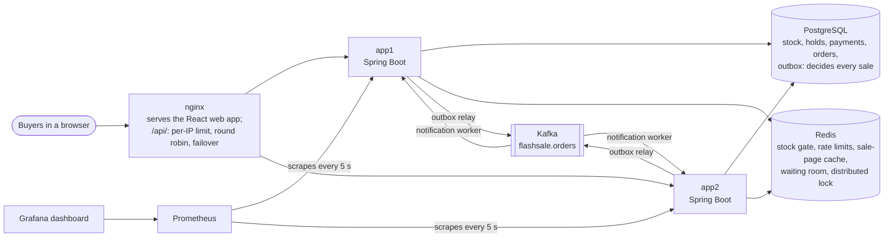

# Flash-Sale Booking Engine

[](https://github.com/shivendrashah/flash-sale-engine/actions/workflows/ci.yml)

A backend for flash sales. A limited stock of items goes on sale at a fixed time, and thousands of people click
"Buy" in the same second. The system must never sell more units than it has, never charge a card twice, and put
unpaid stock back on sale. It must keep doing that when Redis, Kafka or one of its own servers fails.

**Java 21 · Spring Boot 4.1 · PostgreSQL 17 · Redis 7.4 · Kafka 4.1 · nginx · Prometheus · Grafana · k6 · Docker ·
Flyway · Testcontainers · React 19 · TypeScript · Vite**

## How it fits together



One purchase: the buyer views the sale page (cached in Redis for 1 s), waits in the waiting room if the sale has
one, holds units (Redis turns most of the crowd away; PostgreSQL decides every real sale), and pays. The order and
its "order confirmed" event are saved in one transaction; the event reaches Kafka later through the outbox, and a
worker tells the customer once. Holds that are not paid expire after 10 minutes, and their stock goes back on sale.

## Run it

You need only **Docker**. One command builds the app, starts everything (PostgreSQL, Redis, Kafka, two app
instances, nginx), runs the load tests and writes the results table to `loadtest/RESULTS.md`:

```bash
loadtest/run.sh          # about 5 minutes; the first run also builds the image (a few minutes of downloads)
loadtest/run.sh quick    # one short run (under a minute once the image exists), to check that everything works
```

Then, if you like:

```bash
loadtest/chaos.sh        # the failure tests: kill Redis, kill an app instance, stop Kafka under load (about 5 minutes)
                         # writes loadtest/CHAOS.md

docker compose --profile cluster --profile monitoring up -d --build
                         # the cluster plus Prometheus (http://localhost:9090) and Grafana (http://localhost:3000)

docker compose --profile cluster --profile monitoring down -v     # stop everything and delete all data
```

### Use it in a browser

```bash
docker compose --profile cluster up -d --build     # the first build also downloads Node and builds the web app
```

Then open http://localhost:8080 for the shop, or http://localhost:8080/demo for the demo console:

- **Shop:** pick a sale, wait in the line if it has one, reserve, and pay with a test card. There is a card that
  works, one that is declined, a slow bank (the order is confirmed later by the recovery job) and a bank that is down.
- **Demo console:** create a sale, send a crowd of up to 2,000 fake buyers at it, and watch the stock, the orders,
  the Kafka notifications and the line update every second. The "Oversold" tile stays at 0.

Open the sale as a buyer in a second tab and race the crowd. The strip at the bottom shows which app instance
answered each time. To work on the frontend with live reload, run `npm install` and `npm run dev` in `frontend/`
(Node 20 or newer, with the app or the cluster on port 8080).

### Tests

The Java tests need Java 21 as well as Docker (Testcontainers starts throwaway PostgreSQL, Redis, Kafka and nginx
containers):

```bash
./mvnw test              # 275 tests
```

## Results

All numbers come from one laptop (Docker Desktop). Each app instance is limited to 1 CPU, so "two instances" means
twice the CPU; PostgreSQL, Redis and Kafka are shared.

### Correctness: 50 buyers, 1 unit left

From `OversellTest`: 50 buyers click "Buy" on the last unit at the same instant.

| Strategy | Buyers who got the last unit | ...with the Redis stock gate in front |
|---|---|---|
| NAIVE (read, check, write) | **20** (19 oversold, and the stock column still says 0) | 1 |
| PESSIMISTIC (`SELECT ... FOR UPDATE`) | 1 | 1 |
| OPTIMISTIC (`@Version` + retry) | 1 | 1 |
| CONDITIONAL_UPDATE (`UPDATE ... WHERE stock >= qty`) | 1 | 1 |
| REDIS_LOCK (`SET NX EX` + DB version as fencing token) | 1 | 1 |

NAIVE is the bug on purpose; the other four are safe. All five sit behind one interface and can be switched per
request with the `X-Concurrency-Strategy` header ([HLD.md 9](HLD.md#9-the-heart-of-the-system-never-oversell)).

### Load tests: a steady crowd

k6 starts new buyers at a fixed rate; each buyer views the sale page, holds 1 unit, and pays if the hold worked.
Every setup ran 3 times (full table: [loadtest/RESULTS.md](loadtest/RESULTS.md); analysis:
[HLD.md 15](HLD.md#15-scaling-what-breaks-first-and-the-plan)).

| Setup | Buyers a second | Hold p50 | Hold p95 (3 runs) | Hold p99 (3 runs) | Busy (503) | Oversold |
|---|---|---|---|---|---|---|
| 1 instance, PESSIMISTIC, gate on | 450 | 1 ms | 520 / 691 / 615 ms | 726 / 902 / 893 ms | 0 | 0 |
| 2 instances, PESSIMISTIC, gate on | 450 | 1-2 ms | 241 / 315 / 695 ms | 441 / 597 / 1129 ms | 0 | 0 |
| 2 instances, PESSIMISTIC, gate off | 300 | 2 ms | 55 / 7 / 4 ms | 189 / 24 / 7 ms | 0 | 0 |
| 2 instances, OPTIMISTIC, gate off | 300 | 2-3 ms | 14 / **1306** / 8 ms | 74 / **1644** / 88 ms | 0 / **397** / 0 | 0 |
| 2 instances, CONDITIONAL_UPDATE, gate off | 300 | 2 ms | 119 / 6 / 8 ms | 320 / 13 / 102 ms | 0 | 0 |
| 2 instances, REDIS_LOCK, gate off | 300 | 2 ms | 33 / 6 / 167 ms | 240 / 19 / 410 ms | 0 | 0 |
| 2 instances, OPTIMISTIC, gate on | 300 | 2 ms | 25 / 8 / **789** ms | 216 / 51 / **1030** ms | 8 / 0 / **372** | 0 |

- **Never oversold, never an error.** The stock was recounted in PostgreSQL after every run: 0 every time.
- **The typical buyer is fast everywhere.** The median hold took 1 to 3 ms in every setup. The differences are in
  the slowest requests.
- **Two instances roughly halve the slow tail.** Two had the lower p95 in 5 of 6 pairs (counting an earlier probe),
  but not by more than half, because PostgreSQL, Redis, Kafka and k6 share the laptop's CPUs.
- **OPTIMISTIC is the strategy that breaks.** It was the only one that ever answered "busy" (503), in 6 of its 12
  runs that day: its retries collide again and again (a retry storm). The Redis gate does not prevent it, because the
  winners still update the same row together. This is why PESSIMISTIC is the default.

### Failure tests: something breaks during a sale

`loadtest/chaos.sh` sends 100 new buyers a second through nginx for 60 s. At 15 s one part is broken; at 35 s it
comes back. A buyer that gets a gateway error retries once with the same Idempotency-Key, as a real client should.
(Full table with a timeline: [loadtest/CHAOS.md](loadtest/CHAOS.md); analysis:
[HLD.md 14](HLD.md#14-what-happens-when-things-fail).)

| What broke | Buyers | Failed | Hold p50 | Hold p95 | Outbox backlog peak | Orders notified once | Oversold |
|---|---|---|---|---|---|---|---|
| Redis killed (`docker compose kill redis`) | 5,760 | 0 | 310 ms | 2,111 ms | 52 | 5,760 of 5,760 | 0 |
| One app instance killed (`kill app1`) | 5,821 | 5 payments | 2 ms | 4,108 ms | 57 | 5,816 of 5,816 | 0 |
| Kafka stopped | 6,001 | 0 | 3 ms | 23 ms | 2,930 | 6,001 of 6,001 | 0 |

- **Redis killed:** nobody failed. Without Redis, the stock gate, the rate limiter and the sale-page cache step
  aside, and PostgreSQL sells alone. But each hold waited about 2 s: two 1-second Redis timeouts (rate limiter and
  gate). The slowness lasted about 15 s after Redis came back, while the Redis client reconnected.
- **One app instance killed:** nginx sent new requests to the other instance at once, and holds stayed at about
  2 ms. 6 buyers whose request was cut off retried with the same Idempotency-Key and got their answer. 5 payments
  were in progress on the dead instance: the recovery job found them, the provider had no record of them, and their
  holds went back to HELD, so those buyers can pay again. The slow p95 comes later: the restarted instance received
  traffic while its JVM was still cold.
- **Kafka stopped:** buyers did not notice. The order events waited in the outbox (up to 2,930), went out when Kafka
  was back, and every order was notified exactly once.
- One limit to keep in mind: the fake payment provider lives in the app's memory, so it died with app1. A real
  provider might have charged those 5 cards; the same recovery job would then find the charges and confirm the
  orders instead.

## Key design decisions

- **Redis can say no; PostgreSQL decides every yes.** The stock gate (one Lua script per cart) turns most of the
  crowd away cheaply, but every sale is decided by a database transaction ([HLD.md 9.8](HLD.md#98-the-redis-stock-gate-phase-2-built)).
- **PESSIMISTIC row locks are the default strategy.** All four safe strategies are correct; under load only
  OPTIMISTIC broke down, with retry storms ([HLD.md 9.3](HLD.md#93-what-we-measured), [15](HLD.md#15-scaling-what-breaks-first-and-the-plan)).
- **Idempotency keys on every write.** A retry returns the first answer and never takes stock or money twice; the
  failure tests used exactly this ([HLD.md 10](HLD.md#10-idempotency-safe-retries)).
- **No database transaction during a payment call.** Every provider call waits at most 2 s, a missing answer means
  "maybe charged" (202, never "failed"), a circuit breaker per provider fails fast, and a recovery job finishes stuck
  payments ([HLD.md 12](HLD.md#12-payments)).
- **A transactional outbox and an idempotent consumer.** The "order confirmed" event is a row in the order's
  transaction; delivery is at least once, and the worker drops duplicates by event id ([HLD.md 9.12](HLD.md#912-the-transactional-outbox-and-the-notification-worker-phase-3-built)).
- **Fail open where a part only saves time, fail closed where it guards correctness.** Without Redis, the gate, the
  rate limiter, the cache and the waiting room step aside; the REDIS_LOCK strategy refuses with 503 instead ([HLD.md 14](HLD.md#14-what-happens-when-things-fail)).
- **A waiting room for the biggest crowds.** A sale can queue its buyers in Redis and let N in each second; all
  instances share one admission rate ([HLD.md 9.15](HLD.md#915-the-waiting-room-phase-3-built)).
- **Stateless instances behind nginx.** Anything shared lives in PostgreSQL, Redis or Kafka, so any instance can
  serve any request; nginx also limits each IP address ([HLD.md 9.13](HLD.md#913-two-instances-behind-nginx-phase-3-built)).
- **A reconciliation job that only repairs in the safe direction.** It measures how far Redis's stock counters
  drift from PostgreSQL and raises a counter that is too low; a high one is harmless ([HLD.md 9.14](HLD.md#914-the-stock-reconciliation-job-phase-3-built)).
- **Monitor the promise, not only the traffic.** Two gauges recount the stock from the hold rows on every scrape;
  "Oversold units" on the dashboard must stay 0 ([HLD.md 15](HLD.md#15-scaling-what-breaks-first-and-the-plan)).
- **The database is the last line of defence.** CHECK constraints and partial unique indexes stop bad data even if
  the code had a bug ([HLD.md 6](HLD.md#6-database-design)).

## Try the API

Run the app on your Mac (needs Java 21 and Docker), or use the two-instance cluster below; both answer on
http://localhost:8080.

```bash
docker compose up -d            # PostgreSQL + Redis + Kafka
./mvnw spring-boot:run          # the app on http://localhost:8080
# or, without docker compose (throwaway containers, data lost on stop):
./mvnw spring-boot:test-run
```

Try a purchase:

```bash
curl -s -X POST localhost:8080/api/admin/sales -H 'Content-Type: application/json' -d '{
  "name": "Diwali Flash Sale", "startsAt": "2026-01-01T00:00:00Z", "endsAt": "2030-01-01T00:00:00Z",
  "items": [{"productName": "iPhone 17", "regularPrice": 79999, "salePrice": 59999, "stock": 100}]}'

curl -s -X POST localhost:8080/api/holds -H 'Content-Type: application/json' \
  -H 'X-User-Id: alice' -H 'Idempotency-Key: alice-hold-1' \
  -d '{"items": [{"saleItemId": 1, "quantity": 1}]}'

curl -s -X POST localhost:8080/api/holds/1/pay -H 'Content-Type: application/json' \
  -H 'X-User-Id: alice' -H 'Idempotency-Key: alice-pay-1' \
  -d '{"provider": "STRIPE", "paymentToken": "tok_success"}'

curl -s localhost:8080/api/orders/1 -H 'X-User-Id: alice'
```

Try a cart (all items must come from the same sale; leave `mode` out for all-or-nothing). After the purchase above,
this new sale's items get ids 2 and 3:

```bash
curl -s -X POST localhost:8080/api/admin/sales -H 'Content-Type: application/json' -d '{
  "name": "Combo Sale", "startsAt": "2026-01-01T00:00:00Z", "endsAt": "2030-01-01T00:00:00Z",
  "items": [{"productName": "MacBook Air", "regularPrice": 119999, "salePrice": 89999, "stock": 5},
            {"productName": "AirPods", "regularPrice": 24999, "salePrice": 14999, "stock": 0}]}'

curl -s -X POST localhost:8080/api/holds -H 'Content-Type: application/json' \
  -H 'X-User-Id: rahul' -H 'Idempotency-Key: rahul-cart-1' \
  -d '{"items": [{"saleItemId": 2, "quantity": 1}, {"saleItemId": 3, "quantity": 1}], "mode": "PARTIAL"}'
# 201: the MacBook is held; "unavailable": [{"saleItemId": 3, "quantity": 1}]
```

Test card tokens: `tok_success` (approved), `tok_declined` (declined), and three that make the fake provider
misbehave: `tok_timeout` (charges, but answers too late: 202, the recovery job confirms it), `tok_lost` (never
arrives: 202, then failed), `tok_unavailable` (503; five in a row open the circuit).

Try a per-user limit (a new sale; adjust the `saleItemId` to the id this sale's item gets):

```bash
curl -s -X POST localhost:8080/api/admin/sales -H 'Content-Type: application/json' -d '{
  "name": "Sneaker Drop", "startsAt": "2026-01-01T00:00:00Z", "endsAt": "2030-01-01T00:00:00Z", "perUserLimit": 2,
  "items": [{"productName": "Air Max", "regularPrice": 12999, "salePrice": 6999, "stock": 50}]}'
# hold 1 unit three times as the same user (new Idempotency-Key each time): the third is
# 409 PURCHASE_LIMIT_EXCEEDED "...allows at most 2 unit(s) per buyer. You already hold or bought 2..."
```

Hit the rate limit (20 requests from one buyer at the same moment, after the purchase above):

```bash
seq 1 20 | xargs -P 20 -I{} curl -s -o /dev/null -w "%{http_code}\n" -X POST localhost:8080/api/holds \
  -H 'Content-Type: application/json' -H 'X-User-Id: carol' -H "Idempotency-Key: burst-{}" \
  -d '{"items": [{"saleItemId": 1, "quantity": 1}]}' | sort | uniq -c
#   10 201
#   10 429
```

The 429 itself (one more request right away):

```http
HTTP/1.1 429
X-RateLimit-Limit: 10
X-RateLimit-Remaining: 0
Retry-After: 1
Content-Type: application/problem+json

{"detail":"Too many requests. Wait 1 second(s) and try again","instance":"/api/holds","status":429,
 "title":"Too Many Requests","code":"RATE_LIMITED"}
```

See the sale-page cache (sale 1 from the purchase above):

```bash
curl -s -o /dev/null -w "%{time_total}s\n" localhost:8080/api/sales/1   # a miss: read from PostgreSQL (34 ms here)
curl -s -o /dev/null -w "%{time_total}s\n" localhost:8080/api/sales/1   # a hit: from Redis (8 ms here)
docker compose exec redis redis-cli PTTL cache:sale:1                   # e.g. 805: ms left before Redis deletes it
curl -s 'localhost:8080/actuator/metrics/flashsale.sale.cache?tag=outcome:miss'   # PostgreSQL reads so far
```

See the order notification (after the purchase above). The app logs one line per order, about half a second after
the payment:

```text
c.f.notification.FakeNotificationSender  : Notification to alice: Your order #1 is confirmed. Total: INR 59999.00 (event f32f8bc2-...)
```

The same event on Kafka, and in the outbox table:

```bash
docker compose exec kafka /opt/kafka/bin/kafka-console-consumer.sh --bootstrap-server localhost:9092 \
  --topic flashsale.orders --from-beginning --property print.key=true --property print.headers=true --timeout-ms 5000
docker compose exec postgres psql -U flashsale -d flashsale -c "SELECT id, event_type, status, attempts FROM outbox_events"
# Try a Kafka outage: docker compose stop kafka, buy and pay again (still 200), then docker compose start kafka:
# the waiting event goes out within seconds. A user id that starts with "bounce" ends on flashsale.orders.DLT.
```

Try the waiting room (a sale that lets 20 buyers in each second):

```bash
curl -s -X POST localhost:8080/api/admin/sales -H 'Content-Type: application/json' -d '{
  "name": "Queued Sale", "startsAt": "2026-01-01T00:00:00Z", "endsAt": "2030-01-01T00:00:00Z", "admitPerSecond": 20,
  "items": [{"productName": "iPhone 17", "regularPrice": 79999, "salePrice": 59999, "stock": 1000}]}'
# after the sales above, this is sale 4 with item 5. Buying before joining: 403 {"code":"NOT_ADMITTED"}
curl -s -X POST localhost:8080/api/sales/4/queue -H 'X-User-Id: dave'   # {"state":"WAITING","position":1,...}
curl -s localhost:8080/api/sales/4/queue -H 'X-User-Id: dave'           # poll until {"state":"ADMITTED"}
curl -s -X POST localhost:8080/api/holds -H 'Content-Type: application/json' \
  -H 'X-User-Id: dave' -H 'Idempotency-Key: dave-hold-1' -d '{"items": [{"saleItemId": 5, "quantity": 1}]}'
```

Run two instances behind nginx (stop `./mvnw spring-boot:run` first: nginx uses port 8080 too):

```bash
docker compose --profile cluster up -d --build   # builds the app image, starts app1, app2 and nginx on :8080
# every curl above works unchanged. The X-Upstream header says which instance answered:
for i in $(seq 1 10); do curl -s -o /dev/null -D - localhost:8080/api/sales/1 | grep -i x-upstream; done | sort | uniq -c
docker compose --profile cluster stop app1       # failover: the same loop still answers 200, all from app2
docker compose --profile cluster start app1
# a burst from one IP: about 47 x 200, the rest 429 {"code":"IP_RATE_LIMITED"} with Retry-After: 1
seq 1 100 | xargs -P 100 -I{} curl -s -o /dev/null -w "%{http_code}\n" localhost:8080/api/sales/1 | sort | uniq -c
docker compose --profile cluster down -v         # stop everything and delete the data
```

See the dashboard (Prometheus and Grafana, with the two instances behind nginx):

```bash
docker compose --profile cluster --profile monitoring up -d --build
# Grafana:    http://localhost:3000  (no login; opens on the "Flash sale engine" dashboard)
# Prometheus: http://localhost:9090/targets  (app1 and app2 UP; host.docker.internal:8080 is DOWN in cluster mode)
# Make the correctness row turn red: sell a 1-unit item with the broken NAIVE strategy and the gate off
curl -s -X POST localhost:8080/api/admin/sales -H 'Content-Type: application/json' -d '{
  "name": "Naive demo", "startsAt": "2026-01-01T00:00:00Z", "endsAt": "2030-01-01T00:00:00Z",
  "items": [{"productName": "Last iPhone", "regularPrice": 79999, "salePrice": 59999, "stock": 1}]}'
seq 1 20 | xargs -P 20 -I{} curl -s -o /dev/null -w "%{http_code}\n" -X POST localhost:8080/api/holds \
  -H 'Content-Type: application/json' -H 'X-User-Id: naive-{}' -H 'Idempotency-Key: n-{}' \
  -H 'X-Concurrency-Strategy: NAIVE' -H 'X-Stock-Gate: off' -d '{"items":[{"saleItemId":1,"quantity":1}]}'
# (use the item id the sale above returned). Live: 20 x 201, and the dashboard showed "Oversold units" 19.
docker compose --profile cluster --profile monitoring down -v
```

All your requests come from one IP address, so nginx's per-IP limit (20 a second) stops a big burst from one laptop:
in a live run, 150 buyers at once got 121 x 429. Send requests at a steady pace to see normal traffic on the
dashboard.

See the Redis stock gate:

```bash
docker compose exec redis redis-cli GET 'stock:{1}:1'     # 99: units the gate still lets through for item 1
curl -s 'localhost:8080/actuator/metrics/flashsale.stock.gate?tag=outcome:passed'
# add -H 'X-Stock-Gate: off' to a hold request to skip the gate for that request
```

**Watch it work:** `./mvnw spring-boot:run -Dspring-boot.run.profiles=learn` prints every SQL statement and
transaction (begin/commit) for each request, and what the Redis stock gate answered for each cart.

## Docs

| Doc | Read it for |
|---|---|
| [HLD.md](HLD.md) | System design: requirements, estimates, architecture, database, API, flows, the five strategies, the Redis stock gate, limits, caching, the outbox and Kafka, two instances, reconciliation, the waiting room, payments, failures (with the failure test results), scaling (with the load test results), the web app, 90 interview Q&As |
| [LLD.md](LLD.md) | Code design: packages, class diagram, state machine, design patterns, transactions, locks and lock order, idempotency, error handling, Java concurrency tools, the tests and the bugs they caught, 73 interview Q&As |
| [PLAN.md](PLAN.md) | The roadmap and how each part works ("how it works" sections, with the live numbers) |
| [loadtest/RESULTS.md](loadtest/RESULTS.md), [loadtest/CHAOS.md](loadtest/CHAOS.md) | The raw load test and failure test tables |

To watch a request run, start the app with
`./mvnw spring-boot:run -Dspring-boot.run.profiles=learn`: it prints every SQL statement, every transaction and each
stock gate decision.

## Status

All four phases are done (2026-10-02 to 2026-10-10):

- **Phase 1:** the core flow, five concurrency strategies, holds with expiry, payments, idempotency.
- **Phase 2:** multi-item carts, the Redis stock gate, payment safety (timeouts, circuit breakers, recovery job), the
  per-user purchase limit, the rate limiter with an error code on every error, the sale-page cache.
- **Phase 3:** order notifications (transactional outbox, Kafka, retries, dead-letter topic), two instances behind
  nginx with a per-IP limit, the stock reconciliation job, the waiting room.
- **Phase 4:** Prometheus and Grafana with oversell gauges, k6 load tests, failure tests, this README.
- **Web app (2026-10-11):** a React and TypeScript frontend served by nginx: the shop, the full checkout, and a demo
  console with a crowd simulator.

Design only (described in [HLD.md](HLD.md), not built): read replicas, sharding, a saga for refunds, stampede
protection across instances, multi-region and Kubernetes autoscaling, change data capture (Debezium) for the outbox,
retry topics, alerts, a highly available nginx pair, and real login (the `X-User-Id` header stands in for it).
